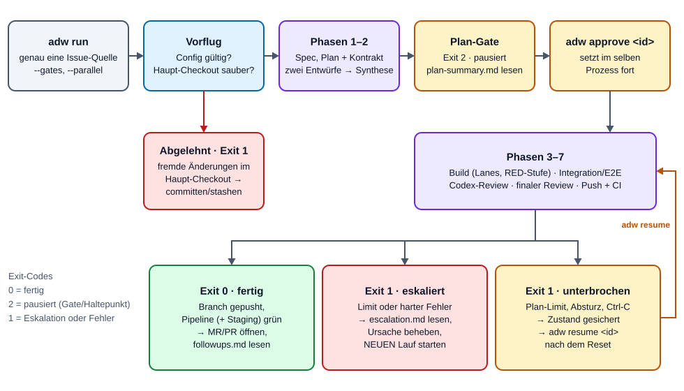
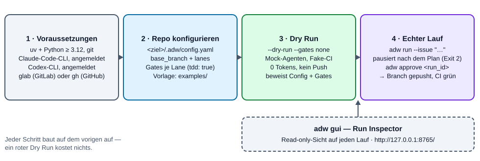
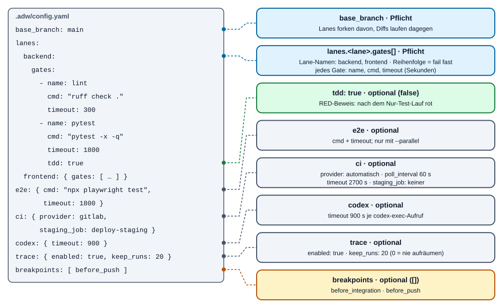
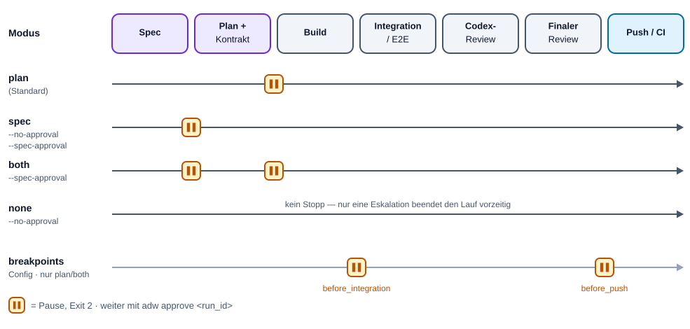
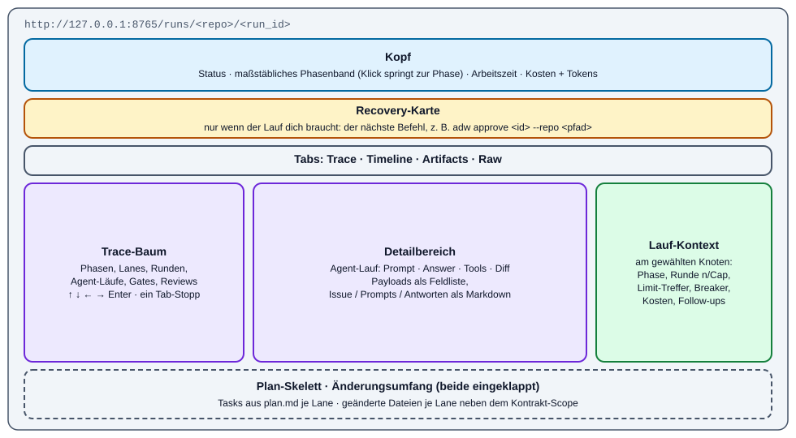
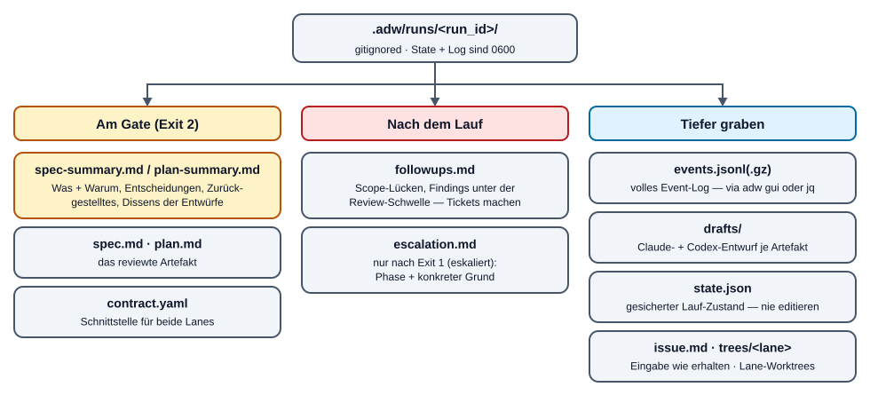
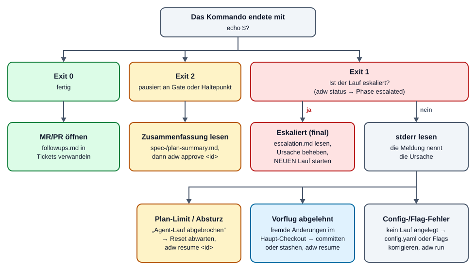

# ADW-Handbuch — den Agentic Developer Workflow betreiben

[English](ADW-HANDBOOK.md) | **Deutsch**

> Zielgruppe: Entwickler, die ADW gegen ihre eigenen Repositories laufen lassen.
> Begleitdokumente: [ADW-WORKFLOW.de.md](ADW-WORKFLOW.de.md) (Tiefenblick in
> die sieben Phasen und ihre Schleifen) · [ADW-SPEC.de.md](ADW-SPEC.de.md)
> (Contributor-Spec und Philosophie).

## Auf einen Blick

- **Was:** `adw run` führt ein Issue durch **Spec → Plan + Kontrakt → Build →
  Integration/E2E → Codex-Review → finales Review → Push/CI**. Agents liefern
  Urteilsvermögen, der Kontrollfluss ist deterministisches Python.
- **Einstieg:** `uv sync` → `.adw/config.yaml` im Ziel-Repo anlegen →
  `adw run --repo <pfad> --issue "…" --dry-run --gates none`.
- **Kontrolle behalten:** Standardmäßig hält der Lauf nach dem Plan (Exit 2).
  `plan-summary.md` lesen, dann `adw approve <run_id>`.
- **Zuschauen:** `adw gui` öffnet einen read-only Run Inspector auf
  `127.0.0.1:8765`.
- **Wenn es schiefgeht:** Exit 1 plus `.adw/runs/<run_id>/escalation.md`. Nach
  einem Absturz oder erschöpftem Plan-Limit setzt `adw resume <run_id>` exakt
  dort fort, wo der Lauf stand.



## Inhalt

1. [Was ADW ist](#1-was-adw-ist)
2. [Voraussetzungen und Installation](#2-voraussetzungen-und-installation)
3. [Ziel-Repo vorbereiten](#3-ziel-repo-vorbereiten)
4. [Der erste Lauf: Dry Run](#4-der-erste-lauf-dry-run)
5. [Echte Läufe](#5-echte-läufe)
6. [Freigabe-Gates und Haltepunkte](#6-freigabe-gates-und-haltepunkte)
7. [CLI-Referenz](#7-cli-referenz)
8. [Der Run Inspector (GUI)](#8-der-run-inspector-gui)
9. [Lauf-Artefakte und wie man sie liest](#9-lauf-artefakte-und-wie-man-sie-liest)
10. [Absturz, Pause, Fortsetzen](#10-absturz-pause-fortsetzen)
11. [Aufbewahrung und Aufräumen](#11-aufbewahrung-und-aufräumen)
12. [Abrechnung und Plan-Limits](#12-abrechnung-und-plan-limits)
13. [Gute Issues schreiben (Briefs)](#13-gute-issues-schreiben-briefs)
14. [Eskalationen](#14-eskalationen)
15. [Fehlerbehebung und FAQ](#15-fehlerbehebung-und-faq)
16. [Glossar](#16-glossar)

---

## 1. Was ADW ist

ADW ist ein Python-Orchestrator. Du gibst ihm ein Issue (Freitext, ein
GitLab-Issue oder ein GitHub-Issue); zurück kommt ein **gepushter Feature-Branch,
dessen CI-Pipeline — inklusive eines optionalen Staging-Jobs — grün ist**.

Drei Regeln prägen alles, was du beobachten wirst:

- **Kontrollfluss ist Code, nicht Prompt.** Schleifen, Gates, Merges, Dispatch,
  Triage, Limits und CI-Polling sind schlichtes Python (0 Tokens). Agents
  (Claude Agent SDK + Codex CLI) laufen nur dort, wo Urteilsvermögen nötig ist.
- **Reviewer fixen nie.** Jeder Fix wird von einem Build-Agent gemacht und läuft
  danach erneut durch **alle** Gates — keine Abkürzung, auch nicht für einen
  Einzeiler.
- **Alles ist begrenzt.** Jede Schleife hat ein hartes Limit plus
  Circuit-Breaker. Ist ein Limit erreicht, stoppt ADW und schreibt einen
  Eskalationsbericht; ein Mensch übernimmt.

Wer macht was:

| Rolle | Modell / Werkzeug | Schreibt? |
|---|---|---|
| Spec-Agent, Plan-Agent (Entwurfsautoren) | Opus 5.5 (`claude-opus-5-5`) | ja — nur ihr Artefakt |
| Zweiter Entwurfsautor + alle Codex-Reviews | Codex CLI (`codex exec -m gpt-6-astra --sandbox read-only`) | nein (liefert Text) |
| Spec-Synthese, Plan-Synthese | Fable 5.1 (`claude-fable-5-1`) | ja — Artefakt + Zusammenfassung |
| Build-Agent (einer pro Lane) | Opus 5.5 | ja — nur sein Lane-Worktree |
| E2E-Triage, CI-Log-Analyst | Sonnet 5.5 (`claude-sonnet-5-5`) | nein (read-only) |
| Finaler Reviewer | Fable 5.1 | nein (strikt read-only) |
| Gates, Merges, Commits, Push, CI-Polling | der Orchestrator (Python) | — |

Wie die Phasen im Detail funktionieren — die Schleifen, die RED-Stufe, die
Triage, die Review-Runden-Policy — beschreibt [ADW-WORKFLOW.de.md](ADW-WORKFLOW.de.md).

---

## 2. Voraussetzungen und Installation



| Voraussetzung | Wofür | Prüfen |
|---|---|---|
| Linux oder macOS | ADW nutzt `fcntl`-Dateilocks und POSIX-Subprozesse | — |
| Python ≥ 3.12 + [`uv`](https://docs.astral.sh/uv/) | Laufzeit und Abhängigkeiten | `uv --version` |
| `git` | Worktrees, Merges, Snapshots | `git --version` |
| **Claude Code CLI, angemeldet** | jeder Claude-Agent läuft darüber | `~/.claude/.credentials.json` existiert (oder Eintrag im macOS-Schlüsselbund) |
| **Codex CLI, angemeldet** | zweiter Autor und jedes Codex-Review | `~/.codex/auth.json` existiert (oder `$CODEX_HOME/auth.json`) |
| `glab` (GitLab) **oder** `gh` (GitHub), authentifiziert | Issues holen, CI pollen | `glab auth status` / `gh auth status` |
| Ein Plan, der Fable 5.1, Opus 5.5 und Sonnet 5.5 enthält | die Agent-Registry nutzt alle drei | in der Praxis: Max-Plan |

Installation:

```bash
git clone <dieses Repo> agentic-developer-workflow
cd agentic-developer-workflow
uv sync                     # Kern + dev-Gruppe (enthält den GUI-Stack für Tests)
uv run adw --help
```

Die GUI ist ein **optionales Extra** (`fastapi`, `uvicorn`, `jinja2`,
`markdown-it-py`). `uv sync` in diesem Repo zieht diese bereits über die
dev-Gruppe. Wird ADW anderswo als Paket installiert:

```bash
uv pip install 'adw[gui]'   # oder: pip install 'adw[gui]'
```

Ohne das Extra endet `adw gui` mit Exit 1 und genau diesem Installationshinweis;
alle anderen Kommandos funktionieren.

Alle Beispiele unten nutzen `uv run adw …` aus dem ADW-Checkout. Liegt `adw` im
`PATH` (z. B. via `uv tool install`), entfällt das `uv run`.

---

## 3. Ziel-Repo vorbereiten

ADW arbeitet gegen **jedes Git-Repo** (das *Ziel-Repo*). Die gesamte
projektspezifische Konfiguration liegt in **einer Datei**:
`<ziel>/.adw/config.yaml`.

```bash
mkdir -p /pfad/zum/repo/.adw
cp examples/config.yaml /pfad/zum/repo/.adw/config.yaml   # dann anpassen
```

Minimale Single-Lane-Config:

```yaml
base_branch: main
lanes:
  backend:
    gates:                      # Reihenfolge = Ausführungsreihenfolge, fail fast
      - { name: lint,   cmd: "ruff check .",  timeout: 300 }
      # tdd: true = RED-Beweis: nach dem reinen Test-Lauf muss mindestens ein
      # markiertes Gate rot sein, bevor die Implementierung startet
      - { name: pytest, cmd: "pytest -x -q", timeout: 1800, tdd: true }
```

### 3.1 Config-Referenz (jeder Key)

Defaults wie in `adw/config.py`. Unbekannte Keys werden überall abgelehnt.



| Key | Pflicht | Default | Bedeutung |
|---|---|---|---|
| `base_branch` | **ja** | — | Branch, von dem die Lanes abzweigen und gegen den die Diffs laufen. Nicht leer. |
| `lanes` | **ja** | — | Mapping mit mindestens einer Lane. Erlaubte Lane-Namen: **`backend`**, **`frontend`** (sonst nichts). |
| `lanes.<lane>.gates[]` | **ja** | — | Mindestens ein Gate pro Lane. Läuft in Reihenfolge; das erste rote Gate beendet den Durchgang. |
| `…gates[].name` | ja | — | Anzeigename (nicht leer). |
| `…gates[].cmd` | ja | — | Shell-Kommando, läuft im Lane-Worktree (nicht leer). |
| `…gates[].timeout` | ja | — | Sekunden, Ganzzahl > 0 (ein YAML-Boolean wird abgelehnt). |
| `…gates[].tdd` | nein | `false` | Markiert ein RED-Beweis-Gate (strikter Boolean). Siehe §5.3. |
| `e2e.cmd` / `e2e.timeout` | nein | — | E2E-Kommando + Sekunden. Beide Pflicht, wenn `e2e` gesetzt ist. Nur mit `--parallel` genutzt. |
| `ci.provider` | nein | auto | `gitlab` oder `github`. Ungesetzt = Erkennung an der `origin`-URL; ein unbekannter Host (z. B. self-hosted mit eigener Domain) lässt ein echtes `run`/`resume`/`approve` schon im Vorflug scheitern, bevor ein Agent läuft (ein Dry-Run fällt auf GitLab zurück). Bei self-hosted Forges den Key daher immer setzen. |
| `ci.poll_interval` | nein | `60` | Sekunden zwischen Pipeline-Abfragen. |
| `ci.timeout` | nein | `2700` | Gesamtbudget fürs Warten auf CI (45 min). |
| `ci.staging_job` | nein | — | Job, der zusätzlich grün sein muss (z. B. `deploy-staging`). |
| `codex.timeout` | nein | `900` | Zeitlimit in Sekunden für jeden `codex exec`-Aufruf (Autor und Review teilen es). |
| `trace.enabled` | nein | `true` | Ereignis-Log `events.jsonl` schreiben. `false` = gar kein Ereignis-Log (die GUI hat für diesen Lauf dann nichts zu zeigen). |
| `trace.keep_runs` | nein | `20` | Automatisches Pruning nach einem erfolgreichen Lauf behält die neuesten N Läufe. `0` = nie automatisch prunen. |
| `breakpoints[]` | nein | `[]` | Zusätzliche Halte: `before_integration` und/oder `before_push`. Siehe §6. |

Die Validierung ist strikt und fail-fast: fehlende Datei, ungültiges YAML,
doppelter Key, unbekannter Key, Lane ohne Gates, Gate ohne Timeout,
nicht-boolesches `tdd` oder unbekannter Haltepunkt brechen **ab, bevor**
irgendetwas passiert — mit Dateipfad und Grund. Außer den dokumentierten
Defaults wird nichts geraten.

**Deine Gates sind deine Qualitätsgrenze.** ADW akzeptiert einen Build nur, wenn
*alle* Gates grün sind. Was die Gates nicht prüfen, prüft während des Builds
niemand — konfiguriere mindestens einen Linter-/Formatter-Check und die
Testsuite.

**Gate-Umgebung.** Gates und Agents laufen mit einer **Env-Whitelist**: `PATH`,
`HOME`, `USER`, `SHELL`, `TERM`, `TMPDIR`, `LANG`, `LANGUAGE`, `TZ`,
`VIRTUAL_ENV`, `PYTHONPATH`, `NODE_ENV`, `CI`, `CLAUDE_CONFIG_DIR` und `LC_*`.
Alles andere (API-Keys, Cloud-Credentials, Tokens, `DATABASE_URL`, …) ist für ein
Gate **nicht** sichtbar. Zusätzlich werden die Lane-Ports injiziert
(`BACKEND_PORT` / `FRONTEND_PORT`). Braucht deine Testsuite weitere Variablen,
setze sie im Gate-Kommando
(`cmd: "DJANGO_SETTINGS_MODULE=app.settings.test pytest -q"`) oder in einem
Wrapper-Skript im Repo.

**Parallelmodus** (`--parallel`) braucht beide Lanes, `backend` **und**
`frontend`. Sonst eskaliert der Lauf gleich zu Beginn von Phase 1, bevor ein
Agent läuft. Single-Lane-Läufe bauen `backend`, falls konfiguriert, sonst die
einzige konfigurierte Lane.

### 3.2 Was ADW in deinem Repo verändert

- Es legt `.adw/runs/` mit einer `.gitignore` (Inhalt `*`) an — Laufdaten werden
  nie committet.
- Es schreibt sechs **ADW-eigene Authoring-Artefakte** unter `.adw/`:
  `issue.md`, `spec.md`, `plan.md`, `contract.yaml`, `spec-summary.md`,
  `plan-summary.md`. Nicht von Hand bearbeiten (siehe §10.2).
- Es legt Branches `adw/<run_id>/<lane>` an (im Parallelmodus zusätzlich
  `adw/<run_id>/integration`) sowie Snapshot-Refs `refs/adw/<run_id>/*`.
- Es registriert das Repo in `~/.adw/repos.json`, damit die GUI es findet.

---

## 4. Der erste Lauf: Dry Run

Bevor ein Token fließt, den **kompletten Kontrollfluss** mit geskripteten
Mock-Agents durchspielen — 0 Tokens, kein Netz, kein Push:

```bash
uv run adw run --repo /pfad/zum/repo --issue "Demo-Feature" --dry-run --gates none
uv run adw run --repo /pfad/zum/repo --issue "Demo-Feature" --dry-run --gates none --parallel
```

Was der Dry Run beweist:

- deine Config lädt und jede Lane ist verdrahtet;
- RED-Stufe, Gate-Schleife und Commit-Pfad funktionieren gegen **dein** Repo;
- er ist bewusst kein Schönwetterlauf: jede Lane bekommt ein synthetisches
  Gate, das einmal fehlschlägt (der Fix geht an dieselbe Session), und mit
  `--parallel` wird ein roter E2E-Lauf in eine Lane zurücktriagiert;
- CI wird simuliert (Fake-`glab`/`gh`), nichts wird gepusht.

Der Dry-Run-Modus steht im Run-State: ein `resume`/`approve` eines Dry Runs
bleibt tokenfrei. Die Mock-Build-Agents hinterlassen `adw_dry_run_<lane>.md`-Dateien
auf lokalen Dry-Run-Branches; diese Branches kannst du jederzeit löschen.

`--gates none` (oder das Altflag `--no-approval`) lässt den Dry Run ohne Pause
durchlaufen. Ohne das Flag hält auch der Dry Run am Plan-Gate wie ein echter Lauf.

---

## 5. Echte Läufe

### 5.1 Issue-Quelle wählen

Genau **eine** Quelle pro Lauf:

```bash
# Freitext
uv run adw run --repo ~/code/shop --issue "Bug: Login bricht ab, wenn das Passwort einen Doppelpunkt enthält"

# mehrzeiliger Brief aus einer Datei
uv run adw run --repo ~/code/shop --issue "$(cat ~/briefs/warenkorb-rabatte.md)"

# GitLab-Issue (Titel + Beschreibung via `glab issue view`)
uv run adw run --repo ~/code/shop --gitlab-issue 42

# GitHub-Issue (Titel + Body via `gh issue view`)
uv run adw run --repo ~/code/shop --github-issue 42
```

`glab`/`gh` laufen im Verzeichnis des Ziel-Repos und lösen das Projekt über
dessen Remote auf.

### 5.2 Single-Lane vs. `--parallel`

| | Single-Lane (Default) | `--parallel` |
|---|---|---|
| Lanes | `backend`, falls konfiguriert, sonst die einzige Lane | `backend` **und** `frontend`, gleichzeitig |
| Integration/E2E-Phase | entfällt | beide Lane-Branches werden auf `adw/<id>/integration` gemergt, dann `e2e.cmd` |
| Gepushter Branch | `adw/<id>/<lane>` | `adw/<id>/integration` |
| Plan-Verbrauch | niedriger | zwei Opus-Sessions gleichzeitig — leert ein 5-Stunden-Fenster spürbar schneller |

### 5.3 Die RED-Stufe (`tdd: true`)

Hat eine Lane mindestens ein Gate mit `tdd: true`, beginnt ihr Initial-Build mit
einem **reinen Test-Lauf**: Der Build-Agent schreibt Tests und sonst nichts;
dann führt der Orchestrator genau die markierten Gates aus. Mindestens eines muss
**rot** sein — das ist der Beweis, dass die Tests das geforderte Verhalten
abdecken. Danach implementiert dieselbe Session. Sind die markierten Gates nach
dem Test-Lauf grün, eskaliert der Lauf (die Tests beweisen nichts). Empfohlen für
jede Lane mit Testsuite.

### 5.4 Gepinnte Einstellungen

Beim Start pinnt ADW den effektiven **Base-Branch** (Config oder
`--base-branch`), den **Gate-Modus** und die **Haltepunkt-Menge** in den
Run-State. Eine Änderung an `.adw/config.yaml` während des Laufs verschiebt einen
laufenden Lauf nicht. `--base-branch` bei `resume`/`approve` kann die Basis noch
ändern — aber nur, solange noch keine Lanes existieren.

### 5.5 Vor dem Start

Der Haupt-Checkout des Ziel-Repos muss **sauber** sein (siehe §10.2). ADW
verwirft nie deine Arbeit; stattdessen verweigert es.

---

## 6. Freigabe-Gates und Haltepunkte

### 6.1 `--gates`

| Modus | Hält | Entsprechung in Altflags |
|---|---|---|
| `plan` (**Default**) | nach Plan + Kontrakt, vor dem Build | (kein Flag) |
| `spec` | nach der Spec, vor dem Plan | `--no-approval --spec-approval` |
| `both` | nach der Spec **und** nach dem Plan | `--spec-approval` |
| `none` | nie (nur eine Eskalation stoppt den Lauf) | `--no-approval` |

`--gates` und die Altflags dürfen nur kombiniert werden, wenn sie übereinstimmen;
ein Widerspruch oder ein unbekannter Wert wird abgelehnt, bevor ein Lauf
angelegt wird.



### 6.2 Wie eine Pause aussieht

```text
$ uv run adw run --repo ~/code/shop --issue "Warenkorb-Rabatte"
Run 3f9a12c4 gestartet (Phase: spec, Gates: plan)
Plan-Approval ausstehend: .adw/runs/3f9a12c4/plan-summary.md und .adw/runs/3f9a12c4/plan.md lesen, dann `adw approve 3f9a12c4`
$ echo $?
2
```

In dieser Reihenfolge prüfen:

```bash
less ~/code/shop/.adw/runs/3f9a12c4/plan-summary.md   # Was/Warum, Entscheidungen, Zurückgestelltes, wo die Entwürfe abwichen
less ~/code/shop/.adw/runs/3f9a12c4/plan.md           # Workstreams / Tasks
less ~/code/shop/.adw/runs/3f9a12c4/contract.yaml     # Schnittstellen-Kontrakt
uv run adw approve 3f9a12c4 --repo ~/code/shop        # weiter mit Phase 3–7
```

Am Spec-Gate sind es `spec-summary.md` und `spec.md`; nach der Freigabe geht es
mit dem Plan weiter, und im Modus `both` hält der Lauf erneut am Plan-Gate.

Ein „Ablehnen"-Kommando gibt es nicht. Ist der Plan falsch, lass den Lauf liegen
(pausiert lassen oder später prunen) und starte einen neuen Lauf mit einem
schärferen Issue. Eine Richtungskorrektur auf Plan-Ebene ist billig; auf
Code-Ebene kostet sie Build-, Review- und Fix-Zyklen.

### 6.3 Haltepunkte (optional)

Zwei zusätzliche Halte vor teuren, schwer umkehrbaren Schritten, in der Config:

```yaml
breakpoints:
  - before_integration   # alle Build-Lanes grün; vor Integration (parallel) bzw. Codex-Review (Single-Lane)
  - before_push          # finales Review fertig; vor Push/CI
```

Ein Haltepunkt verhält sich wie ein Freigabe-Gate: Exit 2, die CLI nennt ihn,
fortsetzen mit `adw approve <run_id> --repo <pfad>`. Ein freigegebener
Haltepunkt hält nie wieder, auch nicht nach Absturz + Resume. Haltepunkte greifen
nur in den Modi `plan` und `both`: `--gates none` und `--gates spec` (und ihre
Altflags) überspringen sie.

---

## 7. CLI-Referenz

```text
adw run     --repo PFAD (--issue TEXT | --gitlab-issue ID | --github-issue NR)
            [--parallel] [--dry-run] [--gates none|spec|plan|both]
            [--no-approval] [--spec-approval] [--base-branch NAME]
adw resume  RUN_ID [--repo PFAD] [--base-branch NAME]
adw approve RUN_ID [--repo PFAD] [--base-branch NAME]
adw status  [RUN_ID] [--repo PFAD]
adw gui     [--repo PFAD]... [--host 127.0.0.1] [--port 8765] [--open] [--i-know]
adw runs list  [--repo PFAD]
adw runs prune [--repo PFAD] [--keep N] [--older-than TAGE] [--gzip]
```

`--repo` ist überall standardmäßig das aktuelle Verzeichnis.

### `adw run`

| Option | Bedeutung |
|---|---|
| `--issue TEXT` | Issue-Text direkt. |
| `--gitlab-issue ID` | Holt `#iid: Titel` + Beschreibung via `glab issue view ID --output json`. |
| `--github-issue NR` | Holt `#number: Titel` + Body via `gh issue view NR --json number,title,body`. |
| `--parallel` | Baut `backend` und `frontend` in parallelen Lanes; aktiviert Integration + E2E. |
| `--dry-run` | Mock-Agents, Fake-CI, kein Push, 0 Tokens. Steht im State. |
| `--gates MODUS` | Freigabe-Gates, siehe §6.1. Default `plan`. |
| `--no-approval`, `--spec-approval` | Altflags, weiterhin gültig (§6.1). |
| `--base-branch NAME` | `base_branch` für diesen Lauf überschreiben (gepinnt). |

Reihenfolge der Prüfungen: genau eine Issue-Quelle → Gate-Modus → Config →
Forge-Vorflug (nur echte Läufe) → Arbeitsbaum-Vorflug → Issue holen → Lauf anlegen. Ein Fehler in einem dieser
Schritte legt keinen Lauf an.

### `adw resume RUN_ID`

Setzt einen Lauf in seiner persistierten Phase fort — nach Absturz, `Strg-C`,
erschöpftem Plan-Limit oder verweigertem Vorflug. Ein `escalated`-Lauf wird
abgelehnt (Bericht lesen, neuen Lauf starten). Auf einem Lauf, der an einem Gate
pausiert, pausiert `resume` einfach erneut (Exit 2) — dafür `approve` nutzen.

### `adw approve RUN_ID`

Erteilt die ausstehende Freigabe (Spec-Gate, Plan-Gate oder Haltepunkt) und läuft
im selben Prozess weiter. Wird sauber abgelehnt, wenn der Lauf nicht wartet.

`resume`, `approve` und `run` halten einen Ausführungs-Lock pro Lauf: zwei
gleichzeitige Fortsetzungen desselben Laufs können nicht beide ausführen (kein
doppelter Push).

### `adw status [RUN_ID]`

Eine Zeile pro Lauf: `run_id  phase  single|parallel  [dry-run]  erste Zeile des Issues`.

### `adw gui`

Siehe §8. `--repo` ist wiederholbar; `--host` muss eine Loopback-Adresse sein,
außer mit `--i-know`; `--open` öffnet den Browser.

### `adw runs list` / `adw runs prune`

Siehe §11. `--repo` muss die **Wurzel** eines Git-Arbeitsbaums sein.

### Exit-Codes

| Code | Bedeutung | Nächster Schritt |
|---|---|---|
| `0` | Fertig — Branch gepusht, Pipeline (+ Staging-Job) grün. Oder: ein `runs`-/`status`-Kommando war erfolgreich. | MR/PR öffnen. |
| `2` | Pausiert an einem Freigabe-Gate oder Haltepunkt. (`runs prune` nutzt 2 auch für negatives `--keep`/`--older-than`.) | Zusammenfassung lesen, `adw approve <id>`. |
| `1` | Eskalation, verweigerter Vorflug, Agent-/Plan-Limit-Abbruch oder sonstiger Fehler. | stderr lesen; bei Eskalation `escalation.md`. |

---

## 8. Der Run Inspector (GUI)

Eine **read-only** Web-Ansicht jedes Laufs: was passiert ist, in welcher
Reihenfolge, was es gekostet hat, wohin die Zeit ging und warum etwas eskaliert
ist. Sie schreibt nie in ein Repo, eine State-Datei oder ein Log.

### 8.1 Start

```bash
uv run adw gui                                   # http://127.0.0.1:8765/
uv run adw gui --port 8790 --open                # anderer Port, Browser öffnen
uv run adw gui --repo ~/code/shop --repo ~/code/api
```

- Repos kommen aus `~/.adw/repos.json`; jedes `adw run` registriert sein
  Ziel-Repo dort automatisch. `--repo` fügt Repos ad hoc hinzu. Nicht mehr
  existierende Repos werden ausgegraut angezeigt.
- Bindet nur an Loopback. Das Ereignis-Log enthält **rohe, unredigierte
  Agent-Ausgaben** (Tool-Ergebnisse, Dateiinhalte). Ein Nicht-Loopback-`--host`
  verlangt `--i-know`. Lauf-Verzeichnisse nicht teilen.
- Beenden mit `Strg-C`.
- Sprache: Deutsch oder Englisch, gewählt über `?lang=de|en`, dann Cookie, dann
  `Accept-Language` des Browsers; der Umschalter ist ein Link im Header.

### 8.2 Lauf-Liste (`/`)

Alle Läufe über alle registrierten Repos: Run-ID, Repo, Issue-Titel, Status,
Start, Arbeitszeit, Kosten, Ereignisanzahl. Läufe, die auf eine Freigabe warten
(`awaiting_approval`), stehen gruppiert oben, dann laufende, dann der Rest.
Sortieren über die Spaltenköpfe (Start, Dauer, Kosten, Ereignisse); filtern nach
Repo und Status. Dry Runs tragen ein `Dry-Run`-Label. Die Liste aktualisiert sich
nicht live — neu laden.

### 8.3 Lauf-Detail (`/runs/<repo>/<run_id>`)



- **Header:** Status, ein maßstäbliches **Phasenband** (fertig / aktiv / wartend
  / fehlgeschlagen, mit Dauern; Klick springt zur Phase), Arbeitszeit, Kosten und
  Tokens des ganzen Laufs. Ein Dry Run trägt ein mitlaufendes `Dry-Run`-Banner.
- **Trace-Baum** (links): der Span-Baum — Phasen, Lanes, Runden, Agent-Läufe,
  Gates, Reviews. Tool-Rauschen ist in Gruppen/Wiederholungen eingeklappt.
- **Detail-Pane** (rechts): für einen Agent-Lauf die Tabs **Prompt**, **Antwort**,
  **Tools** und **Diff** (der Schritt-Diff aus den Snapshot-Refs). Payloads lesen
  sich als Feldliste; Issue, Prompts und Antworten werden als Markdown gerendert.
- **Lauf-Kontext-Panel:** Phase, Runde (`n/cap`), Limit-Treffer,
  Circuit-Breaker, kumulierte Kosten und Follow-ups **zum Zeitpunkt des gewählten
  Knotens** (Zeitreise).
- **Recovery-Karte:** Braucht der Lauf dich, nennt eine Karte den nächsten
  Schritt — z. B. `adw approve <id> --repo <pfad>` oder den Eskalationsbericht.
- **Plan-Skelett:** die Tasks aus `plan.md` je Lane, eingeklappt unter dem Trace.
- **Änderungsumfang** (eingeklappt): geänderte Dateien pro Lane mit
  `+/-`-Zählern, neben dem im Kontrakt deklarierten Umfang.
- **Tabs auf Laufebene:** `Trace` (Default) · `Timeline` (Swimlanes: wohin geht
  die Zeit; Klick auf einen Balken springt) · `Artifacts` (Issue, Spec, Plan,
  Kontrakt, Zusammenfassungen, Entwürfe nebeneinander, Eskalation, Follow-ups) ·
  `Raw` (filterbares Ereignis-Log — der Fallback, der immer funktioniert).
- **Live:** Solange ein Lauf aktiv ist, aktualisiert sich die Seite selbst
  (Server-Sent Events, entprellt); ein fertiger Lauf ist statisch.

### 8.4 Tastatur

Der Trace-Baum ist ein einziger Tab-Halt; darin:

| Taste | Wirkung |
|---|---|
| ↓ / ↑ | nächste / vorige sichtbare Zeile |
| → | Klappzeile öffnen; ist sie offen, zum ersten Kind |
| ← | Klappzeile schließen; ist sie zu, zur Elternzeile |
| Enter, Leertaste | Knoten auswählen (wie ein Klick) |
| Pos1 / Ende | erste / letzte sichtbare Zeile |

Tab-Gruppen wechseln mit ← / →. Timeline-Zeilen sind fokussierbar und werden mit
Enter/Leertaste aktiviert.

---

## 9. Lauf-Artefakte und wie man sie liest

Alles zu einem Lauf liegt unter `<ziel>/.adw/runs/<run_id>/` (8-stellige
Hex-ID), gitignoriert und nur für dich lesbar (`0600` für State und Log).



| Pfad | Was es ist | Lesen, wenn |
|---|---|---|
| `state.json` | Vollständiger Run-State: Phase, Lanes (Worktree, Branch, Session, Ports, Zähler, RED-Beweis), offene Fix-Tasks, Review-Runden, gepinnte Einstellungen. Atomar geschrieben. | ein Resume zu debuggen ist; nie von Hand ändern. |
| `events.jsonl` (oder `.gz`) | Ereignis-Log: Spans, Agent-Nachrichten, Tool-Aufrufe/-Ergebnisse, Gate-Ausgaben, Findings, Freigaben, Snapshots. Roh und unredigiert. | über die GUI, oder `jq` fürs Skripten. |
| `issue.md` | Der Issue-Text exakt so, wie der Lauf ihn bekam. | geprüft werden soll, was der Lauf gefragt wurde. |
| `drafts/` | Zwei unabhängige Entwürfe je Authoring-Phase: `spec.claude.md` / `spec.codex.md`, `plan.*`, `contract.*`; ein `.codex.FAILED`-Marker, wenn Codex nicht liefern konnte. | eine Synthese-Entscheidung nachvollzogen werden soll. |
| `spec.md`, `plan.md`, `contract.yaml` | Archivierte, reviewte Artefakte dieses Laufs. | an den Gates; danach zur Nachvollziehbarkeit. |
| `spec-summary.md`, `plan-summary.md` | Die Synthese-Zusammenfassung: Was und Warum, Kernentscheidungen, Zurückgestelltes, welcher Entwurf was beitrug, offene Fragen. | **zuerst** an einem Gate. |
| `followups.md` | Follow-up-Issues: `scope_gap`-Findings, P2/P3-Findings unter der Review-Schwelle, zurückgestellte nicht umsetzbare P3-Fixes. Dedupliziert. | nach jedem Lauf — in Tickets überführen. |
| `escalation.md` | Erreichte Phase, konkreter Grund (Gate-Ausgabe, Merge-Konflikt, Limit, Circuit-Breaker, Findings). | nach Exit 1. |
| `trees/<lane>`, `trees/integration` | Lane-Git-Worktrees (und der Integrations-Worktree). | geprüft werden soll, was eine Lane gebaut hat. |

Die sechs Authoring-Artefakte werden außerdem in die Lane-Worktrees geseedet und
**auf dem Feature-Branch mitcommittet** — der MR/PR zeigt genau, was spezifiziert
und geplant wurde. Der Haupt-Checkout bleibt sauber.

Praktische Kommandos:

```bash
uv run adw status --repo ~/code/shop
cat ~/code/shop/.adw/runs/<id>/escalation.md
jq -r 'select(.type=="approval") | .payload' ~/code/shop/.adw/runs/<id>/events.jsonl
git -C ~/code/shop log --oneline adw/<id>/backend
```

---

## 10. Absturz, Pause, Fortsetzen

### 10.1 Was überlebt

ADW checkpointet jeden Phasenübergang **und** jedes offene Zwischenergebnis
(Gate-Feedback, Review-Session, Zähler) in `state.json`. Nach einem
Prozess-Tod — `Strg-C`, Stromausfall, erschöpftes Plan-Fenster:

```text
$ uv run adw status --repo ~/code/shop
3f9a12c4  build                  single    Warenkorb-Rabatte
$ uv run adw resume 3f9a12c4 --repo ~/code/shop
Run 3f9a12c4 wird fortgesetzt (Phase: build)
```

- Fertige Lanes werden **nicht** neu gebaut — das Ergebnis wird per Tree-Hash
  verifiziert.
- Ein offener Fix wird in **derselben Agent-Session** nachgeholt.
- Limits (Iterationen, Runden, Zyklen) überleben: ein Neustart schenkt keine
  zusätzlichen Versuche.
- Ein Dry Run bleibt ein Dry Run.

### 10.2 Der Arbeitsbaum-Vorflug

Bevor `run`, `resume` und `approve` eine Phase betreten, prüft ADW den
Haupt-Checkout. Er **eskaliert nie**; er läuft weiter, heilt selbst oder
verweigert:

- **Sauber** → weiter.
- **Nur ADW-eigene Artefakte dirty** (`.adw/issue.md`, `.adw/spec.md`,
  `.adw/plan.md`, `.adw/contract.yaml`, `.adw/spec-summary.md`,
  `.adw/plan-summary.md` — z. B. Absturzreste) → ADW stellt sie aus `HEAD` wieder
  her (untrackte werden gelöscht) und läuft weiter.
- **Irgendetwas anderes dirty** — eine fremde Datei oder eine Mischung →
  Verweigerung mit Liste der Pfade, Exit 1. Nichts wird verworfen, der Lauf ist
  unverändert und fortsetzbar. Committen oder stashen, dann erneut.

### 10.3 Eskalierte Läufe

Ein Lauf in Phase `escalated` ist absichtlich endgültig. `escalation.md` lesen,
die Ursache beheben (Issue, Config, Gates, Umgebung), neuen Lauf starten.

---

## 11. Aufbewahrung und Aufräumen

Worktrees und Roh-Logs machen Lauf-Verzeichnisse groß. Zwei Kommandos halten sie
im Zaum:

```bash
uv run adw runs list --repo ~/code/shop
# 3f9a12c4  done                    2026-10-02 14:11:07  events=8421  log=31457280

uv run adw runs prune --repo ~/code/shop                     # neueste 20 behalten, Rest löschen
uv run adw runs prune --repo ~/code/shop --keep 5 --older-than 14
uv run adw runs prune --repo ~/code/shop --gzip              # events.jsonl komprimieren, Lauf behalten
```

- Nur **terminale** Läufe (`done`, `escalated`) werden geprunt — ein pausierter
  oder fortsetzbarer Lauf wird nie angefasst.
- Löschen entfernt das Lauf-Verzeichnis, seine Worktrees (mit sauberer
  `git worktree`-Abmeldung) und seine Snapshot-Refs `refs/adw/<id>/*`. Ein
  Worktree mit uncommitteten Änderungen wird übersprungen, nie verworfen.
- `--keep N` schützt die neuesten N Läufe; `--older-than TAGE` beschränkt das
  Pruning auf Läufe, die mindestens so alt sind. `--gzip` komprimiert das Log zu
  `events.jsonl.gz`; die GUI liest beides.
- Lane-**Branches** werden nicht gelöscht; gepushte/gemergte Branches wie gewohnt
  mit git entfernen.
- **Automatisches Pruning:** Nach jedem Lauf, der `done` endet (über `run`,
  `resume` oder `approve`), löscht ADW alte Läufe jenseits von
  `trace.keep_runs` (Default 20). `keep_runs: 0` schaltet es ab. Fehler werden
  gemeldet, ändern aber nie das Ergebnis des fertigen Laufs.

---

## 12. Abrechnung und Plan-Limits

- **Claude läuft ausschließlich über die Claude Code CLI** mit deiner
  gespeicherten Anmeldung. ADW startet keinen Agent ohne
  `~/.claude/.credentials.json` (oder den macOS-Schlüsselbund-Eintrag).
  `ANTHROPIC_API_KEY` und ähnliche Variablen werden für jeden Agent-Prozess aktiv
  geleert — nie tokenweise API-Abrechnung.
- **Verbrauch zählt gegen deinen Plan** (5-Stunden-Fenster + Wochenlimits). Kein
  Kostenrisiko, aber ein Verfügbarkeitsrisiko.
- **Limit erschöpft ≠ Arbeit verloren.** Ein fehlschlagender Agent-Aufruf stoppt
  den Lauf mit Exit 1 und der Meldung *„Agent-Lauf abgebrochen (z. B. Plan-Limit
  erschöpft)"*. Der Lauf ist **nicht** eskaliert, er steht an seinem Checkpoint.
  Nach dem Reset: `adw resume <run_id>`. Ein automatisches Warten gibt es bewusst
  nicht.
- **Codex** läuft über dein ChatGPT-/Codex-Login mit eigenem Kontingent. Jeder
  Aufruf nutzt ein isoliertes `CODEX_HOME`, das nur eine Kopie von `auth.json`
  enthält (keine Nutzer-Config, keine MCP-Server); erneuerte Tokens werden
  zurückgeschrieben.
- Die GUI zeigt Kosten als USD-Äquivalent und Tokens pro Lauf — ein
  Verbrauchsmesser, keine Rechnung.

---

## 13. Gute Issues schreiben (Briefs)

Das Issue ist die einzige Eingabe. Ein guter Brief ist der billigste Hebel auf die
Laufqualität. Die fünf Briefs unter [`docs/briefs/`](briefs/README.md) liefen
jeweils autonom mit `--gates none`, keiner eskalierte; ihre Struktur ist die
empfohlene Vorlage:

1. **Ausgangslage mit gemessenen Fakten**, nicht mit Beschreibungen. Jede
   Behauptung **unmittelbar vor** dem Start gegen Code (oder die laufende App)
   prüfen.
2. **Nummerierte Vorentscheidungen (E1, E2, …)**, jeweils mit „Diese Frage ist
   entschieden — kein Finding, auch nicht im Review-Loop." Review-Loops können
   ambivalente Fragen finden, aber nicht entscheiden; offene Fragen oszillieren
   bis zum Rundendeckel.
3. **„Bestand, der NICHT Gegenstand dieses Issues ist"** — verhindert, dass ein
   Lauf vorhandene Dinge abbaut, die der Brief nicht erwähnt.
4. **Eine Deferred-Liste, die ausdrücklich den Review-Loop bindet.**
5. **Messbare Akzeptanzkriterien**, vor der Freigabe gegen reale Daten
   nachgerechnet.
6. **Toolchain-Fakten explizit** (welchen Linter, Formatter und Test-Runner das
   Repo nutzt — und welche nicht).

Außerdem: ein Issue = eine zusammenhängende Änderung. Große Epics aufteilen; die
Limits von ADW sind für ein fokussiertes Feature oder einen Fix bemessen, nicht
für einen Rewrite.

---

## 14. Eskalationen

ADW stoppt, **bevor** es Budget verbrennt oder Schaden anrichtet. Jede Eskalation
schreibt `escalation.md` und endet mit Exit 1.

| Auslöser | Limit | Typische Ursache |
|---|---|---|
| `--parallel` ohne beide Lanes | sofort, vor Phase 1 | Config hat nur eine Lane |
| Spec-/Plan-Authoring-Loop | 5 Runden; am Deckel eskalieren nur offene P1 (P2/P3 werden dokumentierte Limitations) | Issue zu vage oder widersprüchlich |
| Gate-Schleife einer Lane | 10 Iterationen pro Task | Anforderung und Gates widersprechen sich; flaky Tests |
| Circuit-Breaker | zweimal hintereinander identisches Fehlerbild | Der Agent dreht sich im Kreis |
| RED nicht bestätigt | sofort | Markierte Gates grün nach dem Test-Lauf, oder Tests gelöscht |
| Integration/E2E | 10 Runden | Lane-übergreifende Inkompatibilität, Kontraktlücke |
| Merge-Konflikt | sofort | Lanes haben dieselben Dateien widersprüchlich geändert |
| Codex-Code-Review | 5 Runden | Ein Problem, das Reviews nicht „wegfixen" können |
| Fix-Zyklen nach finalem Review | 3 pro Lane | dito |
| CI | 1 automatischer Re-Entry, Budget `ci.timeout` | Pipeline-/Infra-Problem, Umgebungsunterschied |
| Pipeline rot ohne verwertbare Logs | sofort | abgebrochene/übersprungene Pipeline, CI-YAML-Fehler |
| Nicht parsebare Reviewer-Ausgabe | sofort | Agent/Codex hat das Findings-JSON-Schema verletzt |
| Fremder Commit / HEAD bewegt in einer Lane | sofort | Jemand hat im Lane-Worktree gearbeitet; nur der Orchestrator committet |

---

## 15. Fehlerbehebung und FAQ



**`Fehler: …/.adw/config.yaml: config.yaml fehlt — das Ziel-Repo ist nicht ADW-fähig`**
Keine Config im Ziel-Repo. `examples/config.yaml` kopieren (§3).

**`Fehler: genau EINE Issue-Quelle angeben …`**
Genau eines von `--issue`, `--gitlab-issue`, `--github-issue` angeben.

**`--gates … widerspricht den Altflags`**
`--gates` und `--no-approval`/`--spec-approval` widersprechen sich. Nur `--gates`
verwenden.

**`Der Haupt-Checkout hat uncommittete Änderungen außerhalb der ADW-eigenen Authoring-Artefakte`**
Der Vorflug hat verweigert (§10.2). Die gelisteten Pfade committen oder stashen,
dann neu starten bzw. `adw resume`.

**Eskalation `--parallel verlangt eine frontend- UND backend-Lane`**
Die Config definiert nur eine Lane. Die fehlende Lane (mit eigenen Gates)
ergänzen oder ohne `--parallel` laufen. Es wurden keine Tokens verbraucht — die
Prüfung läuft vor Phase 1.

**`resume` „tut nichts" bei einem pausierten Lauf**
Er steht an einem Gate; `resume` pausiert erneut. `adw approve <id>` verwenden.

**`Run … wartet nicht auf Approval`**
`approve` auf einem nicht pausierten Lauf. Für die Fortsetzung nach Absturz
`resume` verwenden.

**`Agent-Lauf abgebrochen (z. B. Plan-Limit erschöpft)`**
Plan-Fenster leer oder die Claude CLI ist ausgefallen. Am Lauf ist nichts zu
reparieren — Reset abwarten, dann `adw resume <id>`.

**`Keine gespeicherte Claude-CLI-Anmeldung gefunden`**
Mit der Claude Code CLI anmelden (`claude`, dann `/login`). Ein API-Key hilft
nicht — er wird absichtlich ignoriert.

**Eskalation „RED nicht bestätigt"**
Die Tests aus dem reinen Test-Lauf schlugen nicht fehl. Entweder verfehlen sie
das geforderte Verhalten, oder es existiert schon. Issue schärfen, neuen Lauf
starten.

**Eskalation „HEAD bewegt" / „Build-Agent hat selbst committet"**
Nur der Orchestrator committet, und nur nach grünen Gates. Etwas anderes hat den
Lane-Worktree angefasst. Prüfen, dann neuen Lauf starten.

**`--base-branch kann nach dem Anlegen der Lanes nicht mehr geändert werden`**
Die Lanes sind bereits vom gepinnten Base-Branch abgezweigt. Für eine andere
Basis einen neuen Lauf starten.

**`adw gui benötigt das optionale Extra 'gui'`**
`adw[gui]` installieren (§2).

**`--host … ist keine Loopback-Adresse`**
Gewollt. SSH-Tunnel nutzen (`ssh -L 8765:127.0.0.1:8765 host`) oder bewusst
`--i-know`.

**Die GUI zeigt einen Lauf ohne Trace**
Für diesen Lauf war `trace.enabled: false` gesetzt, oder der Lauf ist älter als
das Ereignis-Log. Es gibt dann nur aus dem State abgeleitete Informationen.

**Was kostet ein Lauf?**
Dry Run: nichts. Echter Lauf: nur Plan-Kontingent — Fable 5.1 für Synthese und
finales Review, Opus 5.5 für Authoring-Entwürfe und Build, Sonnet 5.5 für
Triage/Log-Analyse, Codex über sein eigenes Abo. Die Limits deckeln den
schlimmsten Fall.

---

## 16. Glossar

| Begriff | Bedeutung |
|---|---|
| **Ziel-Repo** | Das Repository, an dem ADW arbeitet; enthält `.adw/config.yaml` und `.adw/runs/`. |
| **Lauf / Run-ID** | Ein Durchgang eines Issues durch die Phasen; 8-stellige Hex-ID. |
| **Lane** | Ein Workstream (`backend`/`frontend`) mit eigenem Worktree, Branch, Agent-Session und Ports. |
| **Gate** | Ein konfiguriertes Prüfkommando mit hartem Timeout. Alle grün = Bedingung für jeden Commit. |
| **RED-Stufe** | Reiner Test-Lauf + Beweis, dass `tdd: true`-Gates fehlschlagen, vor der Implementierung. |
| **Entwurf / Synthese** | Zwei unabhängige Entwürfe (Claude + Codex), von Fable 5.1 zu einem Best-of-Artefakt plus Zusammenfassung zusammengeführt. |
| **Kontrakt** | `.adw/contract.yaml` — die vereinbarte Schnittstelle, gegen die beide Lanes bauen. |
| **Finding** | Strukturiertes Review-Ergebnis: Severity P1–P3, Lane, Datei, Problem, Fix-Plan, optional Kategorie. |
| **`scope_gap`** | „Fehlt, war aber nie geplant" — wird zum Follow-up, löst keine Nacharbeit aus. |
| **Freigabe-Gate / Haltepunkt** | Eine bewusste Pause (Exit 2) bis `adw approve`. |
| **Circuit-Breaker** | Sofortige Eskalation, wenn eine Fix-Runde das identische Fehlerbild erzeugt. |
| **Eskalation** | Kontrollierte Übergabe an einen Menschen: Exit 1 + `escalation.md`. |
| **Session-Resume** | Fix-Tasks gehen an die bestehende Agent-Session, mit vollem Kontext. |
| **Run Inspector** | Die read-only GUI (`adw gui`). |

---

ADW-Handbuch · Quellstand 0.26.1 · 2026-10-11 ·
Tiefenblick: [ADW-WORKFLOW.de.md](ADW-WORKFLOW.de.md) · Contributor-Spec: [ADW-SPEC.de.md](ADW-SPEC.de.md)
