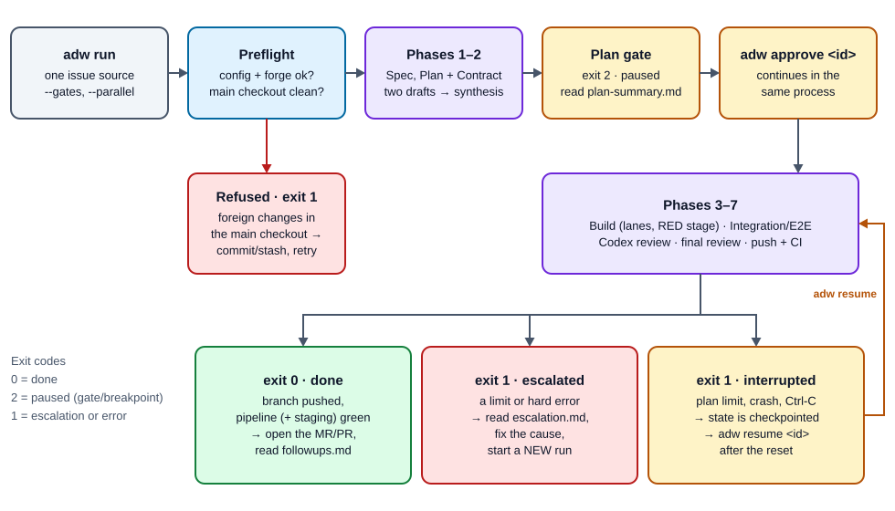
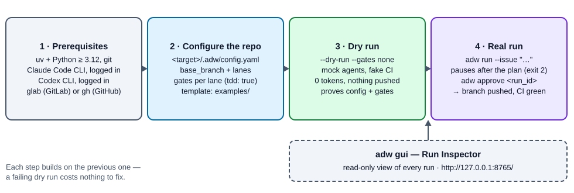
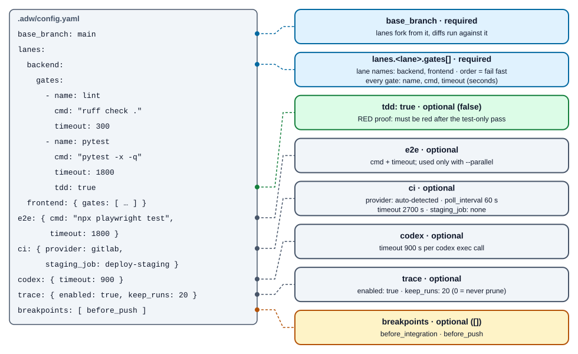
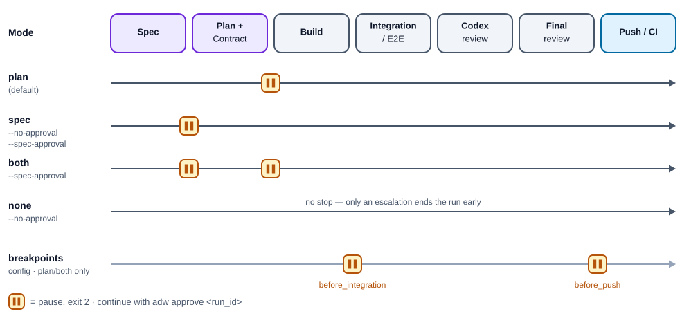
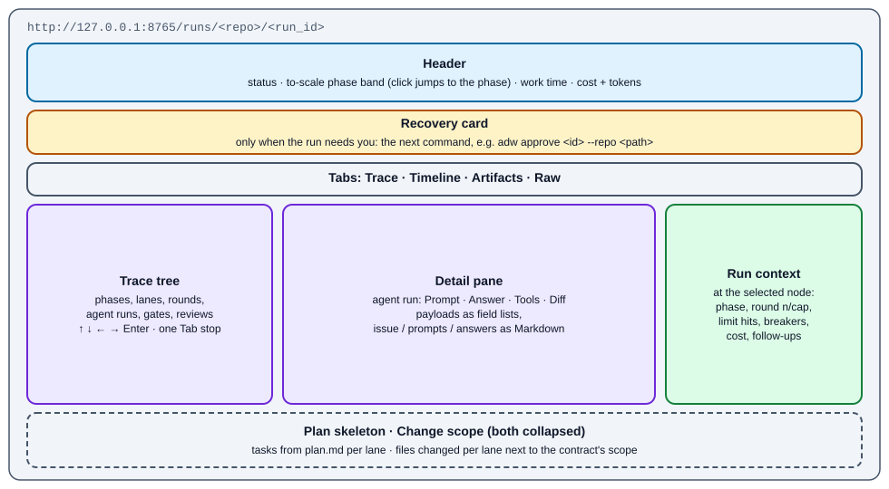
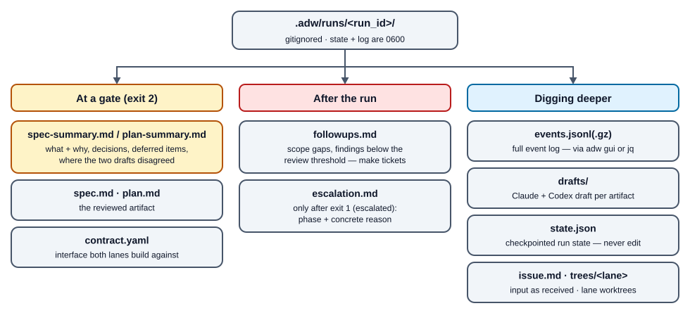
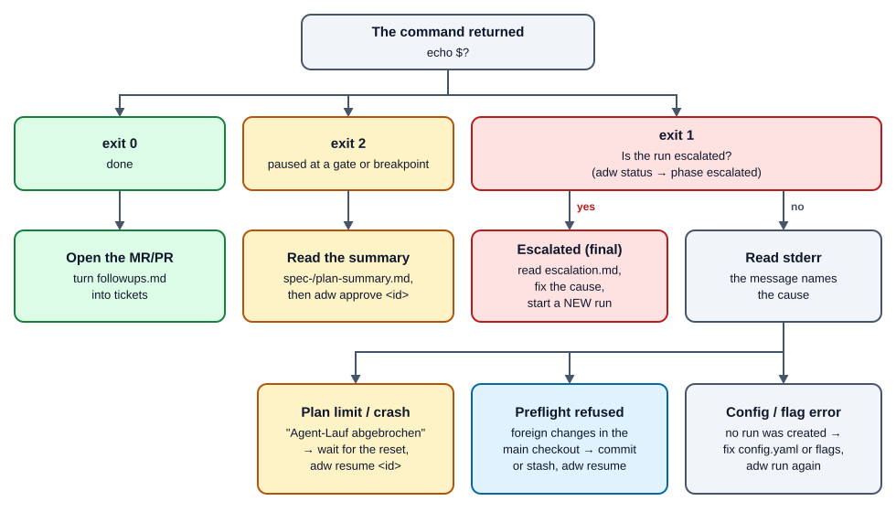

# ADW Handbook — Running the Agentic Developer Workflow

**English** | [Deutsch](ADW-HANDBOOK.de.md)

> Audience: developers who run ADW against their own repositories.
> Companion documents: [ADW-WORKFLOW.md](ADW-WORKFLOW.md) (deep dive into the
> seven phases and their loops) · [ADW-SPEC.md](ADW-SPEC.md) (contributor spec
> and philosophy).

## At a glance

- **What:** `adw run` takes one issue through **Spec → Plan + Contract → Build →
  Integration/E2E → Codex review → final review → Push/CI**. Agents supply
  judgment; the control flow is deterministic Python.
- **Get started:** `uv sync` → create `.adw/config.yaml` in the target repo →
  `adw run --repo <path> --issue "…" --dry-run --gates none`.
- **Stay in control:** by default the run stops after the plan (exit 2). Read
  `plan-summary.md`, then `adw approve <run_id>`.
- **Watch it:** `adw gui` opens a read-only Run Inspector on `127.0.0.1:8765`.
- **When it fails:** exit 1 plus `.adw/runs/<run_id>/escalation.md`. After a
  crash or an exhausted plan limit, `adw resume <run_id>` continues exactly
  where it stopped.



## Contents

1. [What ADW is](#1-what-adw-is)
2. [Prerequisites and installation](#2-prerequisites-and-installation)
3. [Preparing a target repo](#3-preparing-a-target-repo)
4. [The first run: dry run](#4-the-first-run-dry-run)
5. [Real runs](#5-real-runs)
6. [Approval gates and breakpoints](#6-approval-gates-and-breakpoints)
7. [CLI reference](#7-cli-reference)
8. [The Run Inspector (GUI)](#8-the-run-inspector-gui)
9. [Run artifacts and how to read them](#9-run-artifacts-and-how-to-read-them)
10. [Crash, pause, resume](#10-crash-pause-resume)
11. [Retention and cleanup](#11-retention-and-cleanup)
12. [Billing and plan limits](#12-billing-and-plan-limits)
13. [Writing good issues (briefs)](#13-writing-good-issues-briefs)
14. [Escalations](#14-escalations)
15. [Troubleshooting and FAQ](#15-troubleshooting-and-faq)
16. [Glossary](#16-glossary)

---

## 1. What ADW is

ADW is a Python orchestrator. You hand it an issue (free text, a GitLab issue or
a GitHub issue); it hands back a **pushed feature branch whose CI pipeline —
including an optional staging job — is green**.

Three rules shape everything you will observe:

- **Control flow is code, not prompt.** Loops, gates, merges, dispatch, triage,
  limits and CI polling are plain Python (0 tokens). Agents (Claude Agent SDK +
  Codex CLI) run only where judgment is needed.
- **Reviewers never fix.** Every fix is done by a build agent and then passes
  **all** gates again — no shortcut, not even for a one-liner.
- **Everything is bounded.** Every loop has a hard limit plus a circuit breaker.
  When a limit is hit, ADW stops and writes an escalation report; a human takes
  over.

Who does what:

| Role | Model / tool | Writes? |
|---|---|---|
| Spec agent, plan agent (draft authors) | Opus 5.5 (`claude-opus-5-5`) | yes — only their artifact |
| Second draft author + all Codex reviews | Codex CLI (`codex exec -m gpt-6-astra --sandbox read-only`) | no (returns text) |
| Spec synthesis, plan synthesis | Fable 5.1 (`claude-fable-5-1`) | yes — artifact + summary |
| Build agent (one per lane) | Opus 5.5 | yes — its lane worktree only |
| E2E triage, CI log analyst | Sonnet 5.5 (`claude-sonnet-5-5`) | no (read-only) |
| Final reviewer | Fable 5.1 | no (strictly read-only) |
| Gates, merges, commits, push, CI polling | the orchestrator (Python) | — |

How the phases work in detail — the loops, the RED stage, triage, the review
round policy — is the subject of [ADW-WORKFLOW.md](ADW-WORKFLOW.md).

---

## 2. Prerequisites and installation



| Requirement | Why | Check |
|---|---|---|
| Linux or macOS | ADW uses `fcntl` file locks and POSIX subprocesses | — |
| Python ≥ 3.12 + [`uv`](https://docs.astral.sh/uv/) | runtime and dependency management | `uv --version` |
| `git` | worktrees, merges, snapshots | `git --version` |
| **Claude Code CLI, logged in** | every Claude agent runs through it | `~/.claude/.credentials.json` exists (or the macOS keychain entry) |
| **Codex CLI, logged in** | second author and every Codex review | `~/.codex/auth.json` exists (or `$CODEX_HOME/auth.json`) |
| `glab` (GitLab) **or** `gh` (GitHub), authenticated | fetching issues, CI polling | `glab auth status` / `gh auth status` |
| A plan that includes Fable 5.1, Opus 5.5 and Sonnet 5.5 | the agent registry uses all three | in practice: a Max plan |

Installation:

```bash
git clone <this repo> agentic-developer-workflow
cd agentic-developer-workflow
uv sync                     # core + dev group (includes the GUI stack for tests)
uv run adw --help
```

The GUI is an **optional extra** (`fastapi`, `uvicorn`, `jinja2`,
`markdown-it-py`). `uv sync` in this repo already pulls those in through the dev
group. When ADW is installed as a package elsewhere:

```bash
uv pip install 'adw[gui]'   # or: pip install 'adw[gui]'
```

Without the extra, `adw gui` exits 1 with exactly that install hint; every other
command works.

All examples below use `uv run adw …` from the ADW checkout. If `adw` is on your
`PATH` (e.g. via `uv tool install`), drop the `uv run`.

---

## 3. Preparing a target repo

ADW works against **any git repo** (the *target repo*). Its entire
project-specific configuration lives in **one file**: `<target>/.adw/config.yaml`.

```bash
mkdir -p /path/to/repo/.adw
cp examples/config.yaml /path/to/repo/.adw/config.yaml   # then adapt
```

Minimal single-lane config:

```yaml
base_branch: main
lanes:
  backend:
    gates:                      # order = execution order, fail fast
      - { name: lint,   cmd: "ruff check .",  timeout: 300 }
      # tdd: true = RED proof: after the test-only pass at least one
      # marked gate must be red, before implementation starts
      - { name: pytest, cmd: "pytest -x -q", timeout: 1800, tdd: true }
```

### 3.1 Config reference (every key)

Defaults are those in `adw/config.py`. Unknown keys are rejected everywhere.



| Key | Required | Default | Meaning |
|---|---|---|---|
| `base_branch` | **yes** | — | Branch the lanes fork from and the diffs run against. Non-blank string. |
| `lanes` | **yes** | — | Mapping with at least one lane. Allowed lane names: **`backend`**, **`frontend`** (nothing else). |
| `lanes.<lane>.gates[]` | **yes** | — | At least one gate per lane. Runs in order; the first red gate ends the pass. |
| `…gates[].name` | yes | — | Display name (non-blank). |
| `…gates[].cmd` | yes | — | Shell command, run in the lane worktree (non-blank). |
| `…gates[].timeout` | yes | — | Seconds, integer > 0 (a YAML boolean is rejected). |
| `…gates[].tdd` | no | `false` | Marks a RED-proof gate (strict boolean). See §5.3. |
| `e2e.cmd` / `e2e.timeout` | no | — | E2E command + seconds. Both required if `e2e` is set. Used only with `--parallel`. |
| `ci.provider` | no | auto | `gitlab` or `github`. Unset = detected from the `origin` URL; an unknown host (e.g. self-hosted with a custom domain) refuses a real `run`/`resume`/`approve` in the preflight, before any agent runs (a dry run falls back to GitLab). For self-hosted forges always set the key. |
| `ci.poll_interval` | no | `60` | Seconds between pipeline polls. |
| `ci.timeout` | no | `2700` | Total budget for waiting on CI (45 min). |
| `ci.staging_job` | no | — | Job that must additionally be green (e.g. `deploy-staging`). |
| `codex.timeout` | no | `900` | Time limit in seconds for every `codex exec` call (author and review share it). |
| `trace.enabled` | no | `true` | Write the event log `events.jsonl`. `false` = no event log at all (the GUI then has nothing to show for that run). |
| `trace.keep_runs` | no | `20` | Automatic pruning after a successful run keeps the newest N runs. `0` = never prune automatically. |
| `breakpoints[]` | no | `[]` | Extra holds: `before_integration` and/or `before_push`. See §6. |

Validation is strict and fail-fast: a missing file, invalid YAML, a duplicate
key, an unknown key, a lane without gates, a gate without timeout, a non-boolean
`tdd` or an unknown breakpoint abort **before** anything happens, with the file
path and the reason. Apart from the documented defaults, nothing is guessed.

**Your gates are your quality boundary.** ADW only accepts a build when *all*
gates are green. What the gates don't check, nobody checks during the build — at
minimum configure a linter/formatter check and the test suite.

**Gate environment.** Gates and agents run with an **environment whitelist**:
`PATH`, `HOME`, `USER`, `SHELL`, `TERM`, `TMPDIR`, `LANG`, `LANGUAGE`, `TZ`,
`VIRTUAL_ENV`, `PYTHONPATH`, `NODE_ENV`, `CI`, `CLAUDE_CONFIG_DIR` and `LC_*`.
Anything else (API keys, cloud credentials, tokens, `DATABASE_URL`, …) is **not**
visible to a gate. Lane ports are injected additionally (`BACKEND_PORT` /
`FRONTEND_PORT`). If your test suite needs further variables, set them inside
the gate command (`cmd: "DJANGO_SETTINGS_MODULE=app.settings.test pytest -q"`)
or a wrapper script in the repo.

**Parallel mode** (`--parallel`) needs both lanes, `backend` **and** `frontend`.
Otherwise the run escalates at the very start of phase 1, before any agent runs.
Single-lane runs build `backend` if configured, else the only configured lane.

### 3.2 What ADW changes in your repo

- It creates `.adw/runs/` with a `.gitignore` containing `*` — run data never
  gets committed.
- It writes six **ADW-owned authoring artifacts** under `.adw/`:
  `issue.md`, `spec.md`, `plan.md`, `contract.yaml`, `spec-summary.md`,
  `plan-summary.md`. Do not edit them by hand (see §10.2).
- It creates branches `adw/<run_id>/<lane>` (and `adw/<run_id>/integration` in
  parallel mode) plus snapshot refs `refs/adw/<run_id>/*`.
- It registers the repo in `~/.adw/repos.json` so the GUI can find it.

---

## 4. The first run: dry run

Before any token is spent, exercise **the complete control flow** with scripted
mock agents — 0 tokens, no network, no push:

```bash
uv run adw run --repo /path/to/repo --issue "Demo feature" --dry-run --gates none
uv run adw run --repo /path/to/repo --issue "Demo feature" --dry-run --gates none --parallel
```

What the dry run proves:

- your config loads and every lane is wired;
- the RED stage, the gate loop and the commit path work against **your** repo;
- it is deliberately not a fair-weather run: every lane gets a synthetic gate
  that fails once (the fix goes to the same session), and with `--parallel` one
  red E2E run is triaged back into a lane;
- CI is simulated (fake `glab`/`gh`), nothing is pushed.

The dry-run mode is stored in the run state: a `resume`/`approve` of a dry run
stays token-free. Mock build agents leave `adw_dry_run_<lane>.md` files on local
dry-run branches; delete those branches whenever you like.

`--gates none` (the deprecated `--no-approval` still works) lets the dry run go through without
pausing. Without it, the dry run pauses at the plan gate like a real run.

---

## 5. Real runs

### 5.1 Choosing the issue source

Exactly **one** source per run:

```bash
# free text
uv run adw run --repo ~/code/shop --issue "Bug: login aborts when the password contains a colon"

# multi-line brief from a file
uv run adw run --repo ~/code/shop --issue "$(cat ~/briefs/cart-discounts.md)"

# GitLab issue (title + description via `glab issue view`)
uv run adw run --repo ~/code/shop --gitlab-issue 42

# GitHub issue (title + body via `gh issue view`)
uv run adw run --repo ~/code/shop --github-issue 42
```

`glab`/`gh` run in the target repo directory, so they resolve the project from
its remote.

### 5.2 Single-lane vs. `--parallel`

| | single-lane (default) | `--parallel` |
|---|---|---|
| Lanes | `backend` if configured, else the only configured lane | `backend` **and** `frontend`, concurrently |
| Integration/E2E phase | skipped | both lane branches merged onto `adw/<id>/integration`, then `e2e.cmd` |
| Pushed branch | `adw/<id>/<lane>` | `adw/<id>/integration` |
| Plan usage | lower | two Opus sessions at once — drains a 5-hour window noticeably faster |

### 5.3 The RED stage (`tdd: true`)

If a lane has at least one gate with `tdd: true`, its initial build starts with
a **test-only pass**: the build agent writes tests and nothing else; then the
orchestrator runs exactly the marked gates. At least one must be **red** — that
is the proof the tests cover the requested behavior. Then the same session
implements. If the marked gates are green after the test-only pass, the run
escalates (the tests prove nothing). Recommended for every lane that has a test
suite.

### 5.4 Pinned settings

At run start ADW pins the effective **base branch** (config or
`--base-branch`), the **gate mode** and the **breakpoint set** into the run
state. Editing `.adw/config.yaml` mid-run does not move a running run.
`--base-branch` on `resume`/`approve` can still change the base, but only
until lanes exist.

### 5.5 Before you start

The main checkout of the target repo must be **clean** (see §10.2). ADW never
discards your work; it refuses instead.

---

## 6. Approval gates and breakpoints

### 6.1 `--gates`

| Mode | Holds | Legacy flag equivalent |
|---|---|---|
| `plan` (**default**) | after plan + contract, before the build | (no flag) |
| `spec` | after the spec, before the plan | `--no-approval --spec-approval` |
| `both` | after the spec **and** after the plan | `--spec-approval` |
| `none` | never (only an escalation stops the run) | `--no-approval` |

`--gates` and the legacy flags may be combined only if they agree; a
contradiction or an unknown value is rejected before any run is created.



### 6.2 What a pause looks like

```text
$ uv run adw run --repo ~/code/shop --issue "Cart discounts"
Run 3f9a12c4 gestartet (Phase: spec, Gates: plan)
Plan-Approval ausstehend: .adw/runs/3f9a12c4/plan-summary.md und .adw/runs/3f9a12c4/plan.md lesen, dann `adw approve 3f9a12c4`
$ echo $?
2
```

(CLI messages are in German; the meaning is given here.)

Review in this order:

```bash
less ~/code/shop/.adw/runs/3f9a12c4/plan-summary.md   # what/why, decisions, deferred items, where the drafts disagreed
less ~/code/shop/.adw/runs/3f9a12c4/plan.md           # workstreams / tasks
less ~/code/shop/.adw/runs/3f9a12c4/contract.yaml     # interface contract
uv run adw approve 3f9a12c4 --repo ~/code/shop        # continue with phases 3–7
```

At a spec gate the files are `spec-summary.md` and `spec.md`; after approval the
run continues with the plan and — in mode `both` — stops again at the plan gate.

There is no "reject" command. If the plan is wrong, abandon the run (leave it
paused or prune it later) and start a new run with a sharper issue. Correcting
direction at plan level is cheap; at code level it costs build, review and fix
cycles.

### 6.3 Breakpoints (optional)

Two extra holds before expensive, hard-to-reverse steps, set in the config:

```yaml
breakpoints:
  - before_integration   # all build lanes green; before integration (parallel) or Codex review (single-lane)
  - before_push          # final review done; before push/CI
```

A breakpoint behaves like an approval gate: exit 2, the CLI names it, continue
with `adw approve <run_id> --repo <path>`. A granted breakpoint never holds
again, even after crash + resume. Breakpoints hold only in the modes `plan` and
`both`: `--gates none` and `--gates spec` (and their legacy flags) skip them.

---

## 7. CLI reference

```text
adw run     --repo PATH (--issue TEXT | --gitlab-issue ID | --github-issue NR)
            [--parallel] [--dry-run] [--gates none|spec|plan|both]
            [--no-approval] [--spec-approval]   (deprecated)  [--base-branch NAME]
adw resume  RUN_ID [--repo PATH] [--base-branch NAME]
adw approve RUN_ID [--repo PATH] [--base-branch NAME]
adw status  [RUN_ID] [--repo PATH]
adw gui     [--repo PATH]... [--host 127.0.0.1] [--port 8765] [--open] [--i-know]
adw runs list  [--repo PATH]
adw runs prune [--repo PATH] [--keep N] [--older-than DAYS] [--gzip]
```

`--repo` defaults to the current directory everywhere.

### `adw run`

| Option | Meaning |
|---|---|
| `--issue TEXT` | Issue text directly. |
| `--gitlab-issue ID` | Fetch `#iid: title` + description via `glab issue view ID --output json`. |
| `--github-issue NR` | Fetch `#number: title` + body via `gh issue view NR --json number,title,body`. |
| `--parallel` | Build `backend` and `frontend` in parallel lanes; enables integration + E2E. |
| `--dry-run` | Mock agents, fake CI, no push, 0 tokens. Stored in the state. |
| `--gates MODE` | Approval gates, see §6.1. Default `plan`. |
| `--no-approval`, `--spec-approval` | Deprecated: still work, but print a hint to use `--gates` (§6.1). |
| `--base-branch NAME` | Override `base_branch` for this run (pinned). |

Order of checks: exactly one issue source → gate mode → config → forge
preflight → working-tree preflight → model check (forge + models: real runs only) → issue fetch → run creation. A failure at any step creates no run.

### `adw resume RUN_ID`

Continues a run in its persisted phase — after a crash, `Ctrl-C`, an exhausted
plan limit or a refused preflight. An `escalated` run is rejected (read the
report, start a new run). On a run that is paused at a gate, `resume` simply
pauses again (exit 2) — use `approve`.

### `adw approve RUN_ID`

Grants the pending approval (spec gate, plan gate or breakpoint) and continues
in the same process. Rejected cleanly if the run is not waiting.

`resume`, `approve` and `run` hold a per-run execution lock: two concurrent
continuations of the same run cannot both execute (no double push).

### `adw status [RUN_ID]`

One line per run: `run_id  phase  single|parallel  [dry-run]  first line of the issue`.

### `adw gui`

See §8. `--repo` can be repeated; `--host` must be a loopback address unless
`--i-know` is given; `--open` opens the browser.

### `adw runs list` / `adw runs prune`

See §11. `--repo` must be the **root** of a git work tree.

### Exit codes

| Code | Meaning | Next step |
|---|---|---|
| `0` | Done — branch pushed, pipeline (+ staging job) green. Or: a `runs`/`status` command succeeded. | Open the MR/PR. |
| `2` | Paused at an approval gate or breakpoint. (`runs prune` also uses 2 for `--keep` below 1 or a negative `--older-than`.) | Read the summary, `adw approve <id>`. |
| `1` | Escalation, refused preflight, agent/plan-limit abort or any error. | Read stderr; for an escalation `escalation.md`. |

---

## 8. The Run Inspector (GUI)

A **read-only** web view of every run: what happened, in what order, what it
cost, where time went and why something escalated. It never writes to a repo,
a state file or a log.

### 8.1 Start

```bash
uv run adw gui                                   # http://127.0.0.1:8765/
uv run adw gui --port 8790 --open                # other port, open browser
uv run adw gui --repo ~/code/shop --repo ~/code/api
```

- Repos come from `~/.adw/repos.json`; every `adw run` registers its target repo
  there automatically. `--repo` adds repos ad hoc. Repos that no longer exist
  are shown greyed out.
- Binds to loopback only. The event log contains **raw, unredacted agent
  output** (tool results, file contents). A non-loopback `--host` requires
  `--i-know`. Do not share run directories.
- Stop with `Ctrl-C`.
- Language: English or German, chosen by `?lang=de|en`, then cookie, then the
  browser's `Accept-Language`; the switch is a link in the header.

### 8.2 Run list (`/`)

All runs across registered repos: run ID, repo, issue title, status, start,
work time, cost, event count. Runs waiting at an approval (`awaiting_approval`)
are grouped at the top, then running ones, then the rest. Sort via the column
headers (start, duration, cost, events); filter by repo and status. Dry runs
carry a `Dry-Run` label. The list does not live-update — reload to refresh.

### 8.3 Run detail (`/runs/<repo>/<run_id>`)



- **Header:** status, a to-scale **phase band** (done / active / awaiting /
  failed, with durations; click jumps to the phase), whole-run work time, cost
  and tokens. A dry run carries a sticky `Dry-Run` banner.
- **Trace tree** (left): the span tree — phases, lanes, rounds, agent runs,
  gates, reviews. Tool noise is folded into groups/repetitions.
- **Detail pane** (right): for an agent run the tabs **Prompt**, **Answer**,
  **Tools** and **Diff** (the step diff from the snapshot refs). Payloads read as
  a field list; issue, prompts and answers render as Markdown.
- **Run-context panel:** phase, round (`n/cap`), limit hits, circuit breakers,
  cumulative cost and follow-ups **as of the selected node** (time travel).
- **Recovery card:** when the run needs you, one card names the next step —
  e.g. `adw approve <id> --repo <path>` or the escalation report.
- **Plan skeleton:** the tasks from `plan.md` per lane, collapsed below the trace.
- **Change scope** (collapsed): files changed per lane with `+/-` counts, next
  to the scope declared in the contract.
- **Run-level tabs:** `Trace` (default) · `Timeline` (swimlanes: where does the
  time go; click a bar to jump) · `Artifacts` (issue, spec, plan, contract,
  summaries, drafts side by side, escalation, follow-ups) · `Raw` (filterable
  event log — the fallback that always works).
- **Live:** while a run is active the page refreshes itself (server-sent
  events, debounced); a finished run is static.

### 8.4 Keyboard

The trace tree is a single Tab stop; inside it:

| Key | Effect |
|---|---|
| ↓ / ↑ | next / previous visible row |
| → | open a fold row; if open, move to its first child |
| ← | close a fold row; if closed, move to the parent |
| Enter, Space | select the node (same as a click) |
| Home / End | first / last visible row |

Tab groups switch with ← / →. Timeline rows are focusable and activate with
Enter/Space.

---

## 9. Run artifacts and how to read them

Everything for one run lives under `<target>/.adw/runs/<run_id>/` (8-hex run
ID), gitignored and readable only by you (`0600` for state and log).



| Path | What it is | Read it when |
|---|---|---|
| `state.json` | Complete run state: phase, lanes (worktree, branch, session, ports, counters, RED proof), open fix tasks, review rounds, pinned settings. Atomically written. | Debugging a resume; never edit it. |
| `events.jsonl` (or `.gz`) | Event log: spans, agent messages, tool calls/results, gate outputs, findings, approvals, snapshots. Raw and unredacted. | Via the GUI, or `jq` for scripting. |
| `issue.md` | The issue text exactly as the run received it. | Verifying what the run was asked. |
| `drafts/` | Two independent drafts per authoring phase: `spec.claude.md` / `spec.codex.md`, `plan.*`, `contract.*`; a `.codex.FAILED` marker if Codex could not deliver. | Understanding a synthesis decision. |
| `spec.md`, `plan.md`, `contract.yaml` | Archived, reviewed artifacts of this run. | At the gates; afterwards for traceability. |
| `spec-summary.md`, `plan-summary.md` | The synthesis summary: what and why, key decisions, deferred items, which draft contributed what, open questions. | **First** thing to read at a gate. |
| `followups.md` | Follow-up issues: `scope_gap` findings, P2/P3 findings below the review threshold, deferred unactionable P3 fixes. Deduplicated. | After every run — turn them into tickets. |
| `escalation.md` | Phase reached, concrete reason (gate output, merge conflict, limit, circuit breaker, findings). | After exit 1. |
| `trees/<lane>`, `trees/integration` | Lane git worktrees (and the integration worktree). | Inspecting what a lane built. |

The six authoring artifacts are also seeded into the lane worktrees and
**committed on the feature branch** — the MR/PR shows exactly what was specified
and planned. The main checkout stays clean.

Handy commands:

```bash
uv run adw status --repo ~/code/shop
cat ~/code/shop/.adw/runs/<id>/escalation.md
jq -r 'select(.type=="approval") | .payload' ~/code/shop/.adw/runs/<id>/events.jsonl
git -C ~/code/shop log --oneline adw/<id>/backend
```

---

## 10. Crash, pause, resume

### 10.1 What survives

ADW checkpoints every phase transition **and** every open intermediate result
(gate feedback, review session, counters) into `state.json`. After a process
death — `Ctrl-C`, power loss, an exhausted plan window:

```text
$ uv run adw status --repo ~/code/shop
3f9a12c4  build                  single    Cart discounts
$ uv run adw resume 3f9a12c4 --repo ~/code/shop
Run 3f9a12c4 wird fortgesetzt (Phase: build)
```

- Finished lanes are **not** rebuilt — the result is verified by tree hash.
- An open fix is replayed into **the same agent session**.
- Limits (iterations, rounds, cycles) survive: a restart grants no extra attempts.
- A dry run stays a dry run.

### 10.2 The working-tree preflight

Before `run`, `resume` and `approve` enter any phase, ADW checks the main
checkout. It **never escalates**; it proceeds, self-heals or refuses:

- **Clean** → proceed.
- **Only ADW-owned artifacts dirty** (`.adw/issue.md`, `.adw/spec.md`,
  `.adw/plan.md`, `.adw/contract.yaml`, `.adw/spec-summary.md`,
  `.adw/plan-summary.md` — e.g. crash leftovers) → ADW restores them from `HEAD`
  (untracked ones are deleted) and proceeds.
- **Anything else dirty** — a foreign file, or a mix → refuse with a list of the
  paths, exit 1. Nothing is discarded, the run is unchanged and resumable.
  Commit or stash, then retry.

### 10.3 Escalated runs

A run in phase `escalated` is final by design. Read `escalation.md`, fix the
cause (issue, config, gates, environment), start a new run.

---

## 11. Retention and cleanup

Worktrees and raw logs make run directories big. Two commands keep them in check:

```bash
uv run adw runs list --repo ~/code/shop
# 3f9a12c4  done                    2026-10-02 14:11:07  events=8421  log=31457280

uv run adw runs prune --repo ~/code/shop                     # keep newest 20, delete the rest
uv run adw runs prune --repo ~/code/shop --keep 5 --older-than 14
uv run adw runs prune --repo ~/code/shop --gzip              # compress events.jsonl, keep the run
```

- Only **terminal** runs (`done`, `escalated`) are pruned — a paused or
  resumable run is never touched.
- Deleting removes the run directory, its worktrees (with proper
  `git worktree` deregistration) and its snapshot refs `refs/adw/<id>/*`. A
  worktree with uncommitted changes is skipped, never discarded.
- `--keep N` protects the newest N runs (N ≥ 1 — unlike `trace.keep_runs: 0`, which
  turns auto-pruning off, a manual prune always keeps the newest run); `--older-than DAYS` limits pruning to
  runs at least that old. `--gzip` compresses the log to `events.jsonl.gz`; the
  GUI reads both.
- Lane **branches** are not deleted; remove pushed/merged branches with git as
  usual.
- **Automatic pruning:** after every run that ends `done` (via `run`, `resume`
  or `approve`), ADW deletes old runs beyond `trace.keep_runs` (default 20).
  `keep_runs: 0` switches it off. Failures are reported but never change the
  finished run's result.

---

## 12. Billing and plan limits

- **Claude runs only through the Claude Code CLI** with your stored login. ADW
  refuses to start an agent without `~/.claude/.credentials.json` (or the macOS
  keychain entry). `ANTHROPIC_API_KEY` and similar variables are actively
  blanked for every agent process — no token-by-token API billing, ever.
- **Usage counts against your plan** (5-hour window + weekly limits). No cost
  risk, but an availability risk.
- **Limit exhausted ≠ lost work.** A failing agent call stops the run with
  exit 1 and the message *"Agent-Lauf abgebrochen (z. B. Plan-Limit erschöpft)"*.
  The run is **not** escalated; it stays at its checkpoint. After the reset:
  `adw resume <run_id>`. There is deliberately no automatic waiting.
- **Codex** runs on your ChatGPT/Codex login with a separate quota. Each call
  uses an isolated `CODEX_HOME` that contains only a copy of `auth.json` (no
  user config, no MCP servers); refreshed tokens are written back.
- The GUI shows cost in USD-equivalent and tokens per run — a usage meter, not
  a bill.

---

## 13. Writing good issues (briefs)

The issue is the only input. A good brief is the cheapest lever on run quality.
The five briefs under [`docs/briefs/`](briefs/README.md) each ran autonomously
with `--gates none` and none escalated; their structure is the recommended
template:

1. **Starting point with measured facts**, not descriptions. Check every claim
   against code (or the running app) **right before** the start.
2. **Numbered pre-decisions (E1, E2, …)**, each with *"This question is decided —
   not a finding, not even in the review loop."* Review loops can find
   ambivalent questions but cannot decide them; open questions oscillate until
   the round cap.
3. **"Existing behavior that is NOT part of this issue"** — prevents a run from
   removing things the brief didn't mention.
4. **A deferred list that explicitly binds the review loop.**
5. **Measurable acceptance criteria**, recomputed against real data before
   approval.
6. **Toolchain facts stated explicitly** (which linter, formatter and test runner
   the repo uses — and which it does not).

Also: one issue = one coherent change. Split large epics; ADW's limits are sized
for a focused feature or fix, not for a rewrite.

---

## 14. Escalations

ADW stops **before** it burns budget or causes damage. Every escalation writes
`escalation.md` and exits 1.

| Trigger | Limit | Typical cause |
|---|---|---|
| `--parallel` without both lanes | immediately, before phase 1 | Config has only one lane |
| Spec/plan authoring loop | 5 rounds; at the cap only open P1 escalate (P2/P3 become documented limitations) | Issue too vague or contradictory |
| Gate loop of a lane | 10 iterations per task | Requirements and gates contradict; flaky tests |
| Circuit breaker | identical failure set twice in a row | The agent is going in circles |
| RED not confirmed | immediately | Marked gates green after the test-only pass, or tests deleted |
| Integration/E2E | 10 rounds | Cross-lane incompatibility, contract gap |
| Merge conflict | immediately | Lanes changed the same files in conflicting ways |
| Codex code review | 5 rounds | A problem reviews cannot "fix away" |
| Final review fix cycles | 3 per lane | Same |
| CI | 1 automatic re-entry, `ci.timeout` budget | Pipeline/infra problem, environment difference |
| Pipeline red without usable logs | immediately | Canceled/skipped pipeline, CI YAML error |
| Unparseable reviewer output | immediately | Agent/Codex violated the findings JSON schema |
| Foreign commit / HEAD moved in a lane | immediately | Someone worked in a lane worktree; only the orchestrator commits |

---

## 15. Troubleshooting and FAQ



**`Fehler: …/.adw/config.yaml: config.yaml fehlt — das Ziel-Repo ist nicht ADW-fähig`**
No config in the target repo. Copy `examples/config.yaml` (§3).

**`Es gibt neuere Modelle als die in ADW eingestellten — Lauf NICHT gestartet`**
The model check found a newer Claude or GPT model than ADW pins. The message names
role, pinned → newest model and the constant to change (`adw/agents.py`,
`adw/codex.py`). Update ADW first (constants, tests, docs, release), then start the
run again. The check runs at most once per 24 h (`~/.adw/model-check.json`); delete
that file to force a fresh check. A check that cannot run only prints a warning.

**`Fehler: genau EINE Issue-Quelle angeben …`**
Pass exactly one of `--issue`, `--gitlab-issue`, `--github-issue`.

**`--gates … widerspricht den Altflags`**
`--gates` and `--no-approval`/`--spec-approval` disagree. Use only `--gates`.

**`Der Haupt-Checkout hat uncommittete Änderungen außerhalb der ADW-eigenen Authoring-Artefakte`**
The preflight refused (§10.2). Commit or stash the listed paths, then rerun or
`adw resume`.

**Escalation `--parallel verlangt eine frontend- UND backend-Lane`**
The config defines only one lane. Add the missing lane (with its own gates) or
run without `--parallel`. No tokens were spent — the check runs before phase 1.

**`resume` "does nothing" on a paused run**
It's at a gate; `resume` pauses again. Use `adw approve <id>`.

**`Run … wartet nicht auf Approval`**
`approve` on a run that is not paused. For crash continuation use `resume`.

**`Agent-Lauf abgebrochen (z. B. Plan-Limit erschöpft)`**
Plan window empty or the Claude CLI failed. Nothing to fix on the run — wait for
the reset, then `adw resume <id>`.

**`Keine gespeicherte Claude-CLI-Anmeldung gefunden`**
Log in with the Claude Code CLI (`claude`, then `/login`). An API key does not
help — it is deliberately ignored.

**Escalation "RED not confirmed"**
The tests written in the test-only pass did not fail. Either they miss the
requested behavior or it already exists. Sharpen the issue, start a new run.

**Escalation "HEAD moved" / "build agent committed on its own"**
Only the orchestrator commits, and only after green gates. Something else touched
the lane worktree. Inspect, then start a new run.

**`--base-branch kann nach dem Anlegen der Lanes nicht mehr geändert werden`**
The lanes already forked from the pinned base. Start a new run for another base.

**`adw gui benötigt das optionale Extra 'gui'`**
Install `adw[gui]` (§2).

**`--host … ist keine Loopback-Adresse`**
Intended. Use an SSH tunnel (`ssh -L 8765:127.0.0.1:8765 host`) or, knowingly,
`--i-know`.

**The GUI shows a run without a trace**
`trace.enabled: false` was set for that run, or the run predates the event log.
Only state-derived information is available.

**What does a run cost?**
Dry run: nothing. Real run: plan quota only — Fable 5.1 for synthesis and final
review, Opus 5.5 for authoring drafts and building, Sonnet 5.5 for triage/log
analysis, Codex on its own subscription. The limits cap the worst case.

---

## 16. Glossary

| Term | Meaning |
|---|---|
| **Target repo** | The repository ADW works on; holds `.adw/config.yaml` and `.adw/runs/`. |
| **Run / run ID** | One pass of one issue through the phases; 8-hex ID. |
| **Lane** | A workstream (`backend`/`frontend`) with its own worktree, branch, agent session and ports. |
| **Gate** | A configured check command with a hard timeout. All green = condition for every commit. |
| **RED stage** | Test-only pass + proof that `tdd: true` gates fail, before implementation. |
| **Draft / synthesis** | Two independent drafts (Claude + Codex) merged by Fable 5.1 into one best-of artifact plus a summary. |
| **Contract** | `.adw/contract.yaml` — the agreed interface both lanes build against. |
| **Finding** | Structured review result: severity P1–P3, lane, file, problem, fix plan, optional category. |
| **`scope_gap`** | "Missing, but never planned" — becomes a follow-up, triggers no rework. |
| **Approval gate / breakpoint** | A deliberate pause (exit 2) until `adw approve`. |
| **Circuit breaker** | Immediate escalation when a fix round produces the identical failure set. |
| **Escalation** | Controlled handover to a human: exit 1 + `escalation.md`. |
| **Session resume** | Fix tasks go to the existing agent session, with full context. |
| **Run Inspector** | The read-only GUI (`adw gui`). |

---

ADW Handbook · source version 0.26.1 · 2026-10-11 ·
Deep dive: [ADW-WORKFLOW.md](ADW-WORKFLOW.md) · Contributor spec: [ADW-SPEC.md](ADW-SPEC.md)
