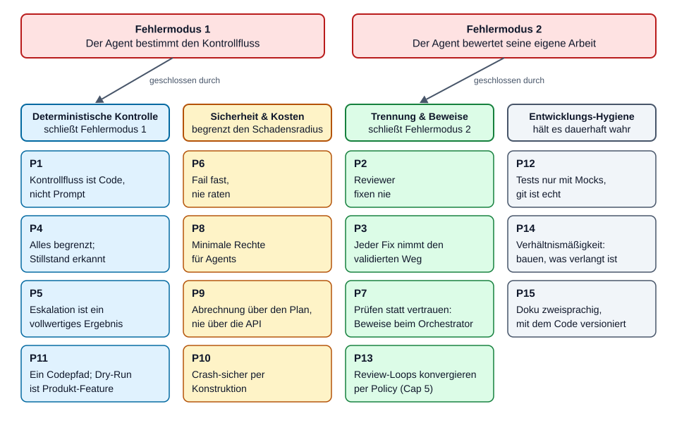
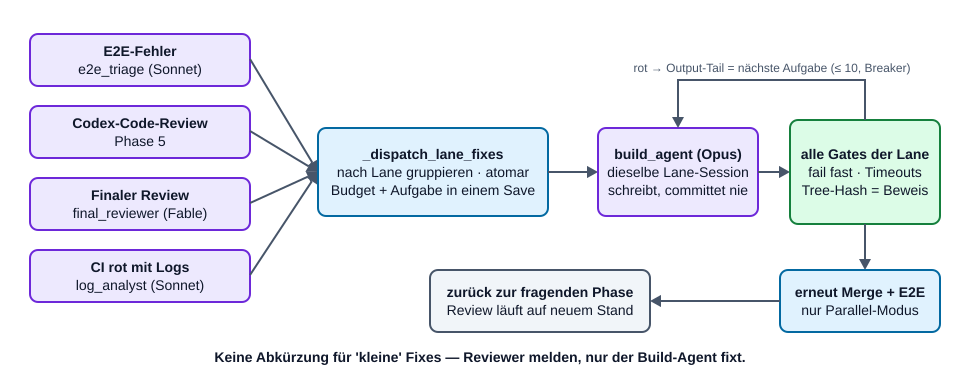
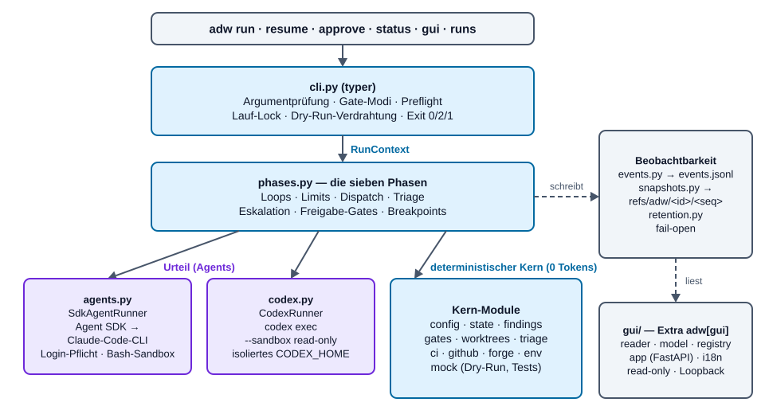
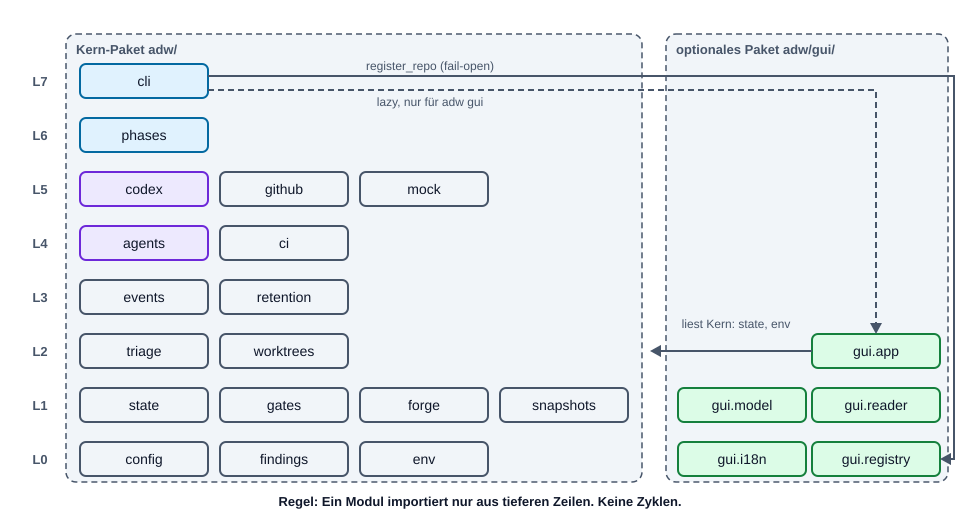
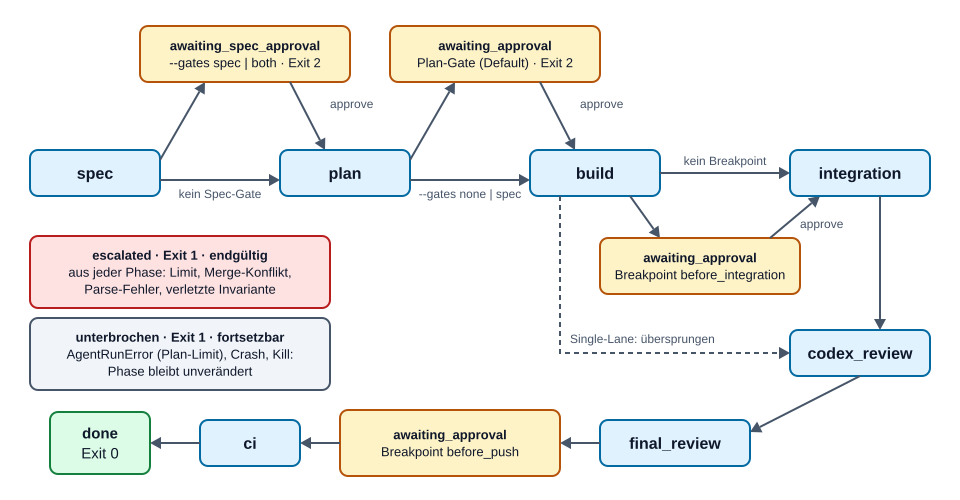
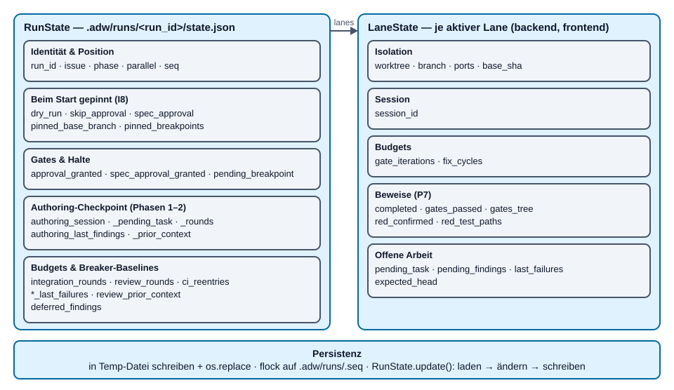
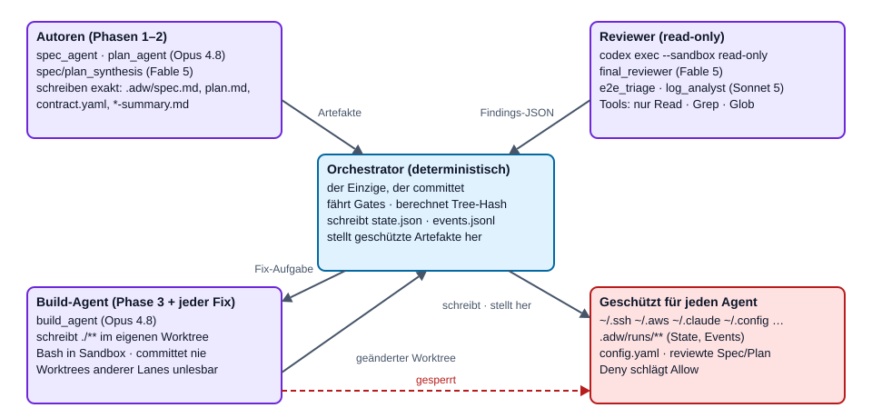
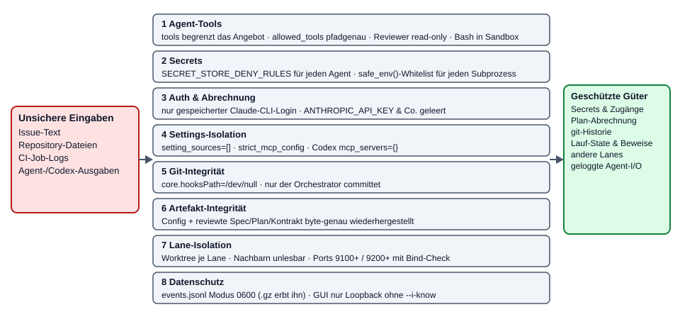

# ADW-Spezifikation — Philosophie, Architektur, Verträge

[English](ADW-SPEC.md) | **Deutsch**

> **Zielgruppe:** Contributors des ADW-Orchestrators — wer `adw/` ändert,
> Änderungen daran reviewt oder wissen muss, *warum* es so gebaut ist.
> **Stand:** Version 0.26.1 (2026-10-11).
> **Begleitdokumente:** [ADW-Workflow](ADW-WORKFLOW.de.md) (die sieben Phasen im
> Detail, für Anwender und Contributors) · [ADW-Handbuch](ADW-HANDBOOK.de.md)
> (ADW als Entwickler bedienen).

## Verhältnis zu den anderen Dokumenten

| Dokument | Rolle | Status |
| --- | --- | --- |
| [`docs/SPEC.de.md`](SPEC.de.md) | Die **ursprüngliche Soll-Spezifikation** mit der Definition of Done (§8), die die Abnahmetests (`tests/test_e2e_dry_run.py`) abbilden. Sie legt fest, *was ADW leisten muss*. | Normativ. Änderungen am Soll-Verhalten landen zuerst dort. |
| [`docs/PLAN.de.md`](PLAN.de.md) | Der **Implementierungsplan** des 0.1.0-Kerns (Tasks 0–13). | Historisch — der Plan ist abgearbeitet und wird mit dem Code nicht fortgeschrieben. |
| [`docs/GUI-SPEC.de.md`](GUI-SPEC.de.md) | Normative Spezifikation von Event-Log, Snapshots, Retention und Run-Inspector-GUI. | Normativ für alles unter `adw/gui/`, `events.py`, `snapshots.py`, `retention.py`. |
| **Dieses Dokument** | Die **Ist-Spezifikation**: die Philosophie hinter dem Design, die Architektur mit Stand 0.26.1, die Datenverträge, Invarianten und Erweiterungspunkte. | Beschreibend, gegen den Code verifiziert. Widersprechen sich dieses Dokument und `SPEC.md`, ist der Code die Tatsache und `SPEC.md` die Absicht — die Lücke als Issue erfassen. |
| [`CHANGELOG.de.md`](../CHANGELOG.de.md) | Was sich je Release geändert hat. | Wird mit jedem Push gepflegt. |
| [`docs/FOLLOWUPS.md`](FOLLOWUPS.md) | Register offener Follow-up-Findings aus ADW-Läufen. | Händisch gepflegt (nur EN). |
| [`docs/briefs/`](briefs/README.md) | Issue-Briefe, die ohne Eskalation durch ADW liefen — Vorlage für neue. | Referenz. |

---

# Teil I — Philosophie

ADW existiert, weil agentisches Programmieren auf zwei vorhersehbare Arten
scheitert: Der Agent *bestimmt den Kontrollfluss* (und dreht Schleifen, überspringt
Prüfungen oder erklärt sich zum Sieger), und der Agent *bewertet seine eigene
Arbeit*. Jedes der folgenden Prinzipien schließt eine dieser Türen. Jedes steht als
Regel da, gefolgt vom Grund und der Stelle im Code, die es durchsetzt — ein Prinzip,
das kein Code durchsetzt, ist nur ein Wunsch.



## P1 — Kontrollfluss ist Code, nicht Prompt

**Regel.** Schleifen, Gates, Merges, Dispatch, Triage, Limits, Freigabepausen und
CI-Polling sind deterministisches Python. Agents werden nur dort gerufen, wo Urteil
nötig ist: Spec oder Plan schreiben, Code schreiben, ein Review beurteilen, einen
Fehler einer Lane zuordnen.

**Warum.** Wiederholbare Arbeit im Prompt kostet Tokens, verhält sich jedes Mal
anders und ist nicht testbar. Dieselbe Arbeit in Python kostet nichts, verhält sich
identisch und ist durch Tests abgedeckt. Ein Agent mit der Anweisung „wiederhole,
bis die Tests grün sind" kann zu früh aufhören, endlos laufen oder „grün" umdeuten;
eine `while`-Schleife mit Zähler nicht.

**Durchgesetzt durch.** `adw/phases.py` besitzt jede Schleife; Agents bekommen einen
einzelnen Task-String und liefern Text. Kein Agent wird je angewiesen, „jetzt die
nächste Phase aufzurufen".

## P2 — Reviewer fixen nie

**Regel.** Jeder Reviewer — Codex in Phase 1, 2 und 5, der Final-Reviewer in
Phase 6, der E2E-Triage-Agent, der CI-Log-Analyst — ist read-only und antwortet nur
mit Findings. Fixes macht immer der Build-Agent der betroffenen Lane.

**Warum.** Ein Reviewer, der „nur die Kleinigkeit" fixt, umgeht genau die
Prüfungen, die seinen Fehler hätten finden sollen, und korrigiert seine eigenen
Hausaufgaben. Die Trennung hält den Reviewer auch ehrlich: Er hat kein Interesse
daran, dass der Code in Ordnung ist.

**Durchgesetzt durch.** Die Agent-Registry (`adw/agents.py`) gibt jedem Reviewer
`READ_ONLY_TOOLS` (Read/Grep/Glob) und keine Schreibregel; Codex läuft mit
`--sandbox read-only`.

## P3 — Jeder Fix nimmt den validierten Weg

**Regel.** Ein Fix aus jeder Quelle (Gate-Fehler, E2E, Codex-Review, Final-Review,
CI) läuft über den Build-Agent, dann durch **alle** Gates der Lane — und im
Parallelmodus erneut durch Merge + E2E. Für kleine Fixes gibt es keine Abkürzung.

**Warum.** „Klein" ist die Meinung des Agents, keine Messung. Die Gates erneut
laufen zu lassen kostet Sekunden bis Minuten; ein ungeprüfter Fix bis zum Push
kostet eine rote Pipeline oder Schlimmeres.

**Durchgesetzt durch.** `_dispatch_lane_fixes` ist die einzige Fix-Routing-Funktion;
sie endet immer in `_run_lane` (der Gate-Schleife). Die Review-Phasen holen ihren
Worktree über `_integration_loop`, ein Review-Fix läuft also erneut durch Merge + E2E.



## P4 — Alles ist begrenzt, und Stillstand wird erkannt

**Regel.** Jede Schleife hat ein hartes, persistiertes Limit. Zusätzlich stoppt ein
Circuit-Breaker eine Schleife, sobald eine Runde exakt dieselbe Fehlermenge liefert
wie die Runde davor.

**Warum.** Eine unbegrenzte Agent-Schleife ist der teuerste Fehlermodus überhaupt.
Limits, die nur im Speicher leben, setzt ein Crash zurück — sie müssen mit der
Arbeit persistiert werden, die sie bewachen. Der Circuit-Breaker fängt den billiger
erkennbaren Fall — „nichts hat sich geändert" — lange bevor das Limit verbraucht ist.

**Durchgesetzt durch.** `adw/triage.py` (`check_gate_iterations`,
`check_fix_cycles`, `check_progress`) und die Rundenzähler in
`RunState`/`LaneState`. Limit-Prüfungen laufen *vor* der teuren Arbeit, nie danach.

## P5 — Eskalation ist ein vollwertiges Ergebnis

**Regel.** Ein erschöpftes Limit, ein Merge-Konflikt, eine unlesbare
Reviewer-Antwort oder eine verletzte Invariante beendet den Lauf kontrolliert:
`escalation.md` + `phase=escalated` + Exit 1. Eskalierte Läufe sind endgültig.

**Warum.** Ein Orchestrator, der „irgendwie weitermacht", produziert teuren Müll.
Ein Mensch bekommt den erreichten Stand und den konkreten Grund und entscheidet.

**Durchgesetzt durch.** `escalate()` in `phases.py`; `adw resume` verweigert
eskalierte Läufe.

## P6 — Fail fast, nie raten

**Regel.** Eine fehlende oder ungültige Config bricht ab, bevor irgendetwas startet;
für Projektwissen (Gates, Branches, Lanes) gibt es keine geratenen Defaults. Parser
akzeptieren genau eine wohldefinierte Form und lehnen alles andere ab.

**Warum.** Stille Defaults erzeugen stilles Fehlverhalten, und ein toleranter Parser
akzeptiert im Zweifel ein veraltetes oder erfundenes `ok`. Ein Parse-Fehler ist
sicher (Eskalation); ein falsches `ok` liefert kaputten Code aus.

**Durchgesetzt durch.** `AdwConfig.load` (strikter YAML-Loader, der doppelte Keys
ablehnt, pydantic mit `extra="forbid"`); `extract_review_result` (JSON als Ganzes
oder der letzte ```` ```json ````-Fence, sonst nichts).

## P7 — Prüfen statt vertrauen: Der Orchestrator hält die Beweise

**Regel.** Jede Behauptung, die ein Agent über seine eigene Arbeit aufstellen
könnte, beweist stattdessen der Orchestrator und persistiert sie in eigenem State:
Gates grün (`gates_passed` + `gates_tree`-Hash), RED bewiesen (`red_confirmed` +
`red_test_paths`), HEAD unverändert (`expected_head`), Branch unverändert. **Nur der
Orchestrator committet.**

**Warum.** Eine vom Agent geschriebene Commit-Message, ein Flag oder Report ist vom
Agent fälschbar. Ein vom Orchestrator berechneter Tree-Hash bindet „die Gates waren
grün" an genau den geprüften Inhalt. Dieselbe Begründung lehnt Task-Selbstauskunft
im Trace ab (`docs/SPEC.md` §6).

**Durchgesetzt durch.** `_worktree_tree_hash`, `_require_no_agent_commit`,
`_require_lane_branch`, `_require_expected_head`, `_commit_lane` in `phases.py`.

## P8 — Minimale Rechte für Agents

**Regel.** Jeder Agent bekommt die kleinste Tool-Menge und die engsten Pfadregeln,
mit denen er seine Aufgabe erledigen kann. Secret-Stores sind für alle gesperrt,
Run-State ist für alle unbeschreibbar, Nachbar-Lanes sind unlesbar, Bash läuft in der
Sandbox. Subprozesse erben nur eine Whitelist der Umgebung.

**Warum.** Agents lesen nicht vertrauenswürdige Inhalte (Issue-Text, Repo-Dateien,
CI-Logs). Was auch immer eine eingeschleuste Anweisung sie tun lassen könnte — die
Tool-Grenze begrenzt den Schaden.

**Durchgesetzt durch.** `AgentSpec.tools` (beschränkt das Angebot) +
`allowed_tools` (artefaktgenaue Pfadregeln), `SECRET_STORE_DENY_RULES`,
`sandbox_bash`, `deny_read_paths` pro Lane, `safe_env()`; geschützte Artefakte werden
nach jedem Agent-Lauf byte-genau wiederhergestellt.

## P9 — Abrechnung über den Plan, nie über den API-Zähler

**Regel.** ADW spricht mit Claude ausschließlich über die Claude-Code-CLI (vom Agent
SDK headless gestartet) mit gespeichertem Login. API-Key-Umgebungsvariablen werden
aktiv geleert. Ein fehlgeschlagener Agent-Aufruf — typischerweise ein erschöpftes
Plan-Fenster — lässt den Lauf an seinem Checkpoint stehen, **ohne zu eskalieren**;
`adw resume` setzt nach dem Reset fort.

**Warum.** Kostenkontrolle per Konstruktion statt per Disziplin: Ein versehentliches
tokenweises API-Budget-Leerlaufen ist technisch unmöglich. Der Preis ist ein
Verfügbarkeitsrisiko, das die Crash-Resume-Konstruktion ohnehin abdeckt.

**Durchgesetzt durch.** `_require_stored_login()` und die Env-Overrides in
`adw/agents.py`; der `AgentRunError`-Zweig in `cli._execute`.

## P10 — Crash-sicher per Konstruktion

**Regel.** Jeder Übergang und jedes offene Feedback wird atomar gecheckpointet.
Budget-Erhöhungen werden im *selben* Save persistiert wie die Arbeit, die sie
rechtfertigt. Billig wiederherstellbarer Zustand (Integrations-Branch,
Review-Worktrees) wird weggeworfen und neu gebaut statt interpretiert.

**Warum.** Echte Läufe dauern Stunden, laufen in Plan-Limits und werden gekillt.
Einen halb gemergten oder halb geschriebenen Zustand korrekt zu interpretieren ist
fehleranfällig; ihn deterministisch neu aufzubauen ist billig und beweisbar korrekt.

**Durchgesetzt durch.** `RunState.save/update` (tmp + `os.replace`, `flock`), den
`mutate_staged`-Hook in `_dispatch_lane_fixes`, `_fresh_integration_worktree`,
`_resume_pending_lanes`.

## P11 — Ein Codepfad; der Dry-Run ist ein Produkt-Feature

**Regel.** Der Single-Lane-Modus ist der Parallelmodus mit einer Lane — es gibt einen
Codepfad und eine CLI. `--dry-run` injiziert Mocks in den *produktiven* Codepfad,
inklusive kanonischer Fehler-Fixtures (ein Gate, das erst im zweiten Versuch grün
wird; ein E2E-Fehler, den ein triagierter Lane-Fix behebt).

**Warum.** Zwei Codepfade driften auseinander. Ein Dry-Run, der den echten
Kontrollfluss durchläuft, lässt Anwender eine Config und den ganzen Ablauf für
0 Tokens abnehmen und gibt den Abnahmetests etwas Echtes zu prüfen.

**Durchgesetzt durch.** `RunContext` als Dependency-Injection-Wurzel (aller Kontakt
mit der Außenwelt läuft darüber); `cli._dry_run_runners/_dry_run_glab/_dry_run_gh`.

## P12 — Tests sind reine Mocks, git ist echt

**Regel.** Kein Test braucht Netzwerk oder Tokens. Agents, Codex, `glab` und `gh`
werden an ihren Schnittstellen gemockt; **git ist echt** (Wegwerf-Repos in
`tmp_path`). Entwickelt wird test-first: ein roter Test vor jeder
Verhaltensänderung, ein Regressionstest zu jedem Bugfix.

**Warum.** Die härtesten Garantien des Orchestrators betreffen git-Zustand,
Crash-Fenster und Worktrees — git zu mocken hieße, den Mock zu testen. Die externen
Dienste sind der Ort von Kosten und Flakiness.

**Durchgesetzt durch.** `adw/mock.py` (`MockAgentRunner`, `MockCodexRunner`); die
injizierbaren Seams `run_glab`/`run_gh`/`sleep`; ein JS-Harness, der das
ausgelieferte `app.js` in reinem `node` treibt, für die GUI.

## P13 — Review-Loops konvergieren per Policy: absteigende Severity, Findings-Gedächtnis, Cap 5

**Regel.** Jeder Codex-Review-Loop — Authoring (Spec/Plan) und Code-Review — folgt
derselben Policy:

| Runde | Bearbeitete Findings | Übrige |
| --- | --- | --- |
| 1 | P1, P2, P3 | — |
| 2 | P1, P2 | P3 → Known Limitations / Follow-ups |
| ≥ 3 | nur P1 | P2, P3 → Known Limitations / Follow-ups |
| Cap 5 | offenes P1 → Eskalation | alles andere akzeptiert und dokumentiert |

Ab Runde 2 bekommt Codex die Findings der Vorrunden **mit ihrer Disposition**
(umgesetzt / abgewiesen + Grund / unter der Schwelle), damit erledigte Punkte nicht
erneut gemeldet werden.

**Warum.** Ohne diese Policy konvergiert der Loop bei Orchestrierungscode nicht: Ein
deterministischer Reviewer findet einen unbegrenzten Vorrat an Randfällen auf der
niedrigsten Severity, und ohne Gedächtnis pendelt er zwischen „zu strikt" und „zu
tolerant". Dieselbe Policy ist die Review-Regel der Contributors pro Commit — ADW und
seine Entwickler fahren bewusst denselben Loop.

**Durchgesetzt durch.** `_actionable_severities`, `_split_by_severity`,
`_severity_context`, `AUTHORING_MAX_ROUNDS = 5`, `MAX_REVIEW_ROUNDS = 5` in
`phases.py`; Dispositionen persistiert in `authoring_prior_context` /
`review_prior_context`.

## P14 — Verhältnismäßigkeit: bauen, was das Issue verlangt

**Regel.** Spec- und Plan-Autoren sind an eine Verhältnismäßigkeitsregel gebunden:
Jedes Akzeptanzkriterium muss sich auf das Issue zurückführen lassen;
Prozessvorgaben (Commit-Messages, Branch-Topologie, git-Historie) gehören nicht in
eine Spec. Am Ende gefundene Scope-Lücken werden Follow-ups, keine neue Arbeit.

**Warum.** Zwei starke Autoren plus ein strenger Reviewer blähen den Scope
naturgemäß auf. Das Gegengewicht muss in den Prompts *beider* Autoren und der
Synthese stehen, sonst macht die Synthese es rückgängig.

**Durchgesetzt durch.** `_SPEC_CONTENT_RULES` / `_PLAN_CONTENT_RULES` — je eine
geteilte Konstante, genutzt vom Claude-Autor, vom Synthese-Agent und in den
Codex-Autor-Prompts; `scope_gap`-Triage nach `followups.md`.

## P15 — Doku ist zweisprachig und mit dem Code versioniert

**Regel.** Alle Doku existiert auf Englisch (Default, ohne Suffix) und Deutsch
(`.de.` vor der Endung), synchron gehalten, mit Sprachumschalter unter der H1. Jeder
Push nach `main` ist ein Release mit Versionssprung, Changelog-Eintrag in beiden
Sprachen und Tag (siehe §18).

**Warum.** Anwender und Contributors arbeiten in beiden Sprachen; eine Doku, die es
nur in einer gibt, veraltet still in der anderen. Releases pro Push halten die Frage
„welche Version hat das eingeführt?" beantwortbar.

---

# Teil II — Technische Spezifikation (Ist-Stand 0.26.1)

## 1. Architektur und Modulkarte



| Modul | Zeilen | Verantwortung |
| --- | ---: | --- |
| `adw/cli.py` | 1235 | typer-Einstieg: `run`, `resume`, `approve`, `status`, `gui`, `runs list`, `runs prune`. Auflösung des Gate-Modus (`--gates` vs. Altflags), Issue-Übernahme (Text, `glab`, `gh`), Forge-Vorflug, Arbeitsbaum-Vorflug mit Selbstheilung, Run-Ausführungs-Lock, Run-Span, Dry-Run-Verdrahtung, Auto-Prune. |
| `adw/phases.py` | 2674 | Die sieben Phasen über einem `RunContext`: Entwurfsstufe, Synthese, Authoring-Loop, Freigabe- und Breakpoint-Gates, Lane-Gate-Schleife inkl. RED-Stufe, Integration + E2E, Codex-Review, Final-Review + Triage, Push + CI. Alle Limits, Dispatch und Eskalation. |
| `adw/agents.py` | 595 | Agent-Registry (`REGISTRY`, `AgentSpec`), geteilte Inhaltsregeln, Deny-Regeln, `SdkAgentRunner` (Stored-Login-Pflicht, Env-Bereinigung, Sandbox, Spiegelung des Streams ins Event-Log), `RunTotals`. |
| `adw/codex.py` | 473 | `CodexRunner`: `review()` und `author()` über `codex exec -m gpt-6-astra --sandbox read-only`, isoliertes `CODEX_HOME`, Marker-Block-Protokoll mit Nonce pro Aufruf, Prozessgruppen-Kill, Token-Rücksync. |
| `adw/findings.py` | 223 | `Finding`, `ReviewResult`, `SCHEMA_INSTRUCTION` (eine geteilte Konstante), strikter Parser `extract_review_result`. |
| `adw/config.py` | 154 | Schema und Loader von `.adw/config.yaml` (`AdwConfig`, `Gate`, `LaneConfig`, `E2eConfig`, `CiConfig`, `CodexConfig`, `TraceConfig`, `BreakpointName`). |
| `adw/state.py` | 289 | `RunState`, `LaneState`, `Phase`; atomare Persistenz, Transaktionen, monotone Sequenz, `find_latest`. |
| `adw/gates.py` | 187 | Gate-Runner: Subprozess pro Gate mit echtem Timeout, Prozessgruppen-Kill, begrenzter Ausgabe-Tail (200 Zeilen × max. 4 KiB), `gate`-Spans. |
| `adw/worktrees.py` | 219 | Lane-Worktrees (idempotent, Ready-Marker, Recovery nach abgebrochenem add, serialisierte Mutationen), Lane-Branches `adw/<run_id>/<lane>`, deterministische Ports mit Bind-Check, selbstignorierende `.adw/runs/.gitignore`. |
| `adw/triage.py` | 95 | Reine Funktionen: Final-Review-Triage (`scope_gap` → Follow-up, Rest → Lane-Fixes), Limit-Prüfungen, Circuit-Breaker. |
| `adw/ci.py` | 207 | GitLab: SHA-gebundenes Pipeline-Polling über `glab api`, Abruf der Logs fehlgeschlagener Jobs. |
| `adw/github.py` | 172 | GitHub Actions: SHA-gebundenes Polling der Workflow-Runs über `gh api`, `--log-failed`-Auszüge. Gleiches `CiResult` und gleiche Fehlerklassen wie `ci.py`. |
| `adw/forge.py` | 82 | GitLab vs. GitHub: `ci.provider`-Override, sonst Hostname der `origin`-URL; unbekannter Host → `ForgeError`: der Forge-Vorflug der CLI verweigert das Kommando; Phase 7 eskaliert nur, wenn sich Origin/Config während des Laufs geändert hat (Dry-Run: Rückfall auf GitLab). |
| `adw/env.py` | 39 | `safe_env()`: Umgebungs-Whitelist für jeden Subprozess. |
| `adw/events.py` | 371 | `EventEmitter`/`NoOpEmitter`: append-only JSON-Lines-Event-Log mit Spans, Seq pro Run, `flock`, Dateimodus 0600, **fail-open**. |
| `adw/snapshots.py` | 133 | Worktree-Snapshots pro Schritt als git-Refs `refs/adw/<run_id>/<seq>` (temporärer Index, `commit-tree`, `update-ref`), fail-open. |
| `adw/retention.py` | 477 | Lauf-Aufzählung, kanonische Datierung, Pruning (Worktrees → Refs → Verzeichnis), `--gzip`-Kompression der Event-Logs. |
| `adw/models.py` | 165 | Modell-Aktualitätsprüfung: neuestes Modell je Rolle (Claude-Aliase, codex-Katalog), 24-h-Cache, Ablehnungsmeldung. |
| `adw/mock.py` | 209 | `MockAgentRunner`, `MockCodexRunner`: skriptbare Antwort-Queues, simulierte Dateischreibvorgänge, Aufrufaufzeichnung. |
| `adw/gui/reader.py` | 131 | Inkrementeller, fehlertoleranter Event-Log-Reader (auch `.jsonl.gz`), meldet `seq_gap`/`bad_line`. |
| `adw/gui/model.py` | 224 | Span-Baum aus Event-Records; Waisen aus Worker-Threads werden über zeitliches Enthaltensein eingehängt. |
| `adw/gui/registry.py` | 203 | `~/.adw/repos.json`: kanonischer Repo-Pfad → stabiler Slug; `adw run` registriert automatisch (fail-open). |
| `adw/gui/app.py` | 3073 | Read-only-FastAPI-App: Lauf-Liste, Lauf-Detail (Trace/Timeline/Artefakte/Raw), JSON-API, SSE-Live-Tail, Diff-Endpoint mit Ref-Allowlist. |
| `adw/gui/i18n.py` | 353 | Wörterbuchbasierte EN/DE-Übersetzung der Oberfläche; Inhalte werden nie übersetzt. |
| `adw/gui/templates/`, `static/` | — | Jinja2-Templates, `app.css` (Token-System, Dark Mode), `app.js` (ohne Framework). |



### 1.1 `RunContext` — die Dependency-Injection-Wurzel

`RunContext` (Dataclass in `phases.py`) trägt alles, was eine Phase braucht:
`repo`, `config`, `state`, die beiden Runner-Schnittstellen (`agents: AgentRunner`,
`codex: CodexClient`), die Seams `run_glab`, `run_gh`, `sleep`, den einen `emitter`
des Laufs, die gepinnten Flags `skip_approval`, `spec_approval`, `dry_run`, ein
`git_env` und ein `threading.RLock` (`state_lock`), das State-Mutationen über
parallele Lane-Threads serialisiert. `ctx.save()` persistiert den State und spiegelt
*nach* erfolgreichem Schreiben ein `state.saved`-Event.

Weil jeder Kontakt mit der Außenwelt über dieses Objekt läuft, läuft derselbe
produktive Code im `--dry-run` und in der Testsuite gegen Mocks.

### 1.2 Die beiden Urteils-Schnittstellen

```python
class AgentRunner(Protocol):
    def run(self, agent: AgentSpec, task: str, cwd: Path, resume: str | None = None,
            deny_read_paths: list[str] | None = None, emitter=None, span=None,
            on_session_id=None) -> AgentResult: ...          # AgentResult(text, session_id)

class CodexClient(Protocol):
    def review(self, kind, content_refs, cwd, context=None, emitter=None, span=None) -> ReviewResult: ...
    def author(self, kind, task, cwd, marker_id=None, emitter=None, span=None) -> dict[str, str]: ...
                                                     # Dateiname → Inhalt; kind: spec | plan
```

`on_session_id` lässt den Runner die SDK-Session-ID melden, sobald sie im Stream
erscheint — ein Crash mitten im Lauf hinterlässt so trotzdem eine fortsetzbare
Session im State.

## 2. Zustandsautomat



- `Phase` ist ein geschlossenes `Literal` in `state.py`: `spec`,
  `awaiting_spec_approval`, `plan`, `awaiting_approval`, `build`, `integration`,
  `codex_review`, `final_review`, `ci`, `done`, `escalated`.
- **Breakpoints** (`before_integration`, `before_push`) nutzen `awaiting_approval`
  mit; welcher wartet, steht in `pending_breakpoint` — kein neuer Phasenwert. Sie
  halten nur, wenn sie in der Config aktiviert sind und die Freigabe nicht
  übersprungen wird (`--gates none` überspringt auch sie).
- `cli._execute` ruft immer die komplette Phasenkette; jede Phasenfunktion prüft
  `ctx.state.phase` selbst und kehrt sofort zurück, wenn sie nicht dran ist. Ein
  Resume startet dadurch ohne Dispatcher in der richtigen Phase.
- **Exit-Codes:** `0` fertig · `2` wartet auf Freigabe (Gate oder Breakpoint) · `1`
  Eskalation, Verweigerung oder abgebrochener Agent-Aufruf (die Meldung
  unterscheidet sie).

## 3. Kontrollfluss der Phasen (Übersicht)

Die Phasen erklärt Schritt für Schritt der [ADW-Workflow](ADW-WORKFLOW.de.md). Die
Verträge, die ein Contributor erhalten muss:

| Phase | Funktion | Vertrag |
| --- | --- | --- |
| 1–2 Spec, Plan | `run_spec_and_plan` → `_draft_stage`, `_reviewed_authoring_loop` | Claude-Autor (Opus) und Codex-Autor schreiben parallel Entwürfe nach `.adw/runs/<id>/drafts/`; idempotent über die Dateien; ein Codex-Fehler degradiert (Marker `<kind>.codex.FAILED`), ein fehlender Claude-Entwurf eskaliert. Der Synthese-Agent (Fable) ist Runde 1 des Authoring-Loops und schreibt zusätzlich die Gate-Zusammenfassung. Schleife: Codex-Review → Findings an *dieselbe* Session → P13-Policy, Cap 5. Geschützte Dateien nach jedem Lauf wiederhergestellt; Artefakte ins Run-Verzeichnis archiviert, Checkout zurückgesetzt. |
| Gates | `cli._execute` / `cli.approve` | Spec-Gate (optional), Plan-Gate (Default), im State persistiert; `awaited`/`granted`-Approval-Events. |
| 3 Build | `run_build_phase` → `_run_lane` | Pro Lane: Worktree, Artefakte einspielen + Orchestrator-Commit, optionale RED-Stufe (`_confirm_red`), Gate-Schleife (Limit → Checkpoint → Agent → Invarianten → Restore → Gates), Beweis mit Tree-Hash, Orchestrator-Commit. Lanes laufen unter `--parallel` in einem Thread-Pool. |
| Breakpoint | `_breakpoint_gate("before_integration")` | Halt, nachdem alle Lanes grün sind. |
| 4 Integration | `run_integration_phase` → `_integration_loop` | Integrations-Branch jede Runde frisch vom Base-Branch; Merge-Konflikt → Abort + Eskalation; E2E-Gate mit den Ports beider Lanes; rot → Triage-Agent → Lane-Fixes → neu integrieren. Nur im Parallelmodus. |
| 5 Codex-Review | `run_codex_review_phase` | Zuerst `_resume_pending_lanes` (kein ungegateter Stand erreicht ein Review); Limit-Prüfung vor dem Dispatch; Circuit-Breaker auf der bearbeitbaren Finding-Menge; P13-Policy; verworfene Findings → `followups.md`. |
| 6 Final-Review | `run_final_review_phase` | Fable, read-only, Pflichtfeld `category`; `triage_final_review` leitet `scope_gap` → Follow-ups, Rest → Fix-Zyklen (max. 3 pro Lane); Zyklus-Erhöhung mit dem vorgemerkten Fix persistiert. |
| Breakpoint | `_breakpoint_gate("before_push")` | Halt vor jeder Push-/CI-Arbeit. |
| 7 CI | `run_ci_phase` | `git push --force-with-lease -u origin <branch>` (Integrations-Branch im Parallelmodus, sonst Lane-Branch; im Dry-Run übersprungen); SHA-gebundenes Polling; rot mit Logs → Log-Analyst → genau ein Re-Entry; rot ohne Logs → Eskalation. |

## 4. Datenmodell

### 4.1 Config im Ziel-Repo — `.adw/config.yaml`

Geladen von `AdwConfig.load(repo)`. Strikt: doppelte YAML-Keys, unbekannte Keys
(`extra="forbid"`), leere Strings, nicht-positive Timeouts und nicht-boolesche
`tdd`-Werte sind ein `ConfigError`, bevor irgendetwas läuft.

| Key | Typ / Default | Bedeutung |
| --- | --- | --- |
| `base_branch` | str, Pflicht | Branch, von dem Lanes abzweigen; Diffs laufen dagegen. |
| `lanes` | `{backend|frontend: {gates: [...]}}`, ≥ 1 Lane | `LaneName` ist das geschlossene Literal `backend`/`frontend`. `--parallel` verlangt beide. |
| `lanes.<l>.gates[]` | `name`, `cmd`, `timeout` (s), `tdd` (bool, false) | Laufen in Reihenfolge, Fail fast. `tdd: true` markiert ein Gate für den RED-Beweis. |
| `e2e` | `cmd`, `timeout` | E2E-Kommando, genutzt im Parallelmodus. |
| `ci` | `poll_interval` 60, `timeout` 2700, `staging_job` null, `provider` null | Polling; `provider` übersteuert die Erkennung aus der origin-URL. |
| `codex` | `timeout` 900 | Limit jedes `codex exec`-Subprozesses (Autor und Review). |
| `trace` | `enabled` true, `keep_runs` 20 | Event-Log an/aus; Auto-Prune nach erfolgreichem Lauf (0 = nie). |
| `breakpoints` | Liste aus `before_integration`/`before_push`, leer | Zusätzliche menschliche Halte. Beim Run-Start gepinnt. |

### 4.2 `RunState` und `LaneState`

Persistiert als `.adw/runs/<run_id>/state.json`. `run_id` sind 8 Hex-Zeichen.



| Feld | Ebene | Zweck |
| --- | --- | --- |
| `run_id`, `issue`, `phase`, `parallel` | Run | Identität und Position. |
| `dry_run`, `skip_approval`, `spec_approval` | Run | CLI-Entscheidungen, die der Resume-Aufruf nicht mehr kennt. |
| `approval_granted`, `spec_approval_granted` | Run | Gate-Freigaben. |
| `pending_breakpoint`, `pinned_breakpoints` | Run | Welcher Breakpoint wartet; die beim Start gepinnte Breakpoint-Menge (`None` = Alt-State, folgt der Config). |
| `pinned_base_branch` | Run | Beim Start gepinnter wirksamer Base-Branch; nach Anlage der Lanes unveränderlich. |
| `authoring_session`, `authoring_pending_task`, `authoring_last_findings`, `authoring_rounds`, `authoring_prior_context` | Run | Checkpoint des Spec-/Plan-Authoring-Loops. |
| `integration_rounds`, `integration_last_failures` | Run | E2E-Budget und Circuit-Breaker-Basis. |
| `review_rounds`, `review_last_failures`, `review_prior_context` | Run | Budget, Basis und Findings-Gedächtnis des Codex-Code-Reviews. |
| `final_review_last_failures` | Run | Circuit-Breaker-Basis von Phase 6. |
| `deferred_findings` | Run | Finding-Keys, die ein Fix-Lauf als nicht umsetzbar erwiesen hat (reine P3); lösen weder einen weiteren Fix noch den Breaker aus. |
| `ci_reentries` | Run | CI-Re-Entry-Budget. |
| `seq` | Run | Monotone Save-Sequenz für `find_latest`. |
| `lanes.<l>.worktree`, `branch`, `ports`, `base_sha` | Lane | Isolation; `base_sha` ist der gepinnte Abzweigpunkt. |
| `session_id` | Lane | SDK-Session für Session-Resume. |
| `gate_iterations`, `fix_cycles` | Lane | Budgets. |
| `completed`, `gates_passed`, `gates_tree` | Lane | Beweis; `gates_tree` bindet grüne Gates an einen Tree-Hash. |
| `red_confirmed`, `red_test_paths` | Lane | RED-Beweis und die Tests, die ihn geliefert haben. |
| `pending_task`, `last_failures`, `pending_findings` | Lane | Offener Fix-Task, Breaker-Basis, Findings des vorgemerkten Fixes. |
| `expected_head` | Lane | HEAD am letzten Checkpoint — erkennt fremde Commits über ein Crash-Fenster hinweg. |

**Persistenz-Mechanik.** Snapshot in eine Temp-Datei + `os.replace` (ein halb
geschriebener State existiert nie); exklusiver `flock` auf `.adw/runs/.seq` um jeden
Schreibvorgang; `RunState.update()` gibt Lane-Threads eine Transaktion Laden →
Ändern → Schreiben; eine korrupte `.seq` wird aus den persistierten States
rekonstruiert.

### 4.3 Findings — der eine Reviewer-Vertrag

Jeder Reviewer (Codex, Final-Reviewer, E2E-Triage, Log-Analyst) antwortet im selben
Schema, eingebettet über die geteilte Konstante `SCHEMA_INSTRUCTION`:

```json
{
  "verdict": "ok | needs_fixes",
  "findings": [{
    "severity": "P1 | P2 | P3",
    "lane": "frontend | backend | unknown",
    "file": "pfad/relativ/zum/repo",
    "issue": "Beschreibung",
    "remediation_plan": ["Schritt 1", "Schritt 2"],
    "category": "scope_gap | implementation | trivial"
  }]
}
```

- `extra="forbid"`; `ok` nur mit leerer Liste, `needs_fixes` mit ≥ 1 Finding.
- `category` ist für den Final-Reviewer Pflicht (fehlt sie → Eskalation, kein stiller
  Default), sonst optional.
- Der Parser akzeptiert **nur** eine Antwort, die als Ganzes JSON ist, oder den
  Inhalt des **letzten** ```` ```json ````-Fence. Doppelte Keys, Verschachtelung > 100
  und Integer > 100 Stellen scheitern geschlossen in linearer Zeit.
  Schema-Verletzungen (`ValidationError`) eskalieren wie Parse-Fehler.
- Die Identität eines Findings für Circuit-Breaker, Vertagung und Dispositionen ist
  der Key `"<file>|<issue>"`.
- Ein Lane-Wert `unknown` oder eine in diesem Lauf inaktive Lane geht an **alle**
  aktiven Lanes — lieber doppelt geprüft als verloren.

### 4.4 Lauf-Artefakte und Verzeichnislayout

```
<ziel-repo>/
  .adw/
    config.yaml                     Projekt-Config (geschützt, nach Agent-Läufen wiederhergestellt)
    issue.md  spec.md  plan.md  contract.yaml  spec-summary.md  plan-summary.md
                                    Authoring-Artefakte im Checkout während Phase 1–2;
                                    danach zurückgesetzt; die einzigen Dateien, die der
                                    Vorflug selbst heilt
    runs/
      .gitignore                    "*" — Laufdaten erscheinen nie in git status
      .seq                          Lock/Zähler der Save-Sequenz
      .lock-<run_id>                Ausführungs-Lock pro Lauf (resume/approve)
      <run_id>/
        state.json                  RunState
        events.jsonl[.gz]           Event-Log (Modus 0600)
        drafts/                     <artefakt>.claude.<ext>, <artefakt>.codex.<ext>, *.codex.FAILED
        spec.md plan.md contract.yaml spec-summary.md plan-summary.md   archivierte Artefakte
        authoring-<kind>-known-findings.md   an Schwelle/Cap akzeptierte Findings
        followups.md                Scope-Lücken, Findings unter der Schwelle, vertagte Findings
        escalation.md               nur bei Eskalation
        trees/<lane>/               Lane-Worktrees (+ trees/integration im Parallelmodus)
  refs/adw/<run_id>/<seq>           Snapshot-Refs (im git-Objektspeicher)
  Branches adw/<run_id>/<lane>      Lane- und Integrations-Branches
```

`contract.yaml` ist der Schnittstellenvertrag zwischen den Lanes
(OpenAPI/Typen/Events). Seine Top-Level-Blöcke `x-adw-*` (z. B. ein deklarierter
Scope) zeigt die GUI neben dem tatsächlichen Änderungsumfang — ohne automatisches
Urteil.

### 4.5 Event-Log

`.adw/runs/<run_id>/events.jsonl`, ein JSON-Objekt pro Zeile:

```json
{"seq": 17, "ts": "2026-09-13T10:02:03.123Z", "type": "gate", "kind": "start|end|point",
 "span": "<id>", "parent": "<id|null>", "phase": "build", "lane": "backend",
 "round": null, "payload": {...}}
```

- **Span-Typen:** `run`, `phase`, `lane`, `round`, `agent.run`, `gate`,
  `codex.review`, `codex.author`, `ci.wait`.
- **Punkt-Typen:** `agent.message`, `agent.tool.call`, `agent.tool.result`,
  `snapshot`, `red.check`, `commit`, `merge`, `ci.poll`, `ci.reentry`,
  `triage.decision`, `limit.hit`, `circuit_breaker`, `escalation`, `approval`,
  `artifact`, `followup`, `state.saved`, `log`.
- Die Payloads spezifiziert [`GUI-SPEC.de.md` §4.4](GUI-SPEC.de.md). Der Start von
  `agent.run` trägt den vollständigen Prompt; das Log enthält daher **unredigierte**
  Agent-Ein- und -Ausgaben und wird mit Modus 0600 angelegt.
- **Fail-open ist die bestimmende Invariante:** Kein Emitter-Fehler (Platte voll,
  Rechte, nicht serialisierbare Payload) erreicht je den Aufrufer. Beim ersten
  internen Fehler warnt der Emitter einmal und schaltet sich für diesen Lauf ab.
  `state.json` — nicht das Event-Log — ist die Resume-Autorität, deshalb wird bewusst
  kein `fsync` ausgeführt.
- `seq` wird unter `flock` prozessübergreifend vergeben; eine durch Crash
  abgeschnittene letzte Zeile wird geheilt, indem der nächste Record auf einer
  frischen Zeile beginnt.
- In Worker-Threads geöffnete Spans (parallele Lanes, Entwurfs-Pool) tragen
  `parent: null`; das GUI-Modell hängt sie über zeitliches Enthaltensein ein.

### 4.6 Snapshots

An jeder Schrittgrenze einer Lane (`before_agent`, `after_agent`, `after_gates`,
`red`) baut `snapshots.capture()` einen Tree über einen temporären Index, erzeugt mit
`commit-tree -p <base_sha>` ein Commit-Objekt, pinnt es als
`refs/adw/<run_id>/<seq>` und emittiert ein `snapshot`-Event. Die GUI berechnet
Schritt-Diffs bei Bedarf aus diesen Refs; ins Log wird nie ein Diff geschrieben.
Fail-open wie der Emitter.

## 5. Agent-Registry

Jeder Agent ist eine eingefrorene `AgentSpec(name, model, tools, allowed_tools,
system_append, permission_mode="default", sandbox_bash=False)`. `tools`
**beschränkt**, was dem Agent überhaupt angeboten wird; `allowed_tools` genehmigt
(pfadbeschränkt). Beides ist nötig.



| Agent | Modell | Tools | Schreibregeln | Auftrag |
| --- | --- | --- | --- | --- |
| `spec_agent` | Opus 5.5 | Read/Grep/Glob/Write/Edit | `.adw/spec.md` | Spec-Entwurf (Ziel, Scope, Nicht-Ziele, Akzeptanzkriterien, DoD) |
| `plan_agent` | Opus 5.5 | dito | `.adw/plan.md`, `.adw/contract.yaml` | Plan-Entwurf mit `## Workstream:`-Abschnitten + Kontrakt |
| `spec_synthesis` | Fable 5.1 | dito | `.adw/spec.md`, `.adw/spec-summary.md` | Best-of-Merge beider Entwürfe + Gate-Zusammenfassung |
| `plan_synthesis` | Fable 5.1 | dito | `.adw/plan.md`, `.adw/contract.yaml`, `.adw/plan-summary.md` | Best-of-Merge + Gate-Zusammenfassung |
| `build_agent` | Opus 5.5 | + Bash (Sandbox) | `./**` (worktree-relativ) | Setzt seinen Workstream gegen den Kontrakt um, TDD; committet nicht; darf mit Begründung von Fix-Plänen abweichen |
| `e2e_triage` | Sonnet 5.5 | Read/Grep/Glob | — | Ordnet E2E-Fehler Lanes zu; nur Findings-JSON |
| `log_analyst` | Sonnet 5.5 | Read/Grep/Glob | — | CI-Logs → Findings mit Lane; nur Findings-JSON |
| `final_reviewer` | Fable 5.1 | Read/Grep/Glob | — | Implementierung gegen Spec; Findings mit Pflichtfeld `category` |

Modell-IDs sind Konstanten in `agents.py`: `FABLE = "claude-fable-5-1"`,
`OPUS = "claude-opus-5-5"`, `SONNET = "claude-sonnet-5-5"`. Codex ist in `codex.py`
gepinnt: `CODEX_MODEL = "gpt-6-astra"` (als `-m` übergeben; das isolierte
`CODEX_HOME` hat keine `config.toml`, ohne es nähme codex seinen eingebauten Default).

**Modell-Ökonomie.** Opus macht die Massenarbeit (Entwürfe, Build — viele Turns, die
günstigere Preisstufe pro Token). Fable, das leistungsstärkste Modell, bleibt dem
Urteil vorbehalten: Entwürfe zusammenführen und der finale Review. Sonnet erledigt
die Fließband-Triage.

**Geteilte Prompt-Konstanten.** `_SPEC_CONTENT_RULES`, `_PLAN_CONTENT_RULES`,
`_BEST_OF_MERGE_RULES`, `_SUMMARY_FORMAT_RULES` existieren einmal und werden von
jedem Agent wiederverwendet, der sie braucht, einschließlich der Codex-Autor-Prompts
— drifteten sie auseinander, würde die Synthese das Verhältnismäßigkeits-Gegengewicht
des Autors kippen.

**Regeln für jeden Agent.**
- Leseregeln sind auf das cwd beschränkt (`Read(./**)`, …).
- Schreibregeln sind **artefaktgenau** (`Write(.adw/spec.md)`, nie `.adw/**` — das
  machte `state.json` beschreibbar).
- `SECRET_STORE_DENY_RULES`: `~/.ssh`, `~/.aws`, `~/.claude`, `~/.gnupg`,
  `~/.config`, `~/.docker`, `~/.kube`, `~/.azure`, `~/.codex`, Credential-Dateien
  sowie Shell-Startup- und History-Dateien sind unlesbar; `.adw/runs/**` ist
  unbeschreibbar. Deny schlägt Allow. Jeder Store steht als Glob und als einfaches
  Verzeichnis darin, weil die Linux-Sandbox reine Glob-Denies ignoriert.
- Unter `--parallel` bekommt jede Lane die Worktrees der anderen Lanes als
  `deny_read_paths`.

**`SdkAgentRunner`.** Baut `ClaudeAgentOptions` mit dem System-Prompt-Preset
`claude_code` + `system_append`, `cwd`, `resume`, `setting_sources=[]` und
`strict_mcp_config=True` (keine repo-gesteuerten Hooks, Settings oder MCP-Server)
und — für `sandbox_bash`-Agents — eine Sandbox mit `allowUnsandboxedCommands: False`
ohne ausgenommene Kommandos (auch git bleibt in der Sandbox). Er spiegelt
Assistant-Text und Tool-Aufrufe/-Ergebnisse ins Event-Log und summiert Kosten/Tokens
in `RunTotals`.

## 6. Gate-Runner

`run_gates(gates, cwd, extra_env, emitter) → GateReport`:

- Gates laufen in Config-Reihenfolge, **Fail fast** beim ersten Fehler.
- Jedes Gate ist ein Subprozess mit `safe_env(extra_env)` (Lane-Ports kommen als
  Extra-Env), dem Config-Timeout, `start_new_session=True` und Prozessgruppen-Kill auf
  jedem Ausgangspfad — keine verwaisten Kindprozesse.
- Die Ausgabe sammeln Pump-Threads in einen RAM-begrenzten Tail: höchstens 200 Zeilen
  à höchstens 4 KiB. Diesen Tail sieht der Build-Agent als Fix-Task (die RED-Stufe
  kürzt ihn weiter auf 40 Zeilen).
- Jedes gestartete Gate ist ein `gate`-Span (`passed`, `exit_code`, `timed_out`,
  `output`).

## 7. Codex-Integration

`CodexRunner` startet `codex exec -m gpt-6-astra --sandbox read-only -c mcp_servers={} …` als
Subprozess mit:

- einem **isolierten `CODEX_HOME`** — ein Temp-Verzeichnis, das nur eine Kopie von
  `auth.json` aus dem echten Home enthält, damit nutzerkonfigurierte MCP-Server und
  Settings draußen bleiben. Ein während des Aufrufs rotiertes Token wird per
  Compare-and-Swap unter `flock` zurücksynchronisiert.
- dem konfigurierten Timeout (`codex.timeout`, Default 900 s) und Prozessgruppen-Kill.
- begrenzten Puffern für stdout (5-MiB-Tail) und stderr (256-KiB-Tail).

**`review(kind, content_refs, cwd, context)`** — `kind` ist `spec`, `plan` oder
`code`; der Prompt bettet `SCHEMA_INSTRUCTION` ein; die Antwort wird mit
`extract_review_result` geparst. Ab Runde 2 trägt `context` die Severity-Schwelle
und die Dispositionen der Vorrunden.

**`author(kind, task, cwd)`** — die Read-only-Sandbox kann nicht schreiben, also muss
Codex Dateiinhalte in Marker-Blöcken `===BEGIN <name> <nonce>===` …
`===END <name> <nonce>===` mit frischer Nonce pro Aufruf liefern. Geparst wird ab dem
letzten Begin-Marker des ersten Namens; ein bloßes Prompt-Echo ergibt leere Blöcke
und löst `CodexAuthorError` aus. Der Orchestrator schreibt den gelieferten Inhalt ins
Entwurfsverzeichnis.

## 8. CI- und Forge-Abstraktion

- `forge.detect_forge(repo, override)` → `"gitlab"` | `"github"`: Der Key
  `ci.provider` gewinnt; sonst der Hostname der `origin`-URL; unbekannter Host →
  `ForgeError`. `cli._preflight_forge` ruft es für echte `run`/`resume`/`approve` auf
  und verweigert (Exit 1, keine State-Änderung), bevor ein Agent läuft; Phase 7 ruft
  es als Sicherheitsnetz erneut auf und eskaliert (kein Polling gegen die falsche
  API). Der Dry-Run fällt auf GitLab zurück.
- **GitLab** (`ci.py`): `glab api projects/:id/pipelines?ref=…&sha=…` — die Pipeline
  wird serverseitig über den gepushten SHA abgefragt, sodass weder eine ältere
  terminale noch eine fremde neuere Pipeline mit der gesuchten verwechselt werden
  kann. Terminale Status: `success`, `failed`, `canceled`, `skipped`. Ein optionaler
  `staging_job` muss zusätzlich grün sein. Logs fehlgeschlagener Jobs kommen als
  200-Zeilen-Auszug.
- **GitHub** (`github.py`): alle Workflow-Runs des Push-SHA
  (`actions/runs?head_sha=…`), bis alle abgeschlossen sind; grüne Conclusions sind
  `success`, `skipped`, `neutral`; rote Runs liefern `gh run view --log-failed`-Auszüge.
- Beide liefern dasselbe `CiResult` und werfen dieselben `CiError`/`CiTimeoutError`.
  Das Zeitbudget wird als Restzeit geführt, der Sleep darauf gedeckelt.
  `run_glab`/`run_gh`/`sleep` sind injizierbare Seams mit 120-s-Subprozess-Timeouts.
- **Eine Forge hinzufügen:** ein `poll_ci(repo, branch, cfg, run_x, sha, emitter)`
  implementieren, das `CiResult` liefert; das `Forge`-Literal und `detect_forge`
  erweitern; den Providerwert in `CiConfig.provider` ergänzen; in `run_ci_phase`
  verdrahten; einen Dry-Run-Fake in `cli.py` und — falls die Forge Issues hat — einen
  Issue-Abruf ergänzen.

## 9. Semantik von Resume, Freigabe und Nebenläufigkeit

- **`adw resume <run_id>`** setzt genau am persistierten Checkpoint fort. Eskalierte
  Läufe verweigert es. Es lädt den State unter dem Ausführungs-Lock des Laufs neu,
  löst die Config über `_config_for_continuation` auf (gepinnter Base-Branch und
  gepinnte Breakpoints schlagen die aktuelle Datei; `--base-branch` ist nur vor
  Anlage der Lanes änderbar), fährt Forge- und Arbeitsbaum-Vorflug und dann `_execute`.
- **`adw approve <run_id>`** gilt nur in `awaiting_approval` /
  `awaiting_spec_approval`. Unter demselben Lock lädt es neu und validiert erneut,
  sodass zwei gleichzeitige Freigaben genau eine Freigabe und eine nachgelagerte
  Ausführung ergeben (ein doppelter Push bei `before_push` ist ausgeschlossen). Eine
  Breakpoint-Freigabe schaltet die Phase weiter und leert `pending_breakpoint` in
  einem atomaren Save; das `granted`-Event emittiert `_catch_up_granted_breakpoints`
  log-geprüft, was das Crash-Fenster zwischen Save und Log-Append ohne zusätzliches
  State-Feld schließt.
- **Arbeitsbaum-Vorflug** (`run`, `resume`, `approve`): Ein sauberer Checkout geht
  weiter; besteht die Dirty-Menge **ausschließlich** aus den sechs
  ADW-Authoring-Artefakten, wird sie aus `HEAD` geheilt (`git checkout HEAD -- <pfad>`,
  bzw. Index-Eintrag entfernt + Datei gelöscht, wenn nicht in HEAD) und erneut
  geprüft; jede fremde Änderung verweigert das Kommando und verwirft nichts. Der
  Vorflug eskaliert nie.
- **Forge-Vorflug** (`run`, `resume`, `approve`; nur echte Läufe): `detect_forge`
  muss gelingen, sonst wird das Kommando mit dem `ci.provider`-Hinweis abgelehnt —
  kein Lauf angelegt, keine State-Änderung, nie eine Eskalation.
- **Modell-Check** (`run`, `resume`, `approve`; nur echte Läufe; `adw/models.py`):
  `agents.resolve_model_alias` löst `opus`/`fable`/`sonnet` mit je einem minimalen
  SDK-Aufruf auf (ohne Tools, ohne Settings); `models_cache.json` der codex-CLI
  liefert das neueste gelistete Modell der gepinnten Stufe oder ein angekündigtes
  Upgrade. Weicht ein gepinntes Modell ab, wird das Kommando mit der zu ändernden
  Konstante abgelehnt. 24 h gecacht in `~/.adw/model-check.json`
  (`ADW_MODEL_CHECK_PATH` überschreibt) samt den Pins, gegen die er lief — neue Pins
  machen ihn ungültig; nur ein vollständiges Ergebnis wird gecacht; ein
  fehlgeschlagener Probe (Fehler-Result, `<synthetic>`-Modell, Zeitlimit 120 s), ein
  fehlender, kaputter oder über 7 Tage alter codex-Katalog oder ein nicht
  schreibbarer Cache warnt und blockiert nie.
- **Abgebrochene Agent-Aufrufe** (`AgentRunError`) lassen die Phase unverändert und
  geben einen Resume-Hinweis aus (P9).
- **Session-Resume:** Fix-Tasks gehen an dieselbe SDK-Session
  (`resume=session_id`); die Session-ID wird gecheckpointet, sobald sie erscheint.
- **Revalidierung:** Vor jeder Review-Phase schickt `_resume_pending_lanes` jede Lane
  durch `_run_lane` — unfertige Fixes holen auf, fertige Lanes werden gegen
  `gates_tree` revalidiert; eine Lane, deren Tree nicht mehr passt, geht zurück in die
  Schleife.

## 10. Beobachtbarkeit, Retention und Registry

- **Retention** (`adw runs list`, `adw runs prune [--keep N] [--older-than TAGE]
  [--gzip]` sowie Auto-Prune mit `trace.keep_runs`, nachdem ein Lauf `done` erreicht):
  Nur `done`-/`escalated`-Läufe sind Kandidaten; ein Lauf mit uncommitteten Änderungen
  in irgendeinem Worktree wird übersprungen und benannt; Löschreihenfolge Worktrees
  (über git's Worktree-Verwaltung, Lane-Branches bleiben) → Snapshot-Refs →
  Verzeichnis; `--gzip` komprimiert das Event-Log atomar und lässt den Lauf vollständig.
  Auto-Prune ist fail-open: Es ändert nie Phase oder Exit-Code des fertigen Laufs.
- **Registry** `~/.adw/repos.json` (Version 1): kanonischer Repo-Pfad → stabiler,
  URL-sicherer Slug + `last_seen`. Atomar geschrieben; `adw run` registriert
  automatisch, fail-open.

## 11. GUI-Architektur (Run Inspector)

Normativ spezifiziert ist die GUI in [`docs/GUI-SPEC.de.md`](GUI-SPEC.de.md); dieser
Abschnitt legt nur die Architekturgrenzen fest, die ein Kern-Contributor nicht
brechen darf.

- **Optionales Extra.** FastAPI, uvicorn, Jinja2, markdown-it-py liegen im Extra
  `gui`. Der Kernpfad `adw run` importiert sie nie; `adw gui` importiert lazy und
  gibt einen Installationshinweis aus, wenn sie fehlen.
- **Strikt read-only.** Keine Schreibroute, kein externes Programm, liest nur unter
  `.adw/runs/<run_id>/`, die Registry und seine paketierten Assets. Diffs nur über
  eine explizite Ref-Allowlist.
- **Standardmäßig Loopback.** Ein Nicht-Loopback-`--host` verlangt `--i-know`, weil
  das Event-Log unredigierte Agent-Ausgaben enthält.
- **Schichten.** `reader` (inkrementell, tolerant) → `model` (Span-Baum) → `app`
  (abgeleitete Sichten: Trace-Baum, Timeline, Lauf-Kontext, Recovery-Karte,
  Plan-Skelett, Änderungsumfang, Kennzahlen). Alles Angezeigte ist aus Event-Log,
  State und Artefakten *abgeleitet* — die GUI fügt kein Event, keine Persistenz und
  keine Sidecar-Datei hinzu.
- **Robustheitsgarantie.** Eine kaputte oder nicht-Mapping-Payload ergibt nie einen
  5xx; jeder Lesezugriff läuft über `_as_mapping()` / `_mapping_payload()`.
- **Routen.** `/`, `/runs/{repo}/{run_id}` sowie `/api/runs`,
  `/api/runs/{repo}/{run_id}`, `…/events`, `…/diff`, `…/artifacts/{name}`,
  `…/stream` (SSE). Änderungen an der JSON-API sind nur additiv.
- **Vertrag für Kern-Contributors:** Wer einen Event-Typ oder ein Payload-Feld
  hinzufügt, aktualisiert `GUI-SPEC.md` §4.4 und stellt sicher, dass unbekannte Typen
  weiterhin als generische Knoten erscheinen. Emitter und Snapshotter dürfen nie einen
  Lauf scheitern lassen können.

## 12. Sicherheitsmodell



| Schicht | Mechanismus |
| --- | --- |
| Agent-Tools | `tools` beschränkt das Angebot; `allowed_tools` mit artefaktgenauen Pfadregeln; Reviewer strikt read-only; Build-Bash in der Sandbox, kein Ausweg ohne Sandbox. |
| Secrets | `SECRET_STORE_DENY_RULES` für jeden Agent; `safe_env()`-Whitelist (`PATH`, `HOME`, `USER`, `SHELL`, `TERM`, `TMPDIR`, `LANG`, `LANGUAGE`, `TZ`, `VIRTUAL_ENV`, `PYTHONPATH`, `NODE_ENV`, `CI`, `CLAUDE_CONFIG_DIR`, `LC_*`) für jeden Subprozess. Das SDK merged `os.environ`, daher werden nicht gelistete Variablen per `""`-Override geleert. `CODEX_HOME` erreicht nur den Codex-Runner. |
| Auth & Abrechnung | Nur gespeicherter Claude-CLI-Login (`_require_stored_login()`, Fail fast, bevor Tokens fließen); `ANTHROPIC_API_KEY` & Co. geleert. Codex mit isoliertem `CODEX_HOME`. |
| Settings-Isolation | `setting_sources=[]`, `strict_mcp_config=True` für Agents; `mcp_servers={}` für Codex — das Ziel-Repo kann keine Hooks, Settings oder MCP-Server einschleusen. |
| git-Integrität | Orchestrator-git läuft mit `core.hooksPath=/dev/null` und der Env-Whitelist. Nur der Orchestrator committet; Agent-Commits, Branch-Wechsel und HEAD-Bewegungen über ein Crash-Fenster werden erkannt und eskalieren. |
| Artefakt-Integrität | `config.yaml` und ab Phase 2 die reviewte Spec (ab Phase 3 Spec/Plan/Kontrakt) werden nach jedem Agent-Lauf byte-genau wiederhergestellt; Symlink-/Verzeichnis-Ersetzungen werden erkannt und ersetzt, nie verfolgt. |
| Lane-Isolation | Ein Worktree pro Lane, Nachbarn unlesbar, deterministische Ports (`backend` 9100–9149, `frontend` 9200–9249, Offset aus der Run-ID) mit Bind-Check. |
| Datenschutz | Event-Log Modus 0600, `.gz` erbt ihn; GUI standardmäßig nur Loopback. |

## 13. Invarianten

Contributors müssen alle diese Aussagen wahr halten. Die meisten haben eigene Tests.

1. **I1** Nur der Orchestrator committet. Jeder Commit eines Agents eskaliert.
2. **I2** Kein Stand erreicht ein Review, einen Merge oder einen Push ohne grüne
   Gates, gebunden an seinen aktuellen Tree-Hash.
3. **I3** Jede Schleife prüft ihr Limit *bevor* sie die teure Arbeit macht.
4. **I4** Jede Budget-Erhöhung wird im selben Save persistiert wie die Arbeit, die sie
   bezahlt.
5. **I5** Circuit-Breaker-Basen rücken erst *nach* dem Fix-Dispatch vor.
6. **I6** Reviewer-Ausgaben werden strikt geparst; jede unlesbare oder
   schemawidrige Antwort eskaliert — nie ein Default `ok`.
7. **I7** Geschützte Artefakte und die Config sind nach jedem Agent-Lauf byte-gleich.
8. **I8** Run-Start-Entscheidungen (Base-Branch, Breakpoints, Gate-Modus, Dry-Run)
   sind im State gepinnt; eine Fortsetzung liest sie nie erneut aus der CLI oder einer
   geänderten Config.
9. **I9** Eskalation ist endgültig; ein abgebrochener Agent-Aufruf ist keine
   Eskalation.
10. **I10** Event-Log, Snapshots, Registry und Auto-Prune sind fail-open und ändern
    nie das Ergebnis eines Laufs.
11. **I11** Der Vorflug verwirft nie fremde Änderungen und eskaliert nie.
12. **I12** Die GUI schreibt nie und liefert für kaputte Log-Daten nie einen 5xx.
13. **I13** Die Kerninstallation importiert nie den Web-Stack.
14. **I14** Kein Subprozess läuft ohne Timeout oder mit voller Umgebung.

## 14. Limits

| Schleife | Limit (Konstante) | Zusätzlich |
| --- | --- | --- |
| Gate-Schleife pro Lane | 10 pro Task (`MAX_GATE_ITERATIONS`, `triage.py`), Reset bei neuem Fix-Task | Circuit-Breaker; der RED-Check verbraucht keine Iteration |
| Integration / E2E | 10 Runden laufweit (`MAX_E2E_ROUNDS`) | Circuit-Breaker |
| Authoring-Loop | 5 Runden pro Artefakt (`AUTHORING_MAX_ROUNDS`) | P13-Policy; offenes P1 am Cap → Eskalation |
| Codex-Code-Review | 5 Runden (`MAX_REVIEW_ROUNDS`) | P13-Policy; Breaker auf der bearbeitbaren Menge |
| Fix-Zyklen nach Final-Review | 3 pro Lane (`MAX_FIX_CYCLES`) | Breaker |
| CI-Re-Entry | 1 (`MAX_CI_REENTRIES`) | Rot ohne Logs → sofortige Eskalation |
| RED-Stufe | genau 1 Test-only-Durchlauf | Alle markierten Gates grün → Eskalation |
| Subprozesse | Gate-Timeout aus der Config; Codex 900 s (konfigurierbar); `glab`/`gh` 120 s; git 30–120 s; CI-Budget 2700 s (konfigurierbar) | Prozessgruppen-Kill |

## 15. Erweiterungspunkte

| Ich will … | Anfassen | Achtung |
| --- | --- | --- |
| **einen Agent hinzufügen** | `REGISTRY` in `agents.py`; eine Aufrufstelle in `phases.py` über `_agent_run`; eine Mock-Antwort in `cli._dry_run_runners` und Tests | Kleinste Tool-Menge; artefaktgenaue Schreibregeln; Reviewer antworten in `SCHEMA_INSTRUCTION`; geteilte Prompt-Konstanten wiederverwenden statt Text kopieren. |
| **eine Phase hinzufügen** | `Phase`-Literal in `state.py`; eine `run_<x>_phase(ctx)` mit `ctx.state.phase`-Guard und `@_phase_span`; Einfügen in `cli._execute`; Übergänge in den Nachbarn | Jeden Zähler vor der Arbeit persistieren; Limit + Breaker ergänzen; GUI-Phasenband (`GUI-SPEC.md`) und Dry-Run nachziehen; `tests/test_e2e_dry_run.py` erweitern. |
| **einen Breakpoint hinzufügen** | `BreakpointName`-Literal in `config.py`; ein Aufruf `_breakpoint_gate(ctx, "<name>")`; `_breakpoint_resume_phase` in `cli.py` | `awaiting_approval` wiederverwenden; für einen Halt nie einen Phasenwert hinzufügen. |
| **eine Gate-Option hinzufügen** | `Gate`-Modell in `config.py`; `gates.py` | Fail fast, echte Timeouts und `safe_env` beibehalten. Gates sind Projektwissen — keine Defaults. |
| **eine Lane hinzufügen** | `LaneName` in `config.py`, das `lane`-Literal in `findings.py`, Port-Basis in `worktrees.py`, `--parallel`-Validierung | Lanes sind heute bewusst eine geschlossene Menge (`backend`, `frontend`). |
| **eine Forge hinzufügen** | siehe §8 | Fail fast bei unbekannten Hosts; SHA-gebundenes Polling. |
| **einen Event-Typ / ein Feld hinzufügen** | Emit-Stelle + `GUI-SPEC.md` §4.4 | Nur additiv; fail-open; die GUI muss unbekannte Typen vertragen. |
| **einen Config-Key hinzufügen** | Modell in `config.py` mit `extra="forbid"`, `examples/config.yaml`, Config-Tabelle im README, Handbuch | Strikte Typen (`strict=True` für Booleans); nur dokumentierte Defaults. |

## 16. Teststrategie und Entwicklungsablauf

- **Suite:** 1278 Tests in `tests/` (Stand 0.26.1), test-first entwickelt, reine
  Mocks, echtes git. Ausführen mit `uv run pytest`. Die CI
  (`.github/workflows/ci.yml`) fährt `uv sync --locked`, `uv run ruff check .`,
  `uv run pytest -q` mit `NO_COLOR=1`.
- **Mock-Rückgrat:** `MockAgentRunner` (Antwort-Queues pro Agent, Dateiausgaben als
  statische Map oder `Callable(cwd)`, vollständige Aufrufaufzeichnung inkl. `resume`
  und `deny_read_paths`), `MockCodexRunner` (Review- und Autor-Queues).
- **Crash-Fenster:** Viele Phasentests manipulieren den State zwischen zwei
  Checkpoints, „killen" den Prozess und setzen fort; andere simulieren
  Agent-Fehlverhalten (fremde Commits, verlinkte Artefakte, umgeschriebene Config,
  gelöschte Tests).
- **Abnahme:** `tests/test_e2e_dry_run.py` bildet die DoD aus `docs/SPEC.md` §8 ab —
  vollständige CLI-Dry-Runs (Single und Parallel), Gate-Fail → Fix in derselben
  Session, Freigabe-Gates, Triage-Pfade, Crash-Resume, Dual Authoring, beide RED-Pfade.
- **GUI:** FastAPI-`TestClient`-Tests auf Endpoint-Ebene (inkl. der
  Payload-Robustheitsmatrix) und ein abhängigkeitsfreier JS-Harness
  (`tests/gui_js_harness.js`), der das ausgelieferte `app.js` in `node` treibt — ein
  fehlendes `node` lässt Tests scheitern, nicht überspringen.
- **Lint:** `uv run ruff check .` (Regeln E, F, W, I, UP, B; Zeilenlänge 100; py312).
  `ruff format` wird **nicht** erzwungen — große Teile des Baums sind nicht formatiert,
  und ADWs eigene Lane-Config gatet bewusst nicht darauf. In diesem Repo weder flake8
  noch isort noch black verwenden.
- **Gate pro Änderung:** roter Test → Implementierung → `uv run ruff check .` +
  `uv run pytest` → `codex review --uncommitted`, mit der P13-Rundenpolicy von Hand
  (Hinweis: `--uncommitted` nimmt kein Custom-Prompt-Argument an, die Dispositionen
  führt der Contributor selbst). P1 vor dem Commit fixen.
- **ADW auf sich selbst:** `.adw/config.yaml` dieses Repos definiert eine einzelne
  `backend`-Lane mit den Gates `ruff check` und `pytest` (`tdd: true`) sowie GitHub-CI.
  Änderungen baut oft ADW selbst — wie man ein konvergierendes Issue schreibt, zeigen
  die Briefe in [`docs/briefs/`](briefs/README.md).

## 17. Technologie

| Komponente | Version | Rolle |
| --- | --- | --- |
| Python | ≥ 3.12 | Laufzeit; `uv` für Umgebungen und Lock-Datei |
| `pydantic` | ≥ 2 | Config, State, Findings |
| `typer` | ≥ 0.12 | CLI |
| `pyyaml` | ≥ 6 | Config, mit striktem Loader |
| `claude-agent-sdk` | ≥ 0.2.118 | Startet die Claude-Code-CLI headless; Untergrenze wegen `tools`, `setting_sources`, `strict_mcp_config`, `sandbox` |
| `anyio` | ≥ 4 | Sync-Wrapper um den asynchronen SDK-Stream |
| `fastapi`, `uvicorn`, `jinja2`, `markdown-it-py` | Extra `gui` | Run Inspector |
| `pytest`, `pytest-asyncio`, `ruff`, `httpx` | Dev-Gruppe | Tests und Lint |
| Extern | `git`, `codex`, `glab` oder `gh`, `node` (nur Tests) | Worktrees/Merges, Reviews und Entwürfe, CI, JS-Harness |

## 18. Release-Prozess

Verbindlich, aus der Projekt-`CLAUDE.md`:

1. Jeder Push nach `main` ist ein Release (SemVer 0.x): Feature-Push → Minor-Bump,
   reiner Doku-/Fix-Push → Patch-Bump.
2. Version **nur** in `pyproject.toml` (`project.version`) erhöhen. `adw/__init__.py`
   liest sie aus den Paket-Metadaten; dort nie ein Literal pflegen
   (`tests/test_smoke.py::test_version_matches_pyproject`).
3. `CHANGELOG.md` **und** `CHANGELOG.de.md` nachziehen (Keep a Changelog): die
   `Unreleased`-Sektion bekommt Nummer und Datum, Compare-Link ergänzen; neue Arbeit
   sammelt sich in einer frischen `Unreleased`-Sektion.
4. `git tag vX.Y.Z` auf den Release-Commit, dann `git push && git push --tags`.
5. Doku ist zweisprachig (P15): beide Sprachfassungen in derselben Änderung pflegen.

## 19. Bekannte Einschränkungen und offene Follow-ups

**Bewusst akzeptiert (by Design):**

| Einschränkung | Einordnung |
| --- | --- |
| Die git-Konfiguration des Ziel-Repos (Filter, Signierung) gilt als vertrauenswürdig. | Vom Nutzer kontrolliert und außerhalb der Agent-Schreibpfade. |
| Codex' Read-only-Sandbox verhindert Schreiben, nicht Lesen außerhalb des cwd. | Gemildert durch secret-freie Umgebung und abgeschaltete MCP-Server. |
| In der Entwurfsstufe liest der Codex-Autor denselben Checkout wie der parallele Claude-Autor. | Worktree-Isolation würde die Phasen-Eingaben verbergen; der Claude-Entwurf wird validiert und der Checkout vor der Synthese zurückgesetzt. |
| Der Codex-Token-Rücksync hält seinen Lock nicht über das ganze Review. | Sonst würden parallele Reviews minutenlang serialisiert; schlimmstenfalls ein einmaliges `codex login`. |
| Ein Crash zwischen CI-Re-Entry-Checkpoint und nächstem Poll kann ohne zweiten Fix-Versuch eskalieren. | Begrenzt, auf der sicheren Seite. |
| Der Circuit-Breaker vergleicht exakte Texte — variierende Ausgaben (Zeitstempel) umgehen ihn. | Dann greifen die harten Limits. |
| Der RED-Beweis hängt an Test-*Pfaden*, nicht am Inhalt; ein Test-only-Durchlauf, der auch Produktivcode schreibt, wird nicht erkannt; vor dem Testdurchlauf gibt es keinen grünen Basislauf. | Inhalts-Unveränderlichkeit würde legitime Test-Reparaturen zu Eskalationen machen; verwässerte Tests bleiben dem Codex-Code-Review überlassen. |
| Lanes sind eine geschlossene Menge (`backend`, `frontend`); `--parallel` braucht beide. | Bewusste Einfachheit; siehe §15. |
| Task-genaue Zuordnung im Trace ist nicht gebaut. | `docs/SPEC.md` §6: Die Dispatch-Einheit ist der Workstream. |

**Offene Follow-ups** (siehe [`docs/FOLLOWUPS.md`](FOLLOWUPS.md)):

- **#3** Nachweis der GUI-Antwortzeit (A4) an einem Lauf mit ≥ 2000 Tool-Knoten —
  wartet auf einen wirklich großen Lauf.
- **#6** Eine Lazy-Payload-Anfrage, die während eines Live-Region-Tauschs unterwegs
  ist, kann in einem abgehängten Element landen — braucht zuerst eine Reproduktion.
- **#9** Der Dirty-Check der Retention ist über mehrere Worktrees eines Laufs nicht
  atomar — nur mit `--parallel` erreichbar.
- GUI-SPEC §7.2 A: Das Live-Update der Lauf-Liste ist noch nicht umgesetzt.
- GUI 0.26.0 AC 5 (Referenz-Größenmessung) ist als unverifiziert vermerkt.

## 20. Glossar

| Begriff | Bedeutung |
| --- | --- |
| **Lane** | Ein Workstream (`backend` / `frontend`) mit eigenem Worktree, Branch, Ports und SDK-Session. |
| **Gate** | Ein Projektkommando aus der Config (Lint, Tests, …), vom Orchestrator mit Timeout ausgeführt. |
| **Gate-Beweis** | `gates_passed` + `gates_tree`: Tree-Hash des vollständigen Worktree-Inhalts (inkl. untracked) über einen temporären git-Index. |
| **RED-Stufe** | Initial-Build einer Lane mit `tdd: true`-Gate: Test-only-Durchlauf, danach beweist der Orchestrator die markierten Gates rot. |
| **Entwurfsstufe / Synthese** | Phase 1–2: Claude und Codex entwerfen parallel; der Synthese-Agent führt zusammen und schreibt die Gate-Zusammenfassung. |
| **Dispatch** | `_dispatch_lane_fixes`: Findings pro Lane gruppieren, Lane-State atomar vormerken (optional mit Budget-Erhöhung über `mutate_staged`), dann die reguläre Lane-Schleife. |
| **Circuit-Breaker** | `check_progress`: dieselbe Fehler-/Finding-Menge wie in der Vorrunde → sofort eskalieren. |
| **Vertagtes Finding** | Ein reines P3-Finding, das ein Fix-Lauf unberührt ließ; als Follow-up vermerkt und von späteren Dispatches und dem Breaker ignoriert. |
| **Breakpoint** | Optionaler menschlicher Halt `before_integration` / `before_push` über die Freigabe-Mechanik. |
| **Eskalation** | Kontrolliertes, endgültiges Laufende: `escalation.md` + `phase=escalated` + Exit 1. |
| **Span** | Ein Start/End-Paar im Event-Log mit ID; Spans verschachteln sich über `parent` oder, bei Worker-Threads, über die Zeit. |
| **Snapshot-Ref** | `refs/adw/<run_id>/<seq>`, ein Commit-Objekt, das einen Worktree-Stand für Schritt-Diffs pinnt. |
| **Fail-open** | Eine Komponente, deren Fehler protokolliert und geschluckt wird, damit sie nie das Ergebnis eines Laufs ändern kann. |

---

ADW-Spezifikation · Quellversion **0.26.1** · verfasst 2026-10-11 · gegen `adw/` auf
`main` verifiziert · Quellen: Code unter `adw/`, `docs/SPEC.de.md`, `docs/PLAN.de.md`,
`docs/GUI-SPEC.de.md`, `CHANGELOG.de.md`, `docs/FOLLOWUPS.md`, `docs/briefs/`,
`CLAUDE.md`.
