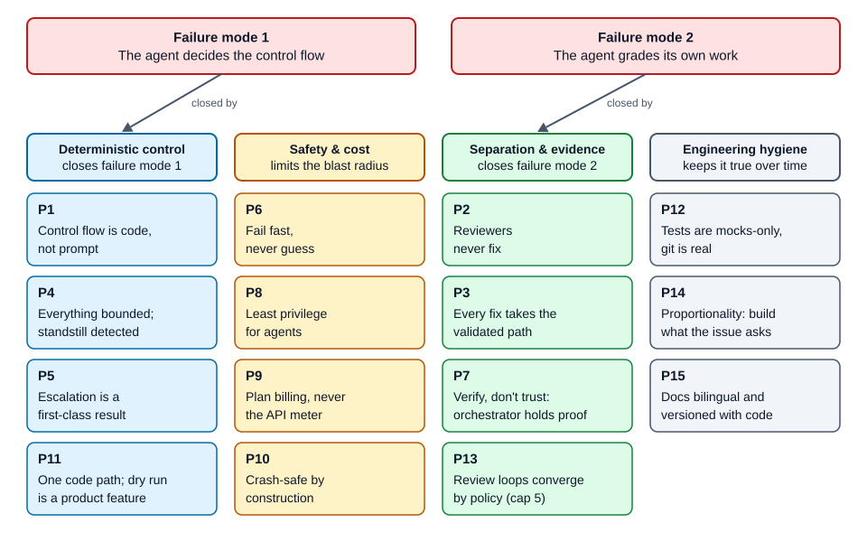
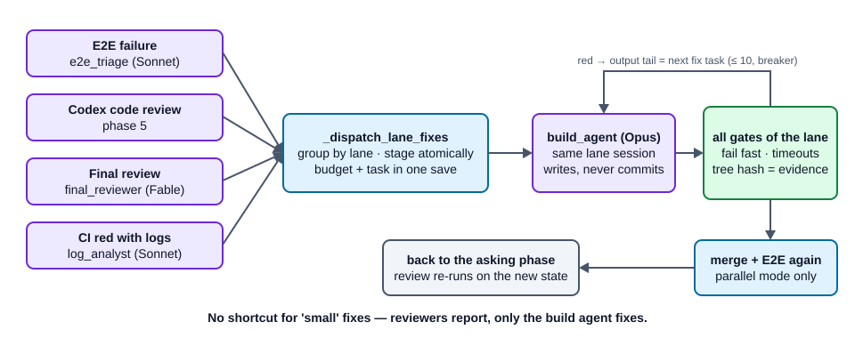
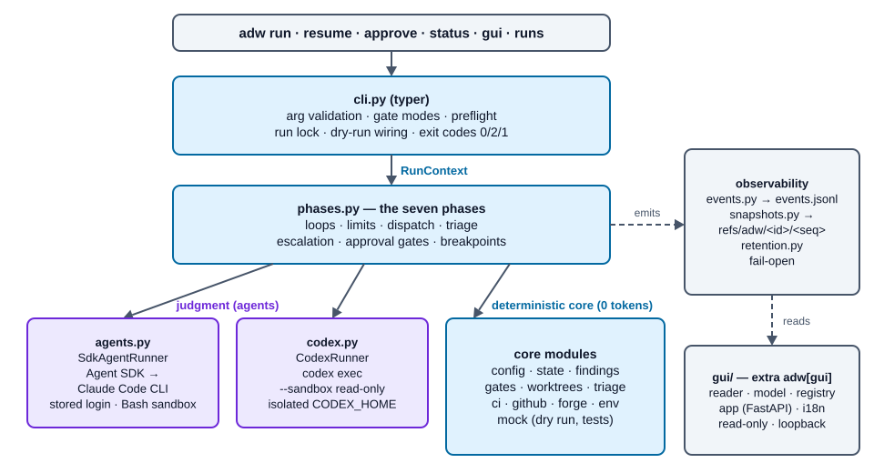
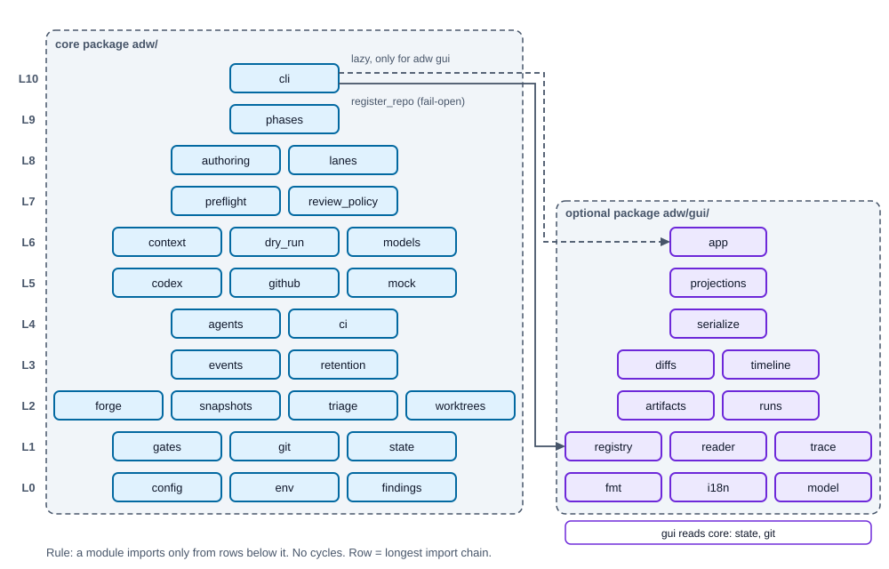
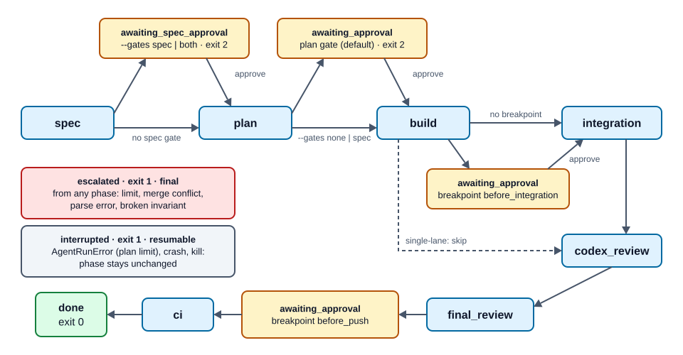
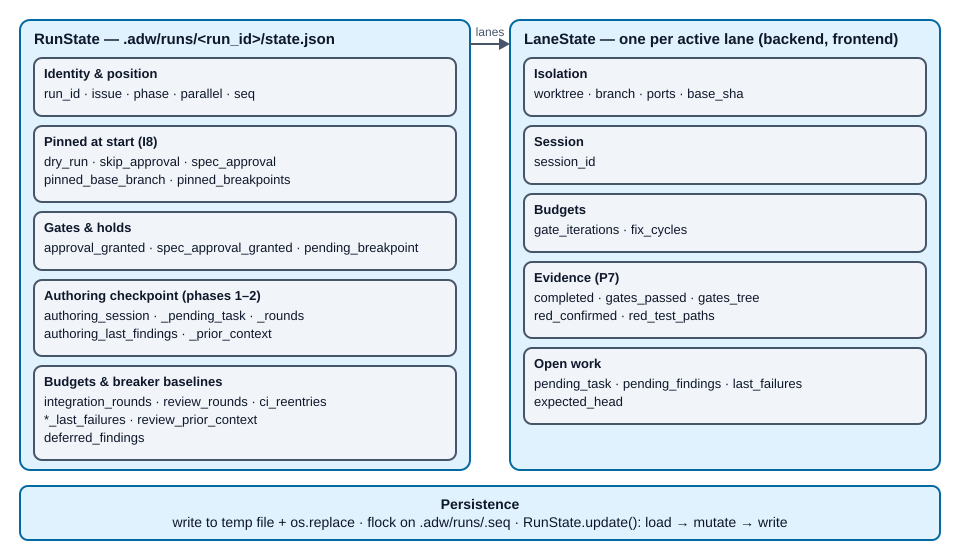
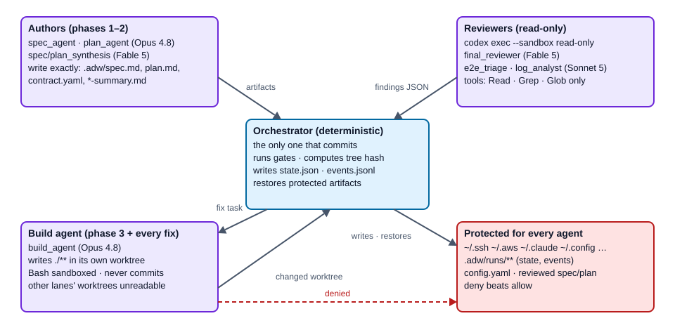
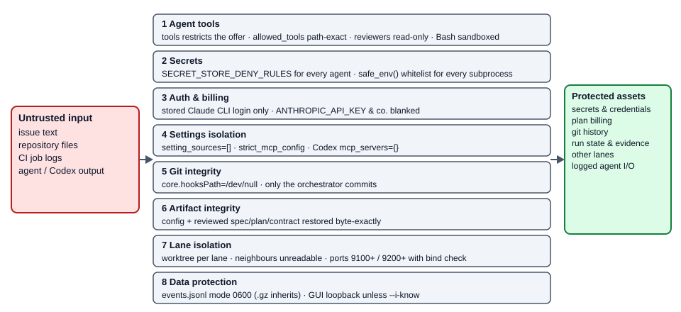

# ADW Specification — Philosophy, Architecture, Contracts

**English** | [Deutsch](ADW-SPEC.de.md)

> **Audience:** contributors to the ADW orchestrator — people who change `adw/`,
> review changes to it, or need to know *why* it is built the way it is.
> **As of:** version 0.26.1 (2026-10-11).
> **Companion documents:** [ADW Workflow](ADW-WORKFLOW.md) (the seven phases in
> depth, for users and contributors) · [ADW Handbook](ADW-HANDBOOK.md) (operating
> ADW as a developer).

## How this document relates to the others

| Document | Role | Status |
| --- | --- | --- |
| [`docs/SPEC.md`](SPEC.md) | The **original target specification** with the Definition of Done (§8) that the acceptance tests (`tests/test_e2e_dry_run.py`) map. It defines *what ADW must do*. | Normative. Changes to target behaviour land there first. |
| [`docs/PLAN.md`](PLAN.md) | The **implementation plan** of the 0.1.0 core (Tasks 0–13). | Historical — the plan was executed; it is not maintained as the code evolves. |
| [`docs/GUI-SPEC.md`](GUI-SPEC.md) | Normative specification of the event log, snapshots, retention and the Run Inspector GUI. | Normative for everything under `adw/gui/`, `events.py`, `snapshots.py`, `retention.py`. |
| **This document** | The **as-built specification**: the philosophy behind the design, the architecture as it stands at 0.26.1, the data contracts, invariants and extension points. | Descriptive, verified against the code. Where it and `SPEC.md` disagree, the code is the fact and `SPEC.md` is the intent — file the gap. |
| [`CHANGELOG.md`](../CHANGELOG.md) | What changed, per release. | Maintained with every push. |
| [`docs/FOLLOWUPS.md`](FOLLOWUPS.md) | Register of open follow-up findings from ADW runs. | Maintained by hand. |
| [`docs/briefs/`](briefs/README.md) | Issue briefs that ran through ADW without escalation — a template for writing new ones. | Reference. |

---

# Part I — Philosophy

ADW exists because agentic coding fails in two predictable ways: the agent
*decides the control flow* (and loops, skips checks, or declares victory), and the
agent *grades its own work*. Every principle below closes one of those doors. Each
one is stated as a rule, followed by the reason and the place in the code that
enforces it — a principle that no code enforces is only a wish.



## P1 — Control flow is code, not prompt

**Rule.** Loops, gates, merges, dispatch, triage, limits, approval pauses and CI
polling are deterministic Python. Agents are called only where judgment is needed:
writing a spec or plan, writing code, assessing a review, assigning a failure to a
lane.

**Why.** Repeatable work in a prompt costs tokens, behaves differently every time
and cannot be tested. The same work in Python costs nothing, behaves identically
and is covered by tests. An agent that is told "repeat until the tests pass" can
stop early, loop forever or redefine "pass"; a `while` loop with a counter cannot.

**Enforced by.** `adw/phases.py` owns every loop; agents receive a single task
string and return text. No agent is ever told "now call the next phase".

## P2 — Reviewers never fix

**Rule.** Every reviewer — Codex in phases 1, 2 and 5, the final reviewer in
phase 6, the E2E triage agent, the CI log analyst — is read-only and answers only
with Findings. Fixes are always done by the build agent of the affected lane.

**Why.** A reviewer that fixes "just the trivial thing" bypasses exactly the
checks that should have caught its mistake, and it marks its own homework. Keeping
the roles apart also keeps the reviewer honest: it has no stake in the code being
fine.

**Enforced by.** The agent registry (`adw/agents.py`) gives every reviewer
`READ_ONLY_TOOLS` (Read/Grep/Glob) and no write rule; Codex runs with
`--sandbox read-only`.

## P3 — Every fix takes the validated path

**Rule.** A fix from any source (gate failure, E2E, Codex review, final review,
CI) goes through the build agent, then through **all** gates of the lane — and in
parallel mode again through merge + E2E. There is no shortcut for small fixes.

**Why.** "Small" is the agent's opinion, not a measurement. The cost of re-running
the gates is seconds to minutes; the cost of an unchecked fix reaching the push is
a red pipeline or worse.

**Enforced by.** `_dispatch_lane_fixes` is the single fix-routing function; it
always ends in `_run_lane` (the gate loop). The review phases obtain their worktree
through `_integration_loop`, so a review fix re-enters merge + E2E.



## P4 — Everything is bounded, and standstill is detected

**Rule.** Every loop has a hard, persisted limit. In addition a circuit breaker
stops a loop as soon as a round produces exactly the same failure set as the round
before.

**Why.** An unbounded agent loop is the most expensive failure mode there is.
Limits that live only in memory are reset by a crash, so they must be persisted
with the work they guard. The circuit breaker catches the cheaper-to-detect case —
"nothing changed" — long before the limit is spent.

**Enforced by.** `adw/triage.py` (`check_gate_iterations`, `check_fix_cycles`,
`check_progress`) and the round counters in `RunState`/`LaneState`. Limit checks run
*before* the expensive work, never after.

## P5 — Escalation is a first-class result

**Rule.** An exhausted limit, a merge conflict, an unparseable reviewer answer or a
broken invariant ends the run in a controlled way: `escalation.md` +
`phase=escalated` + exit 1. Escalated runs are final.

**Why.** An orchestrator that "somehow keeps going" produces expensive garbage. A
human gets the state reached and the concrete reason and decides.

**Enforced by.** `escalate()` in `phases.py`; `adw resume` refuses escalated runs.

## P6 — Fail fast, never guess

**Rule.** A missing or invalid config aborts before anything starts; there are no
guessed defaults for project knowledge (gates, branches, lanes). Parsers accept
exactly one well-defined shape and reject everything else.

**Why.** Silent defaults produce silent misbehaviour, and a tolerant parser accepts
a stale or fabricated `ok` when in doubt. A parse error is safe (escalation); a
false `ok` ships broken code.

**Enforced by.** `AdwConfig.load` (strict YAML loader rejecting duplicate keys,
pydantic with `extra="forbid"`); `extract_review_result` (whole-object JSON or the
last ```` ```json ```` fence, nothing else).

## P7 — Verify, don't trust: the orchestrator holds the evidence

**Rule.** Every claim an agent could make about its own work is instead proven by
the orchestrator and persisted in orchestrator-owned state: gates green
(`gates_passed` + `gates_tree` hash), RED proven (`red_confirmed` +
`red_test_paths`), HEAD unchanged (`expected_head`), branch unchanged. **Only the
orchestrator commits.**

**Why.** An agent-written commit message, flag or report is agent-falsifiable. A
tree hash computed by the orchestrator binds "the gates were green" to exactly the
content that was checked. The same reasoning rejects per-task self-reporting in
the trace (`docs/SPEC.md` §6).

**Enforced by.** `_worktree_tree_hash`, `_require_no_agent_commit`,
`_require_lane_branch`, `_require_expected_head`, `_commit_lane` in `phases.py`.

## P8 — Least privilege for agents

**Rule.** Each agent gets the smallest tool set and the narrowest path rules that
let it do its job. Secret stores are deny-listed for everyone, run state is
unwritable for everyone, neighbouring lanes are unreadable, Bash is sandboxed.
Subprocesses inherit only a whitelisted environment.

**Why.** Agents read untrusted content (issue text, repository files, CI logs).
Whatever an injected instruction could make them do, the tool boundary limits the
damage.

**Enforced by.** `AgentSpec.tools` (restricts what is offered) +
`allowed_tools` (artifact-exact path rules), `SECRET_STORE_DENY_RULES`,
`sandbox_bash`, `deny_read_paths` per lane, `safe_env()`; protected artifacts are
restored byte-exactly after every agent run.

## P9 — Plan billing, never the API meter

**Rule.** ADW talks to Claude only through the Claude Code CLI (spawned headless by
the Agent SDK) with the stored login. API-key environment variables are actively
blanked. An agent call that fails — typically an exhausted plan window — leaves the
run at its checkpoint **without escalating**; `adw resume` continues after the
reset.

**Why.** Cost control by construction instead of by discipline: an accidental
token-by-token API drain is technically impossible. The price is an availability
risk, which the crash-resume design covers anyway.

**Enforced by.** `_require_stored_login()` and the env overrides in
`adw/agents.py`; the `AgentRunError` branch in `cli._execute`.

## P10 — Crash-safe by construction

**Rule.** Every transition and every open piece of feedback is checkpointed
atomically. Budget increments are persisted in the *same* save as the work that
justifies them. State that is cheap to rebuild (the integration branch, review
worktrees) is thrown away and rebuilt instead of interpreted.

**Why.** Real runs take hours, hit plan limits and get killed. Interpreting a
half-merged or half-written state correctly is error-prone; rebuilding it
deterministically is cheap and provably correct.

**Enforced by.** `RunState.save/update` (tmp + `os.replace`, `flock`), the
`mutate_staged` hook in `_dispatch_lane_fixes`, `_fresh_integration_worktree`,
`_resume_pending_lanes`.

## P11 — One code path; the dry run is a product feature

**Rule.** Single-lane mode is parallel mode with one lane — there is one code path
and one CLI. `--dry-run` injects mocks into the *production* code path, including
canonical failure fixtures (a gate that only turns green on the second attempt, an
E2E failure resolved by a triaged lane fix).

**Why.** Two code paths drift apart. A dry run that exercises the real control flow
lets a user accept a config and the whole flow at 0 tokens, and gives the
acceptance tests something real to test.

**Enforced by.** `RunContext` as the dependency-injection root (all contact with
the outside world goes through it); `cli._dry_run_runners/_dry_run_glab/_dry_run_gh`.

## P12 — Tests are mocks-only, git is real

**Rule.** No test needs the network or tokens. Agents, Codex, `glab` and `gh` are
mocked at their interfaces; **git is real** (throwaway repos in `tmp_path`).
Development is test-first: a red test before every behaviour change, and a
regression test for every bugfix.

**Why.** The orchestrator's hardest guarantees are about git state, crash windows
and worktrees — mocking git would test the mock. The external services are where
the cost and the flakiness are.

**Enforced by.** `adw/mock.py` (`MockAgentRunner`, `MockCodexRunner`); the
injectable `run_glab`/`run_gh`/`sleep` seams; a JS harness that drives the served
`app.js` in plain `node` for the GUI.

## P13 — Review loops converge by policy: descending severity, findings memory, cap 5

**Rule.** Every Codex review loop — authoring (spec/plan) and code review — follows
the same policy:

| Round | Findings acted on | Others |
| --- | --- | --- |
| 1 | P1, P2, P3 | — |
| 2 | P1, P2 | P3 → known limitations / follow-ups |
| ≥ 3 | P1 only | P2, P3 → known limitations / follow-ups |
| cap 5 | open P1 → escalation | everything else accepted and documented |

From round 2 on, Codex receives the previous rounds' findings **with their
disposition** (fixed / rejected + reason / below threshold) so settled points are
not re-reported.

**Why.** Without this policy the loop does not converge on orchestration code: a
deterministic reviewer finds an unbounded supply of edge cases at the lowest
severity, and without memory it oscillates between "too strict" and "too lenient".
The same policy is the contributor's own per-commit review rule — ADW and its
developers deliberately run the same loop.

**Enforced by.** `_actionable_severities`, `_split_by_severity`,
`_severity_context`, `AUTHORING_MAX_ROUNDS = 5`, `MAX_REVIEW_ROUNDS = 5` in
`phases.py`; dispositions persisted in `authoring_prior_context` /
`review_prior_context`.

## P14 — Proportionality: build what the issue asks for

**Rule.** The spec and plan authors are bound by a proportionality rule: every
acceptance criterion must trace back to the issue; process requirements (commit
messages, branch topology, git history) do not belong in a spec. Scope gaps found
at the end become follow-ups, not new work.

**Why.** Two strong authors plus a strict reviewer naturally inflate scope. The
counterweight has to be written into the prompts of *both* authors and the
synthesis, or the synthesis undoes it.

**Enforced by.** `_SPEC_CONTENT_RULES` / `_PLAN_CONTENT_RULES` — one shared
constant each, used by the Claude author, the synthesis agent and the Codex author
prompts; `scope_gap` triage into `followups.md`.

## P15 — Documentation is bilingual and versioned with the code

**Rule.** All docs exist in English (default, no suffix) and German (`.de.`
before the extension), kept in sync, with a language switcher under the H1. Every
push to `main` is a release with a version bump, a changelog entry in both
languages and a tag (see §18).

**Why.** The users and contributors work in both languages; a doc that exists in
only one silently goes stale in the other. Releases per push keep "which version
introduced this?" answerable.

---

# Part II — Technical specification (as built, 0.26.1)

## 1. Architecture and module map



| Module | Lines | Responsibility |
| --- | ---: | --- |
| `adw/cli.py` | 1235 | typer entry point: `run`, `resume`, `approve`, `status`, `gui`, `runs list`, `runs prune`. Gate-mode resolution (`--gates` vs. legacy flags), issue intake (text, `glab`, `gh`), forge preflight, working-tree preflight with self-heal, per-run execution lock, run span, dry-run wiring, auto-prune. |
| `adw/phases.py` | 2674 | The seven phases over a `RunContext`: draft stage, synthesis, authoring loop, approval and breakpoint gates, lane gate loop incl. RED stage, integration + E2E, Codex review, final review + triage, push + CI. All limits, dispatch and escalation. |
| `adw/agents.py` | 595 | Agent registry (`REGISTRY`, `AgentSpec`), shared content rules, deny rules, `SdkAgentRunner` (stored-login enforcement, env sanitizing, sandbox, stream mirroring into the event log), `RunTotals`. |
| `adw/codex.py` | 473 | `CodexRunner`: `review()` and `author()` via `codex exec -m gpt-6-astra --sandbox read-only`, isolated `CODEX_HOME`, marker-block protocol with per-call nonce, process-group kill, token back-sync. |
| `adw/findings.py` | 223 | `Finding`, `ReviewResult`, `SCHEMA_INSTRUCTION` (one shared constant), strict parser `extract_review_result`. |
| `adw/config.py` | 154 | `.adw/config.yaml` schema and loader (`AdwConfig`, `Gate`, `LaneConfig`, `E2eConfig`, `CiConfig`, `CodexConfig`, `TraceConfig`, `BreakpointName`). |
| `adw/state.py` | 289 | `RunState`, `LaneState`, `Phase`; atomic persistence, transactions, monotonic sequence, `find_latest`. |
| `adw/gates.py` | 187 | Gate runner: subprocess per gate with real timeout, process-group kill, bounded output tail (200 lines × max. 4 KiB), `gate` spans. |
| `adw/worktrees.py` | 219 | Lane worktrees (idempotent, ready marker, recovery from partial adds, serialized mutations), lane branches `adw/<run_id>/<lane>`, deterministic ports with bind check, self-ignoring `.adw/runs/.gitignore`. |
| `adw/triage.py` | 95 | Pure functions: final-review triage (`scope_gap` → follow-up, rest → lane fixes), limit checks, circuit breaker. |
| `adw/ci.py` | 207 | GitLab: SHA-bound pipeline polling via `glab api`, failed-job log retrieval. |
| `adw/github.py` | 172 | GitHub Actions: SHA-bound workflow-run polling via `gh api`, `--log-failed` excerpts. Same `CiResult` and error classes as `ci.py`. |
| `adw/forge.py` | 82 | GitLab vs. GitHub: `ci.provider` override, otherwise hostname of the `origin` URL; unknown host → `ForgeError`: the CLI forge preflight refuses the command; phase 7 escalates only if origin/config changed mid-run (dry run: falls back to GitLab). |
| `adw/env.py` | 39 | `safe_env()`: environment whitelist for every subprocess. |
| `adw/events.py` | 371 | `EventEmitter`/`NoOpEmitter`: append-only JSON Lines event log with spans, per-run seq, `flock`, file mode 0600, **fail-open**. |
| `adw/snapshots.py` | 133 | Per-step worktree snapshots as git refs `refs/adw/<run_id>/<seq>` (temporary index, `commit-tree`, `update-ref`), fail-open. |
| `adw/retention.py` | 477 | Run enumeration, canonical dating, pruning (worktrees → refs → directory), `--gzip` compression of event logs. |
| `adw/mock.py` | 209 | `MockAgentRunner`, `MockCodexRunner`: scriptable response queues, simulated file writes, call recording. |
| `adw/gui/reader.py` | 131 | Incremental, fault-tolerant event-log reader (also `.jsonl.gz`), reports `seq_gap`/`bad_line`. |
| `adw/gui/model.py` | 224 | Span tree from event records; orphans from worker threads re-homed by time containment. |
| `adw/gui/registry.py` | 203 | `~/.adw/repos.json`: canonical repo path → stable slug; `adw run` registers automatically (fail-open). |
| `adw/gui/app.py` | 3073 | Read-only FastAPI app: run list, run detail (Trace/Timeline/Artifacts/Raw), JSON API, SSE live tail, diff endpoint with ref allowlist. |
| `adw/gui/i18n.py` | 353 | Dictionary-based EN/DE chrome translation; content is never translated. |
| `adw/gui/templates/`, `static/` | — | Jinja2 templates, `app.css` (token system, dark mode), `app.js` (no framework). |



### 1.1 `RunContext` — the dependency-injection root

`RunContext` (dataclass in `phases.py`) carries everything a phase needs: `repo`,
`config`, `state`, the two runner interfaces (`agents: AgentRunner`,
`codex: CodexClient`), the seams `run_glab`, `run_gh`, `sleep`, the run's single
`emitter`, the pinned flags `skip_approval`, `spec_approval`, `dry_run`, a
`git_env`, and a `threading.RLock` (`state_lock`) that serializes state mutations
across parallel lane threads. `ctx.save()` persists the state and mirrors a
`state.saved` event *after* the write succeeded.

Because every contact with the outside world goes through this object, the same
production code runs against mocks in `--dry-run` and in the test suite.

### 1.2 The two judgment interfaces

```python
class AgentRunner(Protocol):
    def run(self, agent: AgentSpec, task: str, cwd: Path, resume: str | None = None,
            deny_read_paths: list[str] | None = None, emitter=None, span=None,
            on_session_id=None) -> AgentResult: ...          # AgentResult(text, session_id)

class CodexClient(Protocol):
    def review(self, kind, content_refs, cwd, context=None, emitter=None, span=None) -> ReviewResult: ...
    def author(self, kind, task, cwd, marker_id=None, emitter=None, span=None) -> dict[str, str]: ...
                                                     # file name → content; kind: spec | plan
```

`on_session_id` lets the runner report the SDK session id the moment it appears in
the stream, so a crash mid-run still leaves a resumable session in the state.

## 2. State machine



- `Phase` is a closed `Literal` in `state.py`: `spec`, `awaiting_spec_approval`,
  `plan`, `awaiting_approval`, `build`, `integration`, `codex_review`,
  `final_review`, `ci`, `done`, `escalated`.
- **Breakpoints** (`before_integration`, `before_push`) reuse
  `awaiting_approval`; which one waits is recorded in `pending_breakpoint` — not a
  new phase value. They pause only when enabled in the config and approval is not
  skipped (`--gates none` skips them too).
- `cli._execute` always calls the complete phase chain; each phase function checks
  `ctx.state.phase` itself and returns immediately when it is not its turn. A resume
  therefore starts in the right phase without a dispatcher.
- **Exit codes:** `0` done · `2` awaiting approval (gate or breakpoint) · `1`
  escalation, refusal, or interrupted agent call (the message distinguishes them).

## 3. Phase control flow (summary)

The phases are explained step by step in [ADW Workflow](ADW-WORKFLOW.md). The
contracts a contributor must preserve:

| Phase | Function | Contract |
| --- | --- | --- |
| 1–2 Spec, Plan | `run_spec_and_plan` → `_draft_stage`, `_reviewed_authoring_loop` | Claude author (Opus) and Codex author write drafts in parallel to `.adw/runs/<id>/drafts/`; idempotent over the files; a Codex failure degrades (marker `<kind>.codex.FAILED`), a missing Claude draft escalates. The synthesis agent (Fable) is round 1 of the authoring loop and also writes the gate summary. Loop: Codex review → findings to the *same* session → P13 policy, cap 5. Protected files restored after every run; artifacts archived to the run dir, the checkout reset. |
| Gates | `cli._execute` / `cli.approve` | Spec gate (optional), plan gate (default), persisted in state; `awaited` / `granted` approval events. |
| 3 Build | `run_build_phase` → `_run_lane` | Per lane: worktree, seed artifacts + orchestrator commit, optional RED stage (`_confirm_red`), gate loop (limit → checkpoint → agent → invariants → restore → gates), evidence with tree hash, orchestrator commit. Lanes run in a thread pool under `--parallel`. |
| Breakpoint | `_breakpoint_gate("before_integration")` | Hold after all lanes are green. |
| 4 Integration | `run_integration_phase` → `_integration_loop` | Integration branch rebuilt fresh every round from the base branch; merge conflict → abort + escalation; E2E gate with both lanes' ports; red → triage agent → lane fixes → re-integrate. Parallel mode only. |
| 5 Codex review | `run_codex_review_phase` | `_resume_pending_lanes` first (no ungated state reaches a review); limit check before dispatch; circuit breaker on the actionable finding set; P13 policy; dropped findings → `followups.md`. |
| 6 Final review | `run_final_review_phase` | Fable, read-only, mandatory `category`; `triage_final_review` routes `scope_gap` → follow-ups, others → fix cycles (max. 3 per lane); cycle increment persisted with the staged fix. |
| Breakpoint | `_breakpoint_gate("before_push")` | Hold before any push/CI work. |
| 7 CI | `run_ci_phase` | `git push --force-with-lease -u origin <branch>` (integration branch in parallel mode, lane branch otherwise; skipped in dry run); SHA-bound polling; red with logs → log analyst → exactly one re-entry; red without logs → escalation. |

## 4. Data model

### 4.1 Target-repo config — `.adw/config.yaml`

Loaded by `AdwConfig.load(repo)`. Strict: duplicate YAML keys, unknown keys
(`extra="forbid"`), blank strings, non-positive timeouts and non-boolean `tdd`
values are a `ConfigError` before anything runs.

| Key | Type / default | Meaning |
| --- | --- | --- |
| `base_branch` | str, required | Branch lanes fork from; diffs run against it. |
| `lanes` | `{backend|frontend: {gates: [...]}}`, ≥ 1 lane | `LaneName` is the closed literal `backend`/`frontend`. `--parallel` requires both. |
| `lanes.<l>.gates[]` | `name`, `cmd`, `timeout` (s), `tdd` (bool, false) | Run in order, fail fast. `tdd: true` marks a gate for the RED proof. |
| `e2e` | `cmd`, `timeout` | E2E command, used in parallel mode. |
| `ci` | `poll_interval` 60, `timeout` 2700, `staging_job` null, `provider` null | Polling; `provider` overrides origin-URL detection. |
| `codex` | `timeout` 900 | Limit of every `codex exec` subprocess (author and review). |
| `trace` | `enabled` true, `keep_runs` 20 | Event log on/off; auto-prune after a successful run (0 = never). |
| `breakpoints` | list of `before_integration`/`before_push`, empty | Additional human holds. Pinned at run start. |

### 4.2 `RunState` and `LaneState`

Persisted as `.adw/runs/<run_id>/state.json`. `run_id` is 8 hex characters.



| Field | Level | Purpose |
| --- | --- | --- |
| `run_id`, `issue`, `phase`, `parallel` | run | Identity and position. |
| `dry_run`, `skip_approval`, `spec_approval` | run | CLI decisions the resume invocation no longer knows. |
| `approval_granted`, `spec_approval_granted` | run | Gate grants. |
| `pending_breakpoint`, `pinned_breakpoints` | run | Which breakpoint waits; the breakpoint set pinned at start (`None` = legacy state, follows config). |
| `pinned_base_branch` | run | Effective base branch pinned at start; cannot change once lanes exist. |
| `authoring_session`, `authoring_pending_task`, `authoring_last_findings`, `authoring_rounds`, `authoring_prior_context` | run | Checkpoint of the spec/plan authoring loop. |
| `integration_rounds`, `integration_last_failures` | run | E2E budget and circuit-breaker baseline. |
| `review_rounds`, `review_last_failures`, `review_prior_context` | run | Codex code-review budget, baseline, findings memory. |
| `final_review_last_failures` | run | Circuit-breaker baseline of phase 6. |
| `deferred_findings` | run | Finding keys a fix run proved unactionable (pure P3); never trigger another fix or the breaker. |
| `ci_reentries` | run | CI re-entry budget. |
| `seq` | run | Monotonic save sequence used by `find_latest`. |
| `lanes.<l>.worktree`, `branch`, `ports`, `base_sha` | lane | Isolation; `base_sha` is the pinned fork point. |
| `session_id` | lane | SDK session for session resume. |
| `gate_iterations`, `fix_cycles` | lane | Budgets. |
| `completed`, `gates_passed`, `gates_tree` | lane | Evidence; `gates_tree` binds green gates to a tree hash. |
| `red_confirmed`, `red_test_paths` | lane | RED proof and the tests that delivered it. |
| `pending_task`, `last_failures`, `pending_findings` | lane | Open fix task, breaker baseline, findings of the staged fix. |
| `expected_head` | lane | HEAD at the last checkpoint — detects foreign commits across a crash window. |

**Persistence mechanics.** Snapshot to a temp file + `os.replace` (no half-written
state ever exists); exclusive `flock` on `.adw/runs/.seq` around every write;
`RunState.update()` gives lane threads a load → mutate → write transaction; a
corrupt `.seq` is reconstructed from the persisted states.

### 4.3 Findings — the one reviewer contract

Every reviewer (Codex, final reviewer, E2E triage, log analyst) answers in the same
schema, embedded via the shared constant `SCHEMA_INSTRUCTION`:

```json
{
  "verdict": "ok | needs_fixes",
  "findings": [{
    "severity": "P1 | P2 | P3",
    "lane": "frontend | backend | unknown",
    "file": "path/relative/to/repo",
    "issue": "description",
    "remediation_plan": ["step 1", "step 2"],
    "category": "scope_gap | implementation | trivial"
  }]
}
```

- `extra="forbid"`; `ok` only with an empty list, `needs_fixes` with ≥ 1 finding.
- `category` is mandatory for the final reviewer (missing → escalation, no silent
  default), optional elsewhere.
- The parser accepts **only** a whole-JSON answer or the content of the **last**
  ```` ```json ```` fence. Duplicate keys, nesting > 100 and integers > 100 digits
  fail closed in linear time. Schema violations (`ValidationError`) escalate like
  parse errors.
- A finding's identity for the circuit breaker, deferral and dispositions is the key
  `"<file>|<issue>"`.
- A lane value that is `unknown` or not active in this run is dispatched to **all**
  active lanes — better checked twice than lost.

### 4.4 Run artifacts and directory layout

```
<target-repo>/
  .adw/
    config.yaml                     project config (protected, restored after agent runs)
    issue.md  spec.md  plan.md  contract.yaml  spec-summary.md  plan-summary.md
                                    authoring artifacts in the checkout during phases 1–2;
                                    reset afterwards; the only files the preflight self-heals
    runs/
      .gitignore                    "*" — run data never shows in git status
      .seq                          save-sequence lock/counter
      .lock-<run_id>                per-run execution lock (resume/approve)
      <run_id>/
        state.json                  RunState
        events.jsonl[.gz]           event log (mode 0600)
        drafts/                     <artifact>.claude.<ext>, <artifact>.codex.<ext>, *.codex.FAILED
        spec.md plan.md contract.yaml spec-summary.md plan-summary.md   archived artifacts
        authoring-<kind>-known-findings.md   findings accepted at threshold/cap
        followups.md                scope gaps, below-threshold and deferred findings
        escalation.md               only when escalated
        trees/<lane>/               lane worktrees (+ trees/integration in parallel mode)
  refs/adw/<run_id>/<seq>           snapshot refs (in the git object store)
  branches adw/<run_id>/<lane>      lane and integration branches
```

`contract.yaml` is the interface contract between lanes (OpenAPI/types/events). Its
top-level `x-adw-*` blocks (e.g. a declared scope) are shown by the GUI next to the
actual change scope — without any automatic verdict.

### 4.5 Event log

`.adw/runs/<run_id>/events.jsonl`, one JSON object per line:

```json
{"seq": 17, "ts": "2026-09-13T10:02:03.123Z", "type": "gate", "kind": "start|end|point",
 "span": "<id>", "parent": "<id|null>", "phase": "build", "lane": "backend",
 "round": null, "payload": {...}}
```

- **Span types:** `run`, `phase`, `lane`, `round`, `agent.run`, `gate`,
  `codex.review`, `codex.author`, `ci.wait`.
- **Point types:** `agent.message`, `agent.tool.call`, `agent.tool.result`,
  `snapshot`, `red.check`, `commit`, `merge`, `ci.poll`, `ci.reentry`,
  `triage.decision`, `limit.hit`, `circuit_breaker`, `escalation`, `approval`,
  `artifact`, `followup`, `state.saved`, `log`.
- Payloads are specified in [`GUI-SPEC.md` §4.4](GUI-SPEC.md). `agent.run` start
  carries the full prompt; the log therefore contains **unredacted** agent input and
  output and is created with mode 0600.
- **Fail-open is the defining invariant:** no emitter error (disk full,
  permissions, unserializable payload) ever reaches the caller. On the first
  internal error the emitter warns once and disables itself for that run.
  `state.json` — not the event log — is the resume authority, so `fsync` is
  deliberately not issued.
- `seq` is assigned under `flock` across processes; a crash-truncated tail line is
  healed by starting the next record on a fresh line.
- Spans opened in worker threads (parallel lanes, the draft pool) carry
  `parent: null`; the GUI model re-homes them by time containment.

### 4.6 Snapshots

At every step boundary of a lane (`before_agent`, `after_agent`, `after_gates`,
`red`) `snapshots.capture()` builds a tree over a temporary index, creates a commit
object with `commit-tree -p <base_sha>` and pins it as `refs/adw/<run_id>/<seq>`,
then emits a `snapshot` event. The GUI computes step diffs lazily from these refs;
no diff is ever written into the log. Fail-open like the emitter.

## 5. Agent registry

Each agent is a frozen `AgentSpec(name, model, tools, allowed_tools, system_append,
permission_mode="default", sandbox_bash=False)`. `tools` **restricts** what the
agent is offered at all; `allowed_tools` approves (path-scoped). Both are needed.



| Agent | Model | Tools | Write rules | Mission |
| --- | --- | --- | --- | --- |
| `spec_agent` | Opus 5.5 | Read/Grep/Glob/Write/Edit | `.adw/spec.md` | Spec draft (goal, scope, non-goals, acceptance criteria, DoD) |
| `plan_agent` | Opus 5.5 | same | `.adw/plan.md`, `.adw/contract.yaml` | Plan draft with `## Workstream:` sections + contract |
| `spec_synthesis` | Fable 5.1 | same | `.adw/spec.md`, `.adw/spec-summary.md` | Best-of merge of both drafts + gate summary |
| `plan_synthesis` | Fable 5.1 | same | `.adw/plan.md`, `.adw/contract.yaml`, `.adw/plan-summary.md` | Best-of merge + gate summary |
| `build_agent` | Opus 5.5 | + Bash (sandboxed) | `./**` (worktree-relative) | Implements its workstream against the contract, TDD; does not commit; may deviate from fix plans with justification |
| `e2e_triage` | Sonnet 5.5 | Read/Grep/Glob | — | Assigns E2E failures to lanes; findings JSON only |
| `log_analyst` | Sonnet 5.5 | Read/Grep/Glob | — | CI logs → findings with lane; findings JSON only |
| `final_reviewer` | Fable 5.1 | Read/Grep/Glob | — | Implementation vs. spec; findings with mandatory `category` |

Model ids are constants in `agents.py`: `FABLE = "claude-fable-5-1"`,
`OPUS = "claude-opus-5-5"`, `SONNET = "claude-sonnet-5-5"`. Codex is pinned in
`codex.py`: `CODEX_MODEL = "gpt-6-astra"` (passed as `-m`; the isolated
`CODEX_HOME` has no `config.toml`, so without it codex would use its built-in default).

**Model economics.** Opus does the volume work (drafts, build — many turns, the
cheaper per-token tier). Fable, the most capable model, is reserved for judgment:
merging the drafts and the final review. Sonnet does assembly-line triage.

**Shared prompt constants.** `_SPEC_CONTENT_RULES`, `_PLAN_CONTENT_RULES`,
`_BEST_OF_MERGE_RULES`, `_SUMMARY_FORMAT_RULES` exist once and are reused by every
agent that needs them, including the Codex author prompts — if they drifted, the
synthesis would undo the author's proportionality counterweight.

**Rules every agent gets.**
- Read rules are scoped to the cwd (`Read(./**)`, …).
- Write rules are **artifact-exact** (`Write(.adw/spec.md)`, never `.adw/**`, which
  would make `state.json` writable).
- `SECRET_STORE_DENY_RULES`: `~/.ssh`, `~/.aws`, `~/.claude`, `~/.gnupg`,
  `~/.config`, `~/.docker`, `~/.kube`, `~/.azure`, `~/.codex`, credential files and
  shell start-up/history files are unreadable; `.adw/runs/**` is unwritable. Deny
  beats allow. Each store is listed both as a glob and as a plain directory because
  the Linux sandbox ignores glob-only denies.
- Under `--parallel`, each lane gets the other lanes' worktrees as
  `deny_read_paths`.

**`SdkAgentRunner`.** Builds `ClaudeAgentOptions` with the `claude_code` system
prompt preset + `system_append`, `cwd`, `resume`, `setting_sources=[]` and
`strict_mcp_config=True` (no repo-controlled hooks, settings or MCP servers), and —
for `sandbox_bash` agents — a sandbox with `allowUnsandboxedCommands: False` and no
excluded commands (git stays sandboxed too). It mirrors assistant text and tool
calls/results into the event log and accumulates cost/tokens in `RunTotals`.

## 6. Gate runner

`run_gates(gates, cwd, extra_env, emitter) → GateReport`:

- Gates run in config order, **fail fast** at the first failure.
- Each gate is a subprocess with `safe_env(extra_env)` (lane ports are passed as
  extra env), the config timeout, `start_new_session=True` and a process-group kill
  on every exit path — no orphaned children.
- Output is collected by pump threads into a RAM-bounded tail: at most 200 lines of
  at most 4 KiB each. That tail is what the build agent sees as the fix task (the
  RED stage shortens it further to 40 lines).
- Each started gate is one `gate` span (`passed`, `exit_code`, `timed_out`,
  `output`).

## 7. Codex integration

`CodexRunner` runs `codex exec -m gpt-6-astra --sandbox read-only -c mcp_servers={} …` as a
subprocess with:

- an **isolated `CODEX_HOME`** — a temp dir containing only a copy of `auth.json`
  from the real home, so user-configured MCP servers and settings stay out. A token
  rotated during the call is synced back via compare-and-swap under `flock`.
- the configured timeout (`codex.timeout`, default 900 s) and a process-group kill.
- bounded stdout (5 MiB tail) / stderr (256 KiB tail) buffers.

**`review(kind, content_refs, cwd, context)`** — `kind` is `spec`, `plan` or `code`;
the prompt embeds `SCHEMA_INSTRUCTION`; the answer is parsed with
`extract_review_result`. From round 2 on, `context` carries the severity floor and
the previous rounds' dispositions.

**`author(kind, task, cwd)`** — the read-only sandbox cannot write, so Codex must
return file contents in marker blocks `===BEGIN <name> <nonce>===` …
`===END <name> <nonce>===` with a fresh nonce per call. Parsing starts from the last
begin marker of the first name; a mere prompt echo yields empty blocks and raises
`CodexAuthorError`. The orchestrator writes the returned content to the drafts
directory.

## 8. CI and forge abstraction

- `forge.detect_forge(repo, override)` → `"gitlab"` | `"github"`: the
  `ci.provider` key wins; otherwise the hostname of the `origin` URL; unknown host →
  `ForgeError`. `cli._preflight_forge` calls it for real `run`/`resume`/`approve`
  and refuses (exit 1, no state change) before any agent runs; phase 7 calls it
  again as a safety net and escalates (no poll against the wrong API). The dry run
  falls back to GitLab.
- **GitLab** (`ci.py`): `glab api projects/:id/pipelines?ref=…&sha=…` — the pipeline
  is queried server-side by the pushed SHA, so neither an older terminal pipeline nor
  a foreign newer one can be mistaken for the one being waited on. Terminal statuses:
  `success`, `failed`, `canceled`, `skipped`. Optional `staging_job` must be green too.
  Failed-job logs are fetched as a 200-line excerpt.
- **GitHub** (`github.py`): all workflow runs of the push SHA
  (`actions/runs?head_sha=…`) until all are completed; green conclusions are
  `success`, `skipped`, `neutral`; red runs deliver `gh run view --log-failed`
  excerpts.
- Both return the same `CiResult` and raise the same `CiError`/`CiTimeoutError`. The
  time budget is tracked as remaining time; the sleep is capped to it. `run_glab` /
  `run_gh` / `sleep` are injectable seams with 120 s subprocess timeouts.
- **To add a forge:** implement a `poll_ci(repo, branch, cfg, run_x, sha, emitter)`
  returning `CiResult`, extend the `Forge` literal and `detect_forge`, add the
  provider value to `CiConfig.provider`, wire it in `run_ci_phase`, add a dry-run
  fake in `cli.py`, and an issue fetcher if the forge has issues.

## 9. Resume, approval and concurrency semantics

- **`adw resume <run_id>`** continues exactly at the persisted checkpoint. It
  refuses escalated runs. It reloads the state under the per-run execution lock,
  resolves the config through `_config_for_continuation` (pinned base branch and
  pinned breakpoints beat the current file; `--base-branch` can only change before
  lanes exist), runs the forge and working-tree preflights, then `_execute`.
- **`adw approve <run_id>`** is valid only in `awaiting_approval` /
  `awaiting_spec_approval`. Under the same lock it reloads and revalidates, so two
  concurrent approvals produce exactly one release and one downstream execution (a
  double push at `before_push` is impossible). A breakpoint release advances the phase
  and clears `pending_breakpoint` in one atomic save; the `granted` event is emitted
  log-checked by `_catch_up_granted_breakpoints`, which closes the crash window
  between save and log append without an extra state field.
- **Working-tree preflight** (`run`, `resume`, `approve`): a clean checkout proceeds;
  a dirty set consisting **only** of the six ADW authoring artifacts is healed from
  `HEAD` (`git checkout HEAD -- <path>`, or index entry dropped + file removed if absent
  from HEAD) and re-checked; any foreign change refuses the command, discarding
  nothing. The preflight never escalates.
- **Forge preflight** (`run`, `resume`, `approve`; real runs only): `detect_forge`
  must succeed, otherwise the command is refused with the `ci.provider` hint —
  no run created, no state change, never an escalation.
- **Interrupted agent calls** (`AgentRunError`) leave the phase unchanged and print a
  resume hint (P9).
- **Session resume:** fix tasks go to the same SDK session (`resume=session_id`); the
  session id is checkpointed as soon as it appears.
- **Revalidation:** before every review phase `_resume_pending_lanes` sends every lane
  through `_run_lane` — unfinished fixes catch up, finished lanes are revalidated
  against `gates_tree`; a lane whose tree no longer matches goes back into the loop.

## 10. Observability, retention and the registry

- **Retention** (`adw runs list`, `adw runs prune [--keep N] [--older-than DAYS]
  [--gzip]`, and auto-prune with `trace.keep_runs` after a run reaches `done`):
  only `done`/`escalated` runs are candidates; a run with uncommitted changes in any
  worktree is skipped and named; deletion order is worktrees (via git's worktree
  management, lane branches survive) → snapshot refs → directory; `--gzip` compresses
  the event log atomically and keeps the run whole. Auto-prune is fail-open: it never
  changes the finished run's phase or exit code.
- **Registry** `~/.adw/repos.json` (version 1): canonical repo path → stable
  URL-safe slug + `last_seen`. Written atomically; `adw run` registers automatically,
  fail-open.

## 11. GUI architecture (Run Inspector)

The GUI is specified normatively in [`docs/GUI-SPEC.md`](GUI-SPEC.md); this section
only fixes the architectural boundaries a core contributor must not break.

- **Optional extra.** FastAPI, uvicorn, Jinja2, markdown-it-py live in the `gui`
  extra. The core `adw run` path never imports them; `adw gui` imports lazily and
  prints an install hint if they are missing.
- **Strictly read-only.** No write route, no external program, reads only below
  `.adw/runs/<run_id>/`, the registry and its packaged assets. Diffs only through an
  explicit ref allowlist.
- **Loopback by default.** A non-loopback `--host` requires `--i-know`, because the
  event log contains unredacted agent output.
- **Layers.** `reader` (incremental, tolerant) → `model` (span tree) → `app`
  (derived views: trace tree, timeline, run context, recovery card, plan skeleton,
  change scope, metrics). Everything shown is *derived* from the event log, the state
  and the artifacts — the GUI adds no event, no persistence and no sidecar file.
- **Robustness guarantee.** A malformed or non-mapping payload never yields a 5xx;
  every read goes through `_as_mapping()` / `_mapping_payload()`.
- **Routes.** `/`, `/runs/{repo}/{run_id}`, and `/api/runs`,
  `/api/runs/{repo}/{run_id}`, `…/events`, `…/diff`, `…/artifacts/{name}`,
  `…/stream` (SSE). JSON API changes are additive only.
- **Contract for core contributors:** if you add an event type or payload field,
  update `GUI-SPEC.md` §4.4 and make sure unknown types still render as generic
  nodes. Never make the emitter or snapshotter able to fail a run.

## 12. Security model



| Layer | Mechanism |
| --- | --- |
| Agent tools | `tools` restricts the offering; `allowed_tools` with artifact-exact path rules; reviewers strictly read-only; build Bash sandboxed, no unsandboxed escape hatch. |
| Secrets | `SECRET_STORE_DENY_RULES` for every agent; `safe_env()` whitelist (`PATH`, `HOME`, `USER`, `SHELL`, `TERM`, `TMPDIR`, `LANG`, `LANGUAGE`, `TZ`, `VIRTUAL_ENV`, `PYTHONPATH`, `NODE_ENV`, `CI`, `CLAUDE_CONFIG_DIR`, `LC_*`) for every subprocess. The SDK merges `os.environ`, so non-whitelisted variables are blanked with `""` overrides. `CODEX_HOME` only reaches the Codex runner. |
| Auth & billing | Stored Claude CLI login only (`_require_stored_login()`, fail fast before tokens flow); `ANTHROPIC_API_KEY` & co. blanked. Codex with isolated `CODEX_HOME`. |
| Settings isolation | `setting_sources=[]`, `strict_mcp_config=True` for agents; `mcp_servers={}` for Codex — the target repo cannot inject hooks, settings or MCP servers. |
| Git integrity | Orchestrator git runs with `core.hooksPath=/dev/null` and the env whitelist. Only the orchestrator commits; agent commits, branch switches and HEAD movement across a crash window are detected and escalate. |
| Artifact integrity | `config.yaml`, and from phase 2 on the reviewed spec (from phase 3 spec/plan/contract), are restored byte-exactly after every agent run; symlink/directory replacements are detected and replaced, never followed. |
| Lane isolation | One worktree per lane, neighbours unreadable, deterministic ports (`backend` 9100–9149, `frontend` 9200–9249, offset from the run id) with bind check. |
| Data protection | Event log mode 0600 and `.gz` inherits it; GUI loopback-only by default. |

## 13. Invariants

Contributors must keep all of these true. Most have dedicated tests.

1. **I1** Only the orchestrator commits. Any commit by an agent escalates.
2. **I2** No state reaches a review, a merge or a push without green gates bound to
   its current tree hash.
3. **I3** Every loop checks its limit *before* doing the expensive work.
4. **I4** Every budget increment is persisted in the same save as the work it pays for.
5. **I5** Circuit-breaker baselines advance only *after* the fix dispatch.
6. **I6** Reviewer output is parsed strictly; any unparseable or schema-violating
   answer escalates — never defaults to `ok`.
7. **I7** Protected artifacts and the config are byte-identical after every agent run.
8. **I8** Run-start decisions (base branch, breakpoints, gate mode, dry run) are pinned
   in the state; a continuation never re-reads them from the CLI or a changed config.
9. **I9** Escalation is final; an interrupted agent call is not an escalation.
10. **I10** The event log, snapshots, registry and auto-prune are fail-open and never
    change a run's outcome.
11. **I11** The preflight never discards foreign changes and never escalates.
12. **I12** The GUI never writes and never returns 5xx for malformed log data.
13. **I13** The core install never imports the web stack.
14. **I14** No subprocess runs without a timeout or with the full environment.

## 14. Limits

| Loop | Limit (constant) | Additionally |
| --- | --- | --- |
| Gate loop per lane | 10 per task (`MAX_GATE_ITERATIONS`, `triage.py`), reset on a new fix task | Circuit breaker; the RED check consumes no iteration |
| Integration / E2E | 10 rounds run-wide (`MAX_E2E_ROUNDS`) | Circuit breaker |
| Authoring loop | 5 rounds per artifact (`AUTHORING_MAX_ROUNDS`) | P13 policy; open P1 at cap → escalation |
| Codex code review | 5 rounds (`MAX_REVIEW_ROUNDS`) | P13 policy; breaker on actionable set |
| Final-review fix cycles | 3 per lane (`MAX_FIX_CYCLES`) | Breaker |
| CI re-entry | 1 (`MAX_CI_REENTRIES`) | Red without logs → immediate escalation |
| RED stage | exactly 1 test-only pass | All marked gates green → escalation |
| Subprocesses | gate timeout from config; Codex 900 s (configurable); `glab`/`gh` 120 s; git 30–120 s; CI budget 2700 s (configurable) | Process-group kill |

## 15. Extension points

| You want to … | Touch | Watch out for |
| --- | --- | --- |
| **Add an agent** | `REGISTRY` in `agents.py`; a call site in `phases.py` via `_agent_run`; a mock response in `cli._dry_run_runners` and tests | Smallest tool set; artifact-exact write rules; reviewers answer in `SCHEMA_INSTRUCTION`; reuse shared prompt constants instead of copying text. |
| **Add a phase** | `Phase` literal in `state.py`; a `run_<x>_phase(ctx)` guarded by `ctx.state.phase` and wrapped in `@_phase_span`; insert into `cli._execute`; transitions in neighbours | Persist every counter before work; add a limit + breaker; update the GUI phase band (`GUI-SPEC.md`) and the dry run; extend `tests/test_e2e_dry_run.py`. |
| **Add a breakpoint** | `BreakpointName` literal in `config.py`; a `_breakpoint_gate(ctx, "<name>")` call; `_breakpoint_resume_phase` in `cli.py` | Reuse `awaiting_approval`; never add a phase value for a hold. |
| **Add a gate type / gate option** | `Gate` model in `config.py`; `gates.py` | Keep fail-fast, real timeouts and `safe_env`. Gates are project knowledge — no defaults. |
| **Add a lane** | `LaneName` in `config.py`, the `lane` literal in `findings.py`, port base in `worktrees.py`, `--parallel` validation | Lanes are a closed set today (`backend`, `frontend`) by design. |
| **Add a forge** | see §8 | Fail fast on unknown hosts; SHA-bound polling. |
| **Add an event type or field** | emit site + `GUI-SPEC.md` §4.4 | Additive only; fail-open; GUI must tolerate unknown types. |
| **Add a config key** | `config.py` model with `extra="forbid"`, `examples/config.yaml`, README config table, handbook | Strict types (`strict=True` for booleans); documented defaults only. |

## 16. Testing strategy and development workflow

- **Suite:** 1278 tests in `tests/` (as of 0.26.1), developed test-first, mocks-only,
  real git. Run with `uv run pytest`. CI (`.github/workflows/ci.yml`) runs
  `uv sync --locked`, `uv run ruff check .`, `uv run pytest -q` with `NO_COLOR=1`.
- **Mock backbone:** `MockAgentRunner` (response queues per agent, file outputs as a
  static map or `Callable(cwd)`, full call recording including `resume` and
  `deny_read_paths`), `MockCodexRunner` (review and author queues).
- **Crash windows:** many phase tests manipulate the state between two checkpoints,
  "kill" the process and resume; others simulate agent misbehaviour (foreign commits,
  symlinked artifacts, rewritten config, deleted tests).
- **Acceptance:** `tests/test_e2e_dry_run.py` maps the DoD of `docs/SPEC.md` §8 —
  full CLI dry runs (single and parallel), gate fail → same-session fix, approval
  gates, triage paths, crash resume, dual authoring, both RED paths.
- **GUI:** FastAPI `TestClient` tests at endpoint level (including the payload
  robustness matrix) and a dependency-free JS harness (`tests/gui_js_harness.js`)
  that drives the served `app.js` in `node` — a missing `node` fails, not skips.
- **Lint:** `uv run ruff check .` (rules E, F, W, I, UP, B; line length 100; py312).
  `ruff format` is **not** enforced — large parts of the tree are not formatted, and
  ADW's own lane config deliberately does not gate on it. Do not use flake8, isort or
  black in this repo.
- **Per-change gate:** red test → implementation → `uv run ruff check .` +
  `uv run pytest` → `codex review --uncommitted`, with the P13 round policy applied by
  hand (note: `--uncommitted` does not accept a custom prompt argument, so the
  dispositions are tracked by the contributor). Fix P1 before committing.
- **ADW on itself:** `.adw/config.yaml` in this repo defines a single `backend` lane
  with `ruff check` and `pytest` (`tdd: true`) gates and GitHub CI. Changes are often
  built by ADW itself — see the briefs in [`docs/briefs/`](briefs/README.md) for how
  to write an issue that converges.

## 17. Technology

| Component | Version | Role |
| --- | --- | --- |
| Python | ≥ 3.12 | Runtime; `uv` for environments and the lock file |
| `pydantic` | ≥ 2 | Config, state, findings |
| `typer` | ≥ 0.12 | CLI |
| `pyyaml` | ≥ 6 | Config, with a strict loader |
| `claude-agent-sdk` | ≥ 0.2.118 | Spawns the Claude Code CLI headless; lower bound for `tools`, `setting_sources`, `strict_mcp_config`, `sandbox` |
| `anyio` | ≥ 4 | Sync wrapper around the async SDK stream |
| `fastapi`, `uvicorn`, `jinja2`, `markdown-it-py` | extra `gui` | Run Inspector |
| `pytest`, `pytest-asyncio`, `ruff`, `httpx` | dev group | Tests and lint |
| External | `git`, `codex`, `glab` or `gh`, `node` (tests only) | Worktrees/merges, reviews and drafts, CI, JS harness |

## 18. Release process

Binding, from the project `CLAUDE.md`:

1. Every push to `main` is a release (SemVer 0.x): feature push → minor bump, pure
   docs/fix push → patch bump.
2. Bump the version **only** in `pyproject.toml` (`project.version`).
   `adw/__init__.py` reads it from package metadata; never maintain a literal there
   (`tests/test_smoke.py::test_version_matches_pyproject`).
3. Update `CHANGELOG.md` **and** `CHANGELOG.de.md` (Keep a Changelog): give the
   `Unreleased` section its number and date, add the compare link; new work collects
   in a fresh `Unreleased` section.
4. `git tag vX.Y.Z` on the release commit, then `git push && git push --tags`.
5. Docs are bilingual (P15): update both language versions in the same change.

## 19. Known limitations and open follow-ups

**Deliberately accepted (by design):**

| Limitation | Assessment |
| --- | --- |
| The target repo's git configuration (filters, signing) is trusted. | User-controlled and outside agent write paths. |
| Codex's read-only sandbox prevents writes, not reads outside the cwd. | Mitigated by a secret-free env and disabled MCP servers. |
| During the draft stage the Codex author reads the same checkout as the parallel Claude author. | Worktree isolation would hide the phase inputs; the Claude draft is validated and the checkout reset before synthesis. |
| The Codex token back-sync does not hold its lock for the whole review. | Otherwise parallel reviews would serialize for minutes; worst case a one-off `codex login`. |
| A crash between the CI re-entry checkpoint and the next poll can escalate without a second fix attempt. | Bounded, on the safe side. |
| The circuit breaker compares exact texts — varying output (timestamps) bypasses it. | The hard limits take over. |
| The RED proof is bound to test *paths*, not content; a test-only pass that also writes production code is not detected; no green baseline run precedes the test pass. | Content immutability would turn legitimate test repairs into escalations; watered-down tests are left to the Codex code review. |
| Lanes are a closed set (`backend`, `frontend`); `--parallel` needs both. | Deliberate simplicity; see §15. |
| Per-task attribution in the trace is not built. | `docs/SPEC.md` §6: the workstream is the unit of dispatch. |

**Open follow-ups** (see [`docs/FOLLOWUPS.md`](FOLLOWUPS.md)):

- **#3** GUI A4 response-time evidence on a run with ≥ 2000 tool nodes — waiting for
  a genuinely large run.
- **#6** A lazy payload request in flight during a live region swap may land in a
  detached element — needs a reproduction first.
- **#9** Retention's dirty check is not atomic across several worktrees of one run —
  only reachable with `--parallel`.
- GUI-SPEC §7.2 A: the run list's live update is not implemented yet.
- GUI 0.26.0 AC 5 (reference size measurement) is recorded as unverified.

## 20. Glossary

| Term | Meaning |
| --- | --- |
| **Lane** | One workstream (`backend` / `frontend`) with its own worktree, branch, ports and SDK session. |
| **Gate** | A project command from the config (lint, tests, …) run by the orchestrator with a timeout. |
| **Gate evidence** | `gates_passed` + `gates_tree`: tree hash of the full worktree content (incl. untracked) via a temporary git index. |
| **RED stage** | Initial build of a lane with a `tdd: true` gate: test-only pass, then the orchestrator proves the marked gates red. |
| **Draft stage / synthesis** | Phases 1–2: Claude and Codex draft in parallel; the synthesis agent merges them and writes the gate summary. |
| **Dispatch** | `_dispatch_lane_fixes`: group findings per lane, stage the lane state atomically (optionally with a budget increment via `mutate_staged`), then run the regular lane loop. |
| **Circuit breaker** | `check_progress`: same failure/finding set as the previous round → escalate immediately. |
| **Deferred finding** | A pure-P3 finding a fix run left untouched; recorded as follow-up and ignored by later dispatches and the breaker. |
| **Breakpoint** | Optional human hold `before_integration` / `before_push`, using the approval mechanics. |
| **Escalation** | Controlled, final run end: `escalation.md` + `phase=escalated` + exit 1. |
| **Span** | A start/end pair in the event log with an id; spans nest via `parent` or, for worker threads, by time. |
| **Snapshot ref** | `refs/adw/<run_id>/<seq>`, a commit object pinning a worktree state for step diffs. |
| **Fail-open** | A component whose failure is logged and swallowed so it can never change a run's outcome. |

---

ADW Specification · source version **0.26.1** · written 2026-10-11 · verified against
`adw/` on `main` · Sources: code under `adw/`, `docs/SPEC.md`, `docs/PLAN.md`,
`docs/GUI-SPEC.md`, `CHANGELOG.md`, `docs/FOLLOWUPS.md`, `docs/briefs/`, `CLAUDE.md`.
