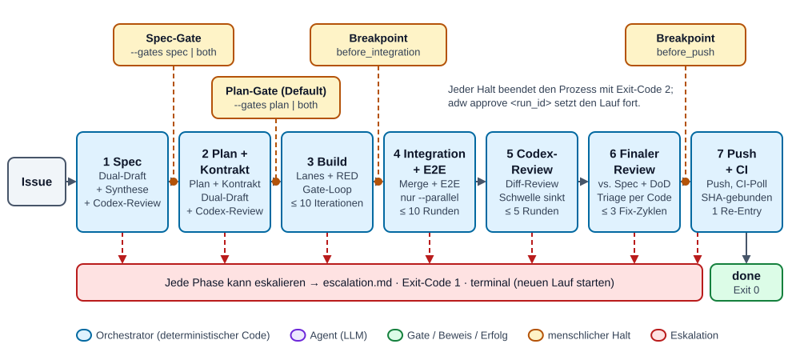
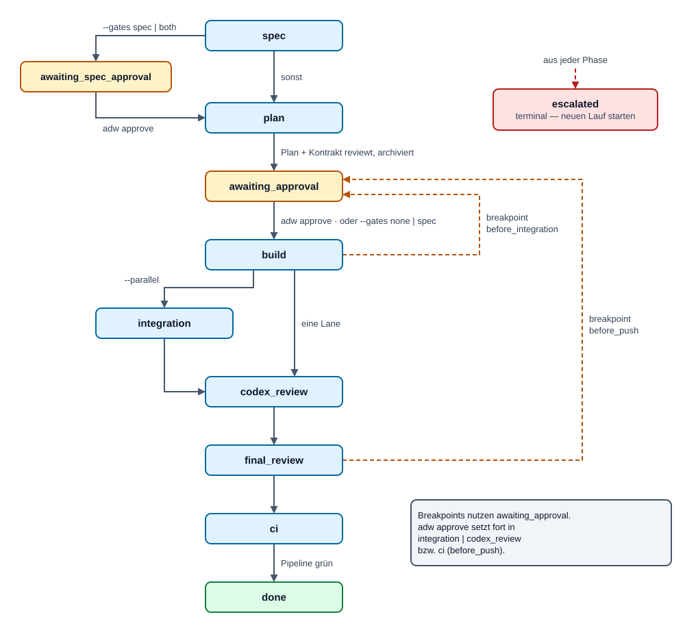
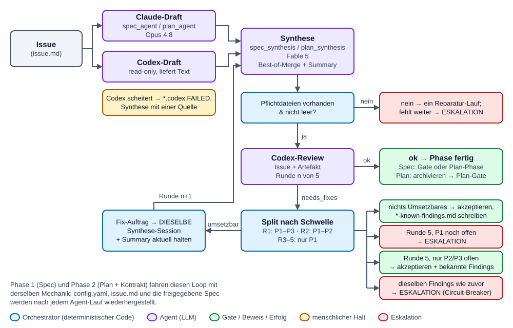
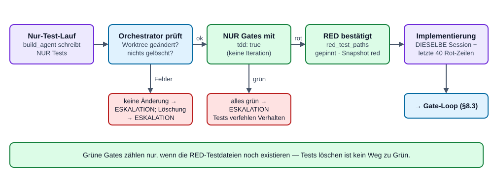
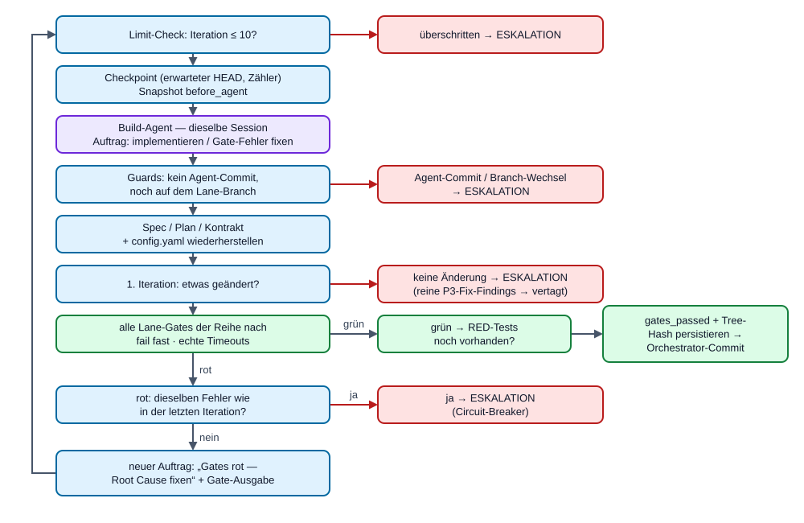
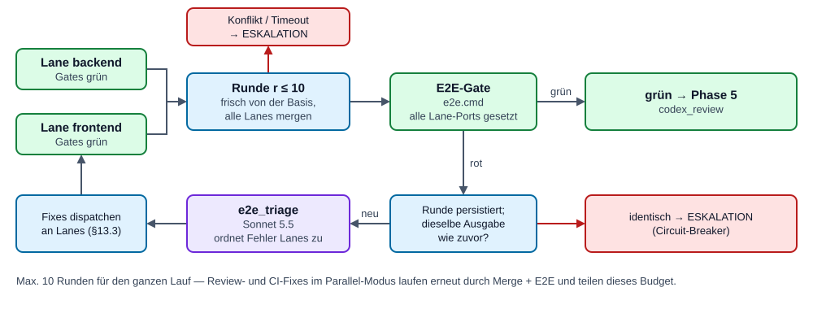
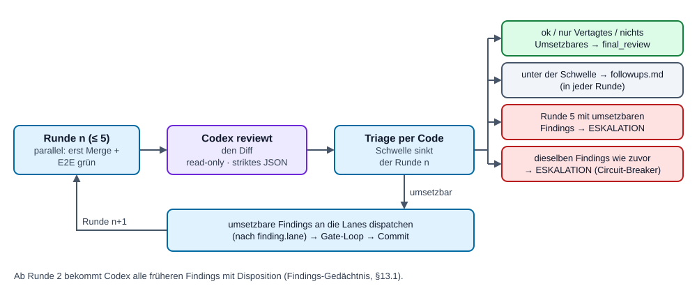
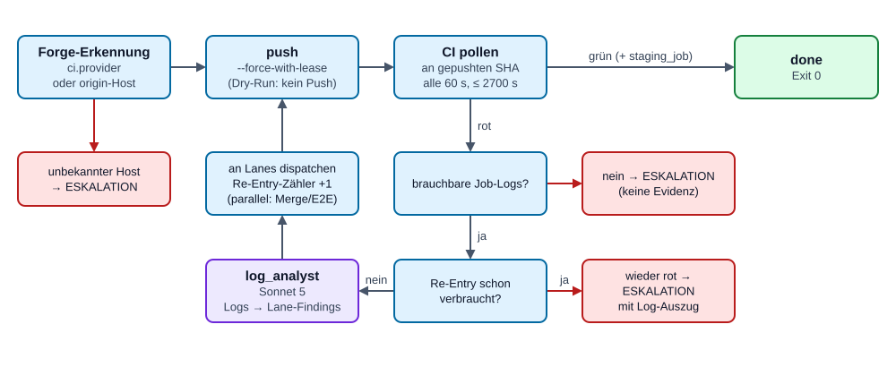
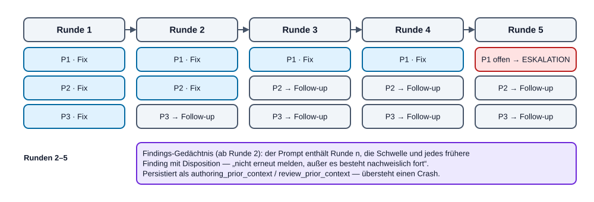
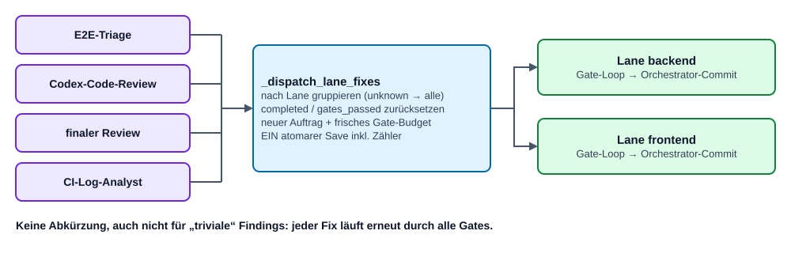

# ADW-Workflow — Wie ein Lauf abläuft, Phase für Phase

[English](ADW-WORKFLOW.md) | **Deutsch**

> **Zielgruppe:** ADW-Contributors und End-User, die verstehen wollen, *warum* sich
> ein Lauf so verhält, wie er sich verhält — nicht nur, welches Kommando man tippt.
> **Begleitdokumente:** [ADW-Handbuch](ADW-HANDBOOK.de.md) (ADW als Entwickler
> bedienen) · [ADW-Spec](ADW-SPEC.de.md) (Design-Philosophie, Invarianten und
> Contributor-Vertrag).
> **Maßgeblich:** der Code unter `adw/` in Version 0.26.1. Wo dieses Dokument und
> der Code sich widersprechen, gilt der Code — bitte dann das Dokument korrigieren.

---

## Inhalt

1. [Die eine Idee hinter allem](#1-die-eine-idee-hinter-allem)
2. [Besetzung: wer macht was](#2-besetzung-wer-macht-was)
3. [Der Lauf im Überblick](#3-der-lauf-im-überblick)
4. [Vor Phase 1: einen Lauf starten](#4-vor-phase-1-einen-lauf-starten)
5. [Phase 1 — Spec](#5-phase-1--spec)
6. [Phase 2 — Plan + Kontrakt](#6-phase-2--plan--kontrakt)
7. [Menschliche Haltepunkte: Freigaben und Breakpoints](#7-menschliche-haltepunkte-freigaben-und-breakpoints)
8. [Phase 3 — Build (Lanes, TDD-RED, Gate-Loop)](#8-phase-3--build-lanes-tdd-red-gate-loop)
9. [Phase 4 — Integration + E2E (nur im Parallel-Modus)](#9-phase-4--integration--e2e-nur-im-parallel-modus)
10. [Phase 5 — Codex-Code-Review](#10-phase-5--codex-code-review)
11. [Phase 6 — Finaler Review + Triage](#11-phase-6--finaler-review--triage)
12. [Phase 7 — Push + CI](#12-phase-7--push--ci)
13. [Querschnitts-Mechanik](#13-querschnitts-mechanik)
14. [Wie ein Lauf endet: done, pausiert, eskaliert, verweigert, unterbrochen](#14-wie-ein-lauf-endet-done-pausiert-eskaliert-verweigert-unterbrochen)
15. [Resume und Checkpoints](#15-resume-und-checkpoints)
16. [Einen Lauf beobachten: Event-Log, Snapshots, GUI](#16-einen-lauf-beobachten-event-log-snapshots-gui)
17. [Durchgespieltes Beispiel: Lauf `b65f5d75`](#17-durchgespieltes-beispiel-lauf-b65f5d75)
18. [Kompakt-Referenz](#18-kompakt-referenz)

---

## 1. Die eine Idee hinter allem

> **Control flow is code, not prompt** — der Kontrollfluss ist Code, kein Prompt.

ADW ist ein **Orchestrator**, kein Agent. Ein festes Python-Programm
(`adw/phases.py`) entscheidet, *wer wann handelt*: Es fährt die Schleifen, zählt
Runden, startet Gates, merged Branches, routet Findings, committet, pollt die CI
und schreibt Checkpoints. Nichts davon kostet ein Token, und nichts davon hängt
davon ab, dass sich ein LLM an ein Vorgehen „erinnert".

Sprachmodelle kommen **nur dort zum Einsatz, wo Urteilsvermögen gebraucht wird**:
Spec schreiben, Plan entwerfen, Code implementieren, reviewen, einen roten
E2E-Test einer Lane zuordnen, CI-Logs lesen. Jeder Agent bekommt einen engen
Auftrag, ein enges Werkzeug-Set und eng begrenzte Schreibpfade — und danach prüft
der Orchestrator das Ergebnis selbst, statt der Selbstauskunft des Agenten zu
glauben.

Daraus folgen drei Regeln, die jede Phase prägen:

1. **Reviewer reparieren nie.** Wer einen Mangel findet, meldet ihn nur — als
   strukturiertes Finding. Jeder Fix geht zurück an einen Build-Agenten und danach
   erneut durch *alle* Gates. Keine Abkürzung, auch nicht für „Kleinigkeiten".
2. **Der Orchestrator glaubt Beweisen, nicht Behauptungen.** Agenten dürfen nicht
   committen. Ob Tests rot waren, ob Gates grün waren, ob sich überhaupt etwas
   geändert hat — das misst der Orchestrator selbst und persistiert es als Beweis,
   gebunden an den exakten Tree-Hash des Worktrees.
3. **Jeder Loop hat einen Deckel und ein Gedächtnis.** Runden-Limits, ein
   Circuit-Breaker für „nichts hat sich geändert" und eine Severity-Schwelle, die
   mit jeder Review-Runde sinkt, garantieren, dass ein Lauf terminiert — grün oder
   mit einem klaren Eskalations-Report, auf dessen Basis ein Mensch handeln kann.

---

## 2. Besetzung: wer macht was

| Rolle | Umgesetzt durch | Modell / Werkzeug | Darf schreiben? |
|---|---|---|---|
| Orchestrator (Loops, Limits, git, Commits, CI-Polling, Triage) | `adw/phases.py`, `adw/cli.py`, `adw/triage.py` | deterministisches Python | alles, was er braucht |
| Spec-Autor A | `spec_agent` | Opus 5.5 (`claude-opus-5-5`) | nur `.adw/spec.md` |
| Spec-/Plan-Autor B (Zweitmeinung) | Codex-CLI, `codex exec -m gpt-6-astra --sandbox read-only` | GPT-6-Astra (`gpt-6-astra`) | nichts — liefert Text zurück |
| Spec-Synthese | `spec_synthesis` | Fable 5.1 (`claude-fable-5-1`) | `.adw/spec.md`, `.adw/spec-summary.md` |
| Plan-Autor A | `plan_agent` | Opus 5.5 | `.adw/plan.md`, `.adw/contract.yaml` |
| Plan-Synthese | `plan_synthesis` | Fable 5.1 | Plan, Kontrakt, `.adw/plan-summary.md` |
| Spec-/Plan-/Code-Reviewer | Codex-CLI (read-only) | GPT-6-Astra | nichts |
| Builder | `build_agent` | Opus 5.5 | sein eigener Lane-Worktree (+ `Bash`) |
| E2E-Triage | `e2e_triage` | Sonnet 5.5 (`claude-sonnet-5-5`) | nichts (read-only) |
| Finaler Reviewer | `final_reviewer` | Fable 5.1 | nichts (read-only) |
| CI-Log-Analyst | `log_analyst` | Sonnet 5.5 | nichts (read-only) |
| Gates | `adw/gates.py` | eure Lint-/Test-/E2E-Kommandos | — |

Alle Claude-Agenten laufen über die **Claude-Code-CLI** (vom Agent SDK headless
gestartet) mit dem gespeicherten Login des Nutzers; der Verbrauch läuft also gegen
den Claude-Plan, API-Key-Variablen werden aktiv geleert. Die Registry mit
Tool-Whitelists und Pfadregeln ist `adw/agents.py:REGISTRY`.

Jeder Subprozess (Gates, git, Codex, `glab`/`gh`) läuft mit einer
**Env-Whitelist** (`adw/env.py`: `PATH`, `HOME`, `LANG`, … — keine Tokens, keine
Secrets).

---

## 3. Der Lauf im Überblick



Gelbe Kästen sind mögliche menschliche Halte; der rote Balken ist der
**Eskalations**-Ausgang (`escalation.md`, Exit-Code 1), den jede Phase nehmen kann.
In der HTML-Fassung sind alle Diagramme interaktiv: **Abspielen** geht den Ablauf
Schritt für Schritt durch, jeder Kasten erklärt sich beim Überfahren oder Anklicken.

### Phasen-Zustandsmaschine

Das persistierte Feld `phase` in `state.json` (`adw/state.py:Phase`) ist die
einzige Wahrheit. Das sind alle Werte und Übergänge:



Breakpoints nutzen die Phase `awaiting_approval` mit; welcher Breakpoint wartet,
steht separat in `pending_breakpoint`. Nach `adw approve` geht es bei
`before_integration` in `integration` (parallel) bzw. `codex_review` (Single-Lane)
weiter, bei `before_push` in `ci`.

---

## 4. Vor Phase 1: einen Lauf starten

`adw run` (`adw/cli.py:run`) prüft in fester Reihenfolge, **bevor** überhaupt ein
State existiert:

1. **Genau eine Issue-Quelle:** `--issue "Text"`, `--gitlab-issue <id>` (via
   `glab`) oder `--github-issue <nr>` (via `gh`).
2. **Gate-Modus auflösen:** `--gates none|spec|plan|both` (Default `plan`); die
   Altflags `--no-approval` (= `none`) und `--spec-approval` (= `both`) gelten
   weiter; ein Widerspruch zwischen beiden scheitert sofort.
3. **Config validieren (fail fast):** `.adw/config.yaml` im Ziel-Repo wird strikt
   geparst — unbekannte Keys, doppelte YAML-Keys, fehlende Gates oder
   nicht-positive Timeouts brechen mit klarer Meldung ab.
   Direkt danach prüft der **Forge-Vorflug** (nur echte Läufe), ob die Forge
   bekannt ist — `ci.provider` oder ein Origin-Host mit `gitlab`/`github`.
   Sonst wird das Kommando abgelehnt, bevor ein Agent läuft (auch vor `resume`
   und `approve`); ein Dry-Run fällt auf GitLab zurück.
   Nach dem Arbeitsbaum-Vorflug (Schritt 4) — ein abgelehnter Checkout kostet so
   keine Probe-Tokens — fragt der **Modell-Check** (nur echte Läufe), ob es neuere Modelle gibt
   als die in ADW gepinnten: Die CLI-Aliase `opus`/`fable`/`sonnet` zeigen auf die
   neuesten Claude-Modelle, der Katalog der codex-CLI nennt das neueste GPT-Modell
   der gepinnten Stufe. Ist eines neuer, wird das Kommando abgelehnt — erst ADW
   aktualisieren. Das Ergebnis wird 24 h gecacht; ein Check, der nicht laufen kann
   (offline, Plan-Limit), warnt nur.
4. **Arbeitsbaum-Vorflug:** Der Haupt-Checkout muss sauber sein. Sind *ausschließlich*
   ADWs sechs eigene Authoring-Artefakte dirty (`.adw/issue.md`, `spec.md`,
   `plan.md`, `contract.yaml`, `spec-summary.md`, `plan-summary.md`), werden sie
   **selbst geheilt** (auf `HEAD` zurückgesetzt bzw. gelöscht). Alles andere ist
   eine **Verweigerung** — ADW verwirft nie fremde Änderungen. Derselbe Vorflug
   läuft vor `resume` und `approve`.
5. **Pinnen:** Eine frische 8-stellige Hex-`run_id` entsteht; der wirksame
   `base_branch`, die Gate-Entscheidungen und die Breakpoint-Menge werden **in den
   State gepinnt** — eine spätere Änderung der `config.yaml` verschiebt einen
   laufenden Lauf nicht.
6. **Erster Save:** `state.json` wird sofort geschrieben (unter einem
   Run-Execution-Lock), sodass selbst ein Crash im ersten Agent-Lauf einen
   fortsetzbaren Lauf hinterlässt. `.adw/runs/` ignoriert sich über eine eigene
   `.gitignore` selbst.

Danach ruft `_execute` einfach die sieben Phasenfunktionen der Reihe nach auf. Jede
prüft `state.phase` selbst und kehrt sofort zurück, wenn sie nicht dran ist —
genau das macht `resume` trivial (§15).

---

## 5. Phase 1 — Spec

**Frage:** *Was genau soll gebaut werden — und was nicht?*

| | |
|---|---|
| **Input** | Issue-Text (als `.adw/issue.md` geschrieben, aus dem State regeneriert) |
| **Akteure** | `spec_agent` (Opus 5.5) und Codex als parallele Autoren · `spec_synthesis` (Fable 5.1) · Codex-Reviewer |
| **Output** | `.adw/runs/<id>/spec.md`, `spec-summary.md`, `drafts/spec.claude.md`, `drafts/spec.codex.md` |
| **Loop** | Authoring-Review-Loop, max. **5 Runden** |

### Schritt 1 — Dual-Draft (parallel)

Zwei unabhängige Autoren schreiben aus demselben Auftrag gleichzeitig eine Spec:

- **Claude-Entwurf** — `spec_agent` schreibt `.adw/spec.md` in den Checkout; der
  Orchestrator kopiert sie nach `drafts/spec.claude.md` und räumt den Checkout
  wieder auf. Fehlt der Entwurf, ist er leer oder byte-identisch mit einem Rest
  eines früheren Laufs, **eskaliert** der Lauf (ein untätiger Agent darf keinen
  Altbestand als Entwurf ausgeben).
- **Codex-Entwurf** — Codex läuft read-only und *liefert* den Inhalt zwischen
  Markern pro Aufruf zurück; der Orchestrator schreibt `drafts/spec.codex.md`.
  Codex ist die Zweitmeinung: Scheitert er, **degradiert** ADW statt zu eskalieren
  — es schreibt einen Marker `spec.codex.FAILED`, loggt eine Warnung, und die
  Synthese arbeitet einquellig.

Entwürfe werden atomar geschrieben (tmp + rename); ein fertiger Entwurf wird beim
Resume nie neu erzeugt.

### Schritt 2 — Synthese + Codex-Review-Loop

`spec_synthesis` (Fable 5.1) liest Issue und beide Entwürfe, schreibt den
**Best-of-Merge** nach `.adw/spec.md` und dazu `.adw/spec-summary.md` — das
Dokument, das der Mensch am Gate liest (Entscheidungen, Scope, Provenienz: welcher
Entwurf was beigesteuert hat, wo die Autoren uneins waren).

Danach läuft der **Authoring-Loop** (`_reviewed_authoring_loop`):



Codex bekommt den Issue-Text bewusst mit: Er prüft die Spec auf
**Proportionalität** — ist das, was tatsächlich verlangt war? Ab Runde 2 erhält er
zusätzlich die Findings der Vorrunden mit ihrer Disposition („Fix dispatched",
„unter der Schwelle, als Follow-up vermerkt"), damit er dieselben Punkte nicht
erneut meldet (§13.1).

`config.yaml`, `issue.md` und später die approvte Spec sind **geschützt**: Sie
werden gesnapshottet und nach *jedem* Agent-Lauf restauriert, sodass selbst ein
fehlgeleiteter Agent nicht ändern kann, was der Reviewer sieht.

**Ende von Phase 1:** Reviewte Spec und Summary werden sofort in den Run-Ordner
kopiert. Mit `--gates spec|both` pausiert der Lauf in `awaiting_spec_approval`,
sonst geht es nach `plan`.

---

## 6. Phase 2 — Plan + Kontrakt

**Frage:** *Wie wird es gebaut — und wie sieht die Schnittstelle genau aus?*

| | |
|---|---|
| **Input** | approvte `spec.md` (+ `spec-summary.md`), Issue, aktive Lanes |
| **Akteure** | `plan_agent` (Opus 5.5) und Codex als parallele Autoren · `plan_synthesis` (Fable 5.1) · Codex-Reviewer |
| **Output** | `plan.md`, `contract.yaml`, `plan-summary.md`, `drafts/plan.*.md`, `drafts/contract.*.yaml` |
| **Loop** | Authoring-Review-Loop, max. **5 Runden** (gleiche Mechanik wie Phase 1) |

Das Muster ist identisch zu Phase 1, nur mit zwei Artefakten statt einem:

- **`plan.md`** — Workstreams je aktiver Lane (`backend`, mit `--parallel` auch
  `frontend`), Schritte, Annahmen, Verifikation.
- **`contract.yaml`** — der Schnittstellen-Kontrakt zwischen den Lanes. Er pinnt
  nur die extern beobachtbare Fläche (Endpunkte, Felder, Verhaltensregeln); die
  Lanes bauen parallel *gegen* ihn, ohne einander zu sehen.

Spec und Spec-Summary werden aus dem Run-Ordner wiederhergestellt und sind ab hier
**fix** — die Plan-Phase darf sie lesen, nie umschreiben. Codex reviewt Plan und
Kontrakt *gegen* das Issue und die Akzeptanzkriterien der Spec.

**Ende von Phase 2:** Alle Artefakte (`issue.md`, `spec.md`, `plan.md`,
`contract.yaml`, beide Summaries) werden nach `.adw/runs/<id>/` **archiviert** und
aus dem Haupt-Checkout entfernt (bzw. dort zurückgesetzt), damit der Checkout
während der Freigabe-Pause sauber bleibt. Die Phase wird `awaiting_approval`.

---

## 7. Menschliche Haltepunkte: Freigaben und Breakpoints

ADW kennt zwei Arten menschlicher Halte. Beide beenden den **Prozess** mit Exit-Code
`2` — während ihr lest, läuft nichts. `adw approve <run_id>` gibt den Halt frei und
setzt den Lauf in einem neuen Prozess fort.

### Freigabe-Gates (`--gates`)

| Modus | Halt nach Spec | Halt nach Plan | Altflags |
|---|---|---|---|
| `none` | – | – | `--no-approval` |
| `spec` | ✔ | – | `--no-approval --spec-approval` |
| `plan` *(Default)* | – | ✔ | *(keine)* |
| `both` | ✔ | ✔ | `--spec-approval` |

An jedem Halt sagt die CLI genau, was zu lesen ist:
`.adw/runs/<id>/spec-summary.md` + `spec.md` bzw. `plan-summary.md` + `plan.md`
(und `contract.yaml`). Die Summary ist die vorgesehene Entscheidungsgrundlage —
kurz, mit Provenienz und offenen Fragen — nicht der vollständige Plan.

### Breakpoints (`breakpoints:` in der `config.yaml`)

Optionale Halte **vor den teuren, schwer umkehrbaren Schritten**:

| Breakpoint | Wo er hält | Weiter in |
|---|---|---|
| `before_integration` | nachdem alle Build-Lanes grün sind, vor jeder Merge-/Review-Arbeit | `integration` (parallel) / `codex_review` |
| `before_push` | nach dem finalen Review, vor jedem Push und jeder CI-Arbeit | `ci` |

Breakpoints werden beim Start gepinnt und halten je Lauf höchstens einmal. Sie
halten nur, wenn das Plan-Gate aktiv ist (`--gates plan` oder `both`); die Modi
`none` und `spec` überspringen die Plan-Freigabe und damit auch die Breakpoints.

---

## 8. Phase 3 — Build (Lanes, TDD-RED, Gate-Loop)

**Frage:** *Bau es — und beweise, dass es funktioniert.*

| | |
|---|---|
| **Input** | archivierte Spec/Plan/Kontrakt; Lane-Config (Gates) |
| **Akteure** | `build_agent` (Opus 5.5) je Lane · Gates (deterministisch) · Orchestrator (git, Commits) |
| **Output** | Lane-Branch `adw/<run_id>/<lane>` mit Orchestrator-Commits; Snapshot-Refs |
| **Loop** | Gate-Loop, max. **10 Iterationen** je Task; Circuit-Breaker |

### 8.1 Lanes und Worktrees

Eine **Lane** ist ein Workstream — `backend` und/oder `frontend`. Jede Lane bekommt:

- einen eigenen **git-Worktree** unter `.adw/runs/<id>/trees/<lane>` auf einem
  eigenen Branch `adw/<run_id>/<lane>`, abgezweigt vom gepinnten Base-Branch (der
  Fork-Point wird als `base_sha` gepinnt);
- eine eigene **Agent-Session** (per Session-ID fortsetzbar);
- einen eigenen deterministischen **Port** (`backend` 9100–9149, `frontend`
  9200–9249, aus der Run-ID abgeleitet, mit Bind-Check-Fallback), für die Gates
  exportiert als `BACKEND_PORT` / `FRONTEND_PORT`;
- Leseverbot auf die Worktrees der anderen Lanes.

Ohne `--parallel` läuft genau eine Lane (`backend`, falls konfiguriert). Mit
`--parallel` laufen beide Lanes gleichzeitig in einem Thread-Pool; die Config muss
dann beide definieren.

Der Orchestrator **seedet** zuerst die approvte Spec/Plan/Kontrakt ins `.adw/` der
Lane und committet sie (`adw(<id>): Spec/Plan/Kontrakt`) — der Build-Agent baut
gegen eingecheckte Artefakte.

### 8.2 TDD-RED-Stufe (Gates mit `tdd: true`)

Hat die Lane mindestens ein Gate mit `tdd: true`, beginnt der **initiale** Build
mit einem Beweis, dass die Tests überhaupt etwas testen:



Der RED-Check verbraucht keine Gate-Iteration. Fix-Dispatches und Resumes nach dem
Beweis überspringen ihn. Am Ende zählen grüne Gates nur, wenn die **RED-Testdateien
noch existieren** — Tests löschen ist kein Weg zu Grün.

### 8.3 Der Gate-Loop



Wesentliche Eigenschaften:

- **Gates sind eure Kommandos** (`lanes.<lane>.gates[]` mit `name`, `cmd`,
  `timeout`), der Reihe nach ausgeführt, Abbruch beim ersten Fehler. Ihr Output
  wird auf die letzten 200 Zeilen begrenzt.
- **Nur der Orchestrator committet** — `adw(<id>/<lane>): Build-Ergebnis nach
  grünen Gates`. Ein Agent-Commit, ein Branch-Wechsel oder ein bewegter HEAD aus
  einem Crash-Fenster eskaliert.
- **Beweis an den Baum gebunden:** `gates_passed` und `gates_tree` (ein Hash über
  den gesamten Worktree inkl. untracked Dateien) werden *vor* dem Commit
  persistiert. Beim Resume gilt eine Lane nur dann als fertig, wenn der Baum noch
  zum Beweis passt.
- **Es muss etwas gebaut werden:** grüne Gates ohne Änderung außerhalb von `.adw/`
  gegenüber dem Base-Branch eskalieren.

Sind alle Lanes fertig: optionaler Breakpoint `before_integration`, dann
`integration` (parallel) oder direkt `codex_review` (Single-Lane).

---

## 9. Phase 4 — Integration + E2E (nur im Parallel-Modus)

**Frage:** *Passen die Teile zusammen?*

| | |
|---|---|
| **Input** | alle grünen Lane-Branches |
| **Akteure** | Orchestrator (Merge) · E2E-Gate · `e2e_triage` (Sonnet 5.5) |
| **Output** | Branch `adw/<run_id>/integration` |
| **Loop** | max. **10 Runden**, laufweit; Circuit-Breaker |



Jede Runde baut den Integrations-Worktree **frisch vom Base-Branch** auf und merged
jeden Lane-Branch hinein (idempotent, crash-sicher). Ein Merge-Konflikt oder
Merge-Timeout **eskaliert** — Konfliktauflösung ist Menschensache.

Dann läuft das E2E-Gate (`e2e.cmd`, die Ports aller Lanes in der Umgebung). Ist
kein `e2e` konfiguriert, ist die Integration ein reiner Merge. Bei Rot:

1. Der Rundenzähler wird persistiert;
2. identischer Fehler-Output wie in der Vorrunde → Circuit-Breaker;
3. `e2e_triage` ordnet jeden Fehler als strukturiertes Finding einer Lane zu
   (`frontend`/`backend`/`unknown`);
4. die Findings werden als Fix-Tasks in den normalen Lane-Loop **dispatcht**
   (§13.3) — frisches Iterationsbudget, Gates, Orchestrator-Commit;
5. nächste Runde: erneut mergen, erneut E2E.

Wichtig: Im Parallel-Modus laufen auch die Review-Phasen (5–7) durch diesen Loop.
Jeder Review-Fix muss also wieder durchs E2E-Gate, und das 10-Runden-Budget gilt
für den ganzen Lauf.

---

## 10. Phase 5 — Codex-Code-Review

**Frage:** *Findet ein unabhängiger Reviewer Mängel im Diff?*

| | |
|---|---|
| **Input** | geänderte Dateien gegenüber dem Base-Branch (Integrations-Worktree im Parallel-Modus, sonst Lane-Worktree) |
| **Akteure** | Codex (read-only) · Orchestrator (Triage, Dispatch) |
| **Loop** | max. **5 Runden**, Severity-Schwelle, Findings-Gedächtnis, Circuit-Breaker |



Jedes Finding ist strukturiertes JSON (`adw/findings.py`): `severity` (P1–P3),
`lane`, `file`, `issue`, `remediation_plan`. Der Parser ist bewusst strikt — ein
unlesbares Review ist eine Eskalation, nie ein stilles „ok".

---

## 11. Phase 6 — Finaler Review + Triage

**Frage:** *Wurde das Richtige gebaut — gemessen an der Spec?*

| | |
|---|---|
| **Input** | derselbe Worktree wie in Phase 5, `spec.md`, `contract.yaml` |
| **Akteure** | `final_reviewer` (Fable 5.1, read-only) · `adw/triage.py` |
| **Loop** | max. **3 Fix-Zyklen je Lane**; Circuit-Breaker |

Codex hat auf den **Diff** geschaut; der finale Reviewer schaut auf das **Ergebnis
gegen die Akzeptanzkriterien und die Definition of Done**. Jedes Finding muss eine
`category` tragen, und die Triage ist reiner Code:

| Kategorie | Was passiert |
|---|---|
| `scope_gap` — die Spec hat es nie verlangt | landet in `followups.md`, **kein** Fix, kein automatischer Neustart |
| `implementation` / `trivial` | Fix-Task an die Lane des Findings; Lane `unknown` → alle aktiven Lanes |

Ein Finding ohne Kategorie eskaliert (es ist nicht sicher triagierbar). Jeder
Dispatch erhöht `fix_cycles` der Lane im **selben Save** wie der gestagte Task; der
4. Zyklus einer Lane eskaliert. Bleiben nur Scope-Gaps übrig → Phase fertig.

Dann: optionaler Breakpoint `before_push`, danach `ci`.

---

## 12. Phase 7 — Push + CI

**Frage:** *Ist es dort grün, wo es zählt?*

| | |
|---|---|
| **Input** | Lane-Branch (Single-Lane) oder Integrations-Branch (parallel, nach frisch grünem E2E) |
| **Akteure** | Orchestrator (Push, Polling) · `log_analyst` (Sonnet 5.5) |
| **Loop** | **1 CI-Re-Entry**, dann ein Mensch |



1. **Forge-Erkennung:** `ci.provider` in der Config hat Vorrang; sonst muss der
   Host der Origin-URL eindeutig `gitlab` oder `github` enthalten (schon im Vorflug geprüft; hat sich Origin oder Config während des Laufs geändert, eskaliert er hier).
2. **Push** durch den Orchestrator: `git push --force-with-lease -u origin
   <branch>` (Hooks abgeschaltet; der SSH-Agent-Socket wird nur dem Push
   durchgereicht). Im `--dry-run` gibt es keinen Push.
3. **Polling** (0 Tokens) via `glab` bzw. `gh`, alle `ci.poll_interval` Sekunden
   (Default 60) bis `ci.timeout` (Default 2700). Das Polling ist **an die gepushte
   SHA gebunden**, damit keine veraltete Pipeline eines früheren Pushs das Ergebnis
   bestimmt. Bei GitHub heißt grün: alle Workflow-Runs der SHA abgeschlossen, keiner
   rot. Mit `ci.staging_job` muss zusätzlich dieser Job grün sein.
4. **Rote Pipeline:**
   - keine verwertbaren Job-Logs (canceled, skipped, YAML-Fehler) → sofortige
     Eskalation — ein Analyst ohne Evidenz würde nur halluzinieren;
   - sonst macht `log_analyst` aus den Logs Lane-Findings, sie werden durch die
     Lane-Loops dispatcht (Zähler atomar erhöht), und die Phase dreht genau eine
     weitere Runde: Merge/E2E (parallel), Push, Pollen;
   - nach diesem einen Re-Entry wieder rot → Eskalation mit Log-Auszug.
5. **Grün** → `done`. Nach einem erfolgreichen Lauf kann automatisches Pruning
   alter Run-Verzeichnisse laufen (`trace.keep_runs`, Default 20; fail-open).

---

## 13. Querschnitts-Mechanik

### 13.1 Review-Loop-Policy (Authoring-Loops und Phase 5)

Ein deterministischer Reviewer findet auf der niedrigsten Severity immer noch einen
Randfall. Ohne Policy oszillieren Review-Loops endlos. ADW wendet deshalb an:

| Runde | Umgesetzt | Unter der Schwelle |
|---|---|---|
| 1 | P1, P2, P3 | — |
| 2 | P1, P2 | P3 → Follow-up / Known Findings |
| 3–5 | nur P1 | P2, P3 → Follow-up / Known Findings |



Ab Runde 2 enthält der Reviewer-Prompt die Rundennummer, die aktuelle Schwelle und
jedes frühere Finding mit seiner **Disposition**, dazu die Anweisung, diese nicht
erneut zu melden, außer das Problem besteht nachweislich fort. Der Verlauf wird
persistiert (`authoring_prior_context`, `review_prior_context`) und überlebt einen
Crash.

### 13.2 Circuit-Breaker

Jeder Loop vergleicht die aktuelle Fehlermenge mit der der Vorrunde
(`triage.check_progress`). Eine identische Menge heißt: Der letzte Fix hat nichts
bewirkt — der Lauf eskaliert **sofort**, statt den Rest seines Budgets zu
verbrennen. Schlüssel: `file|issue` für Findings, `gate|Exit-Code|Output` für Gates.

### 13.3 Fix-Dispatch — ein Weg für jeden Fix

E2E-Fehler, Codex-Findings, Final-Review-Findings und CI-Findings laufen alle durch
`_dispatch_lane_fixes`:

- Findings werden nach Lane gruppiert (`unknown` oder inaktive Lane → alle aktiven
  Lanes);
- je betroffener Lane: `completed`/`gates_passed` zurückgesetzt, ein neuer offener
  Task mit den Findings, ein **frisches Gate-Iterationsbudget** (das Limit gilt pro
  Task);
- alle Lanes werden in **einem** atomaren Save zusammen mit dem Zähler-Update
  gestagt (Review-Runde, Fix-Zyklus oder CI-Re-Entry);
- danach läuft jede Lane den normalen Gate-Loop und bekommt einen
  Orchestrator-Commit.



### 13.4 Vertagte Findings und Follow-ups

Lässt ein Fix-Lauf den Worktree unverändert und sind *alle* seine Findings P3
(Hinweise, Prozessanmerkungen, vom Agenten begründet abgelehnte Findings), ist das
kein Fehler: Die Findings landen in `followups.md`, ihre Schlüssel in
`deferred_findings`. Meldet ein Reviewer sie später erneut, lösen sie weder einen
Fix-Zyklus noch den Circuit-Breaker aus — außer er stuft dasselbe Problem jetzt als
P1/P2 ein.

`followups.md` sammelt alles, was in diesem Lauf bewusst nicht gefixt wurde
(Scope-Gaps, Findings unter der Schwelle, vertagte P3s), dedupliziert über
`file: issue`. Es ist eine Liste von Issue-Kandidaten, kein Fehlerbericht.

### 13.5 Limits im Überblick

| Limit | Wert | Geltungsbereich | Bei Überschreitung |
|---|---|---|---|
| Authoring-Runden | 5 | je Spec / Plan | P1 offen → Eskalation; nur P2/P3 → akzeptieren + Known Findings |
| Gate-Iterationen | 10 | je Lane-**Task** (Reset bei jedem Dispatch) | Eskalation |
| Integrations-/E2E-Runden | 10 | ganzer Lauf | Eskalation |
| Codex-Code-Review-Runden | 5 | ganzer Lauf | Eskalation |
| Fix-Zyklen im finalen Review | 3 | je Lane | Eskalation |
| CI-Re-Entries | 1 | ganzer Lauf | Eskalation |
| Codex-Timeout | 900 s (`codex.timeout`) | je Aufruf | Entwurf: einquellig degradieren · Review: Prozess bricht am letzten Checkpoint ab → `adw resume` |
| CI-Wartezeit | 2700 s (`ci.timeout`) | je Poll-Zyklus | Eskalation |

---

## 14. Wie ein Lauf endet: done, pausiert, eskaliert, verweigert, unterbrochen

| Ausgang | Exit | State | Was tun |
|---|---|---|---|
| **done** | 0 | `done` | Branch reviewen / MR bzw. PR öffnen |
| **pausiert** an Gate oder Breakpoint | 2 | `awaiting_spec_approval` / `awaiting_approval` | Summary lesen, dann `adw approve <id>` |
| **eskaliert** | 1 | `escalated` (terminal) | `.adw/runs/<id>/escalation.md` lesen, Ursache beheben, **neuen** Lauf starten |
| **verweigert** (dirty Checkout) | 1 | unverändert | eigene Änderungen committen/stashen, dann `adw resume <id>` |
| **unterbrochen** (Agent-Lauf gescheitert, z. B. Plan-Limit erschöpft; Codex-Review-Fehler/-Timeout; Crash; Strg-C) | 1 / – | unverändert am letzten Checkpoint | `adw resume <id>` (nach dem Limit-Reset) |

Die Unterscheidung ist wichtig: Eine **Eskalation** ist ein Urteil („ein Mensch muss
entscheiden"), geschrieben nach `escalation.md` mit Phase, Lanes und konkretem
Grund (Gate-Output, Findings, Merge-Konflikt, Limit). **Verweigerung** und
**Unterbrechung** sind keine Urteile — der Lauf bleibt genau dort stehen, wo er war,
und ist fortsetzbar.

---

## 15. Resume und Checkpoints

`state.json` ist die **Resume-Autorität**. Sie wird atomar geschrieben (tmp +
rename) unter einem repo-weiten `flock`, mit monotoner Sequenznummer. Die
Phasenfunktionen sind so geschrieben, dass jedem teuren oder seiteneffektbehafteten
Schritt ein Checkpoint vorausgeht:

| Checkpoint | Überlebt einen Crash, damit … |
|---|---|
| `authoring_session`, `authoring_pending_task`, `authoring_rounds`, `authoring_prior_context` | der Authoring-Loop in derselben Session mit demselben offenen Fix-Task und Rundenzähler weiterläuft |
| Entwürfe in `drafts/` + Marker `*.codex.FAILED` | fertige Entwürfe nicht neu geschrieben und ein gescheiterter Codex nicht erneut versucht wird |
| Lane-`session_id` (gespeichert, sobald der Stream sie meldet) | ein abgebrochener Agent-Lauf in seiner Session fortgesetzt werden kann |
| Lane-`expected_head` | ein Agent-Commit in einem Crash-Fenster trotzdem erkannt wird |
| Lane-`pending_task`, `last_failures`, `pending_findings` | Gate-Feedback und Circuit-Breaker-Basis nicht verloren gehen |
| Lane-`red_confirmed`, `red_test_paths` | der reine Test-Lauf nicht wiederholt wird |
| Lane-`gates_passed` + `gates_tree` | ein grün geprüfter Baum ohne erneuten Lauf committet wird — **nur**, wenn der Tree-Hash noch passt |
| `integration_rounds`, `review_rounds`, `fix_cycles`, `ci_reentries` | Limits sich nicht durch einen Crash zurücksetzen lassen |
| `pinned_base_branch`, `pinned_breakpoints`, `skip_approval`, `spec_approval` | Fortsetzungen sich exakt wie der ursprüngliche Lauf verhalten |

Bei `adw resume <id>` ruft `_execute` alle Phasenfunktionen erneut auf; jede
überspringt, bis die persistierte Phase erreicht ist. Vor Review- und CI-Arbeit
läuft jede Lane noch einmal durch den Lane-Loop: Unfertige Lanes holen nach, fertige
werden gegen ihren Tree-Hash revalidiert. Eskalierte Läufe sind bewusst **nicht**
fortsetzbar.

---

## 16. Einen Lauf beobachten: Event-Log, Snapshots, GUI

ADW schreibt drei Arten von Beobachtungsdaten. Alle sind **fail-open**: Ein Fehler
dort warnt einmal und bricht nie einen Lauf ab oder verändert ihn.

- **Event-Log** — `.adw/runs/<id>/events.jsonl`, JSON Lines. Spans (`run`,
  `phase`, `lane`, `round`, `agent.run`, `codex.review`, `codex.author`)
  verschachteln die Arbeit; Punkt-Events halten Fakten fest, *nachdem* sie
  eingetreten sind (`state.saved`, `artifact`, `commit`, `merge`, `red.check`,
  `snapshot`, `triage.decision`, `followup`, `limit.hit`, `circuit_breaker`,
  `escalation`, `approval`, `ci.reentry`, CI-Polls, Warnungen). Agent-Läufe tragen
  Tool-Calls, Nachrichten, Usage und Kosten. Abschaltbar mit
  `trace.enabled: false`.
- **Snapshots** — an jeder Schrittgrenze des Builds (`before_agent`,
  `after_agent`, `after_gates`, `red`) wird der Lane-Worktree als git-Commit unter
  `refs/adw/<run_id>/<seq>` gepinnt — ohne den echten Index anzufassen. „Was hat
  dieser Schritt geändert?" ist ein `git diff` zwischen zwei Refs.
- **GUI (Run Inspector)** — `adw gui` (optionales Extra `gui`) ist eine strikt
  **read-only** Web-App nur auf Loopback, über Event-Log, State und Artefakte:
  Lauf-Liste nach Status gruppiert, Phasen-Zeitachse, Trace-Baum, Diffs je Schritt,
  Prompt-Diffs zwischen Runden, Artefakte (Entwürfe, Summaries, `escalation.md`,
  `followups.md`), eine Recovery-Karte mit dem richtigen nächsten Kommando und eine
  Live-Ansicht, solange ein Lauf aktiv ist. Sie startet, approvt oder ändert nie
  einen Lauf — die Steuerung bleibt bei der CLI.

Retention: `adw runs list` zeigt Läufe und ob Pruning fällig ist; `adw runs prune
[--keep N] [--older-than DAYS] [--gzip]` entfernt alte Run-Verzeichnisse
(Worktrees — nie dirty, nie nicht-terminale Läufe) oder komprimiert ihre Event-Logs.

---

## 17. Durchgespieltes Beispiel: Lauf `b65f5d75`

Ein echter Lauf von ADW auf seinem eigenen Repo (ADW 0.11.0, Single-Lane,
GitHub-CI). Die oben beschriebene Mechanik war bereits vorhanden; die Zahlen stammen
aus seinem Event-Log. Issue: *„Vom Trace-Knoten in den Raw-Log springen +
Prompt-Diff gegen die Vorrunde."*

| Abschnitt | Zeit (min) | Was passierte |
|---|---|---|
| **1 Spec** | 0,0 – 6,7 | Opus- und Codex-Entwurf parallel; Fable-Synthese. Codex-Review: Runde 1 und 2 fanden je ein P2 — z. B. versprach ein Akzeptanzkriterium, ein Intervallfilter zeige *genau* die Events eines Teilbaums, was ein Sequenz-Intervall nicht garantieren kann. Beide in derselben Session gefixt. Runde 3: `ok`. |
| **2 Plan** | 6,7 – 17,4 | Gleiches Muster, `plan.md` + `contract.yaml`. Runde 1: P2 + P3 (beide gefixt). Runde 2: P2 (gefixt). Runde 3: ein P3 übrig — **unter der Schwelle von Runde 3**, also akzeptiert und nach `authoring-plan-known-findings.md` geschrieben plus Log-Warnung. Der Loop endet mit Papierspur, nicht durch Erschöpfung. |
| **Plan-Gate** | 17,4 – 53,4 | Prozess endet mit Exit-Code 2. Artefakte archiviert, Checkout sauber. Der Mensch liest `plan-summary.md` — inklusive Provenienz-Notiz zum einzigen echten Dissens der beiden Entwürfe — und ruft `adw approve b65f5d75` auf. |
| **3 Build** | 53,4 – 78,4 | Worktree `trees/backend`, Seed-Commit. **RED-Stufe:** Der Test-Lauf schreibt 2 Testdateien / 17 Tests; der Orchestrator fährt das `tdd`-Gate → pytest Exit 1 → `red.check confirmed=true`. Dann **eine** Gate-Iteration: Implementierung in derselben Session, `ruff` und `pytest` grün, RED-Tests noch da, Beweis persistiert, Orchestrator-Commit. |
| **4 Integration** | – | übersprungen (Single-Lane). |
| **5 Codex-Review** | 78,4 – 79,5 | Runde 1: `ok`. |
| **6 Finaler Review** | 79,5 – 82,2 | Fable, read-only, prüft gegen Spec + Kontrakt: `ok`. |
| **7 CI** | 82,2 – 84,3 | Push, 5 Polls gebunden an die gepushte SHA, `success` → `done`. |

Ergebnis: 9 Dateien, +859/−23 Zeilen, 17 neue Tests, 0 Fix-Zyklen, 0 Eskalationen,
rund 48 Minuten Maschinenzeit plus 36 Minuten menschliche Pause. Die Kosten lagen
konzentriert *vor* dem Code (Spec + Plan) — und der Build brauchte danach keine
einzige Korrekturrunde. Das ist die Design-Wette von ADW in Zahlen: Vorne nachdenken
ist billiger als hinten nachbessern.

Eine ausführliche Analyse dieses Laufs steht in
[`adw-flow-handout.de.md`](adw-flow-handout.de.md).

---

## 18. Kompakt-Referenz

### Run-Verzeichnis `.adw/runs/<run_id>/`

| Pfad | Inhalt |
|---|---|
| `state.json` | persistierter Lauf-State — die Resume-Autorität |
| `events.jsonl` (oder `.gz`) | Event-Log (Spans + Punkte) |
| `issue.md` | der ursprüngliche Issue-Text |
| `spec.md`, `spec-summary.md` | reviewte Spec + Gate-Zusammenfassung |
| `plan.md`, `contract.yaml`, `plan-summary.md` | reviewter Plan, Kontrakt + Gate-Zusammenfassung |
| `drafts/` | `spec.claude.md`, `spec.codex.md`, `plan.*.md`, `contract.*.yaml`, `*.codex.FAILED` |
| `authoring-<spec|plan>-known-findings.md` | als Known Limitations akzeptierte Findings |
| `followups.md` | Scope-Gaps, Findings unter der Schwelle und vertagte Findings |
| `escalation.md` | nur nach einer Eskalation: Phase, Lanes, Grund |
| `trees/<lane>`, `trees/integration` | git-Worktrees der Lanes / des Integrations-Branches |

### Branches und Refs

`adw/<run_id>/<lane>` · `adw/<run_id>/integration` · `refs/adw/<run_id>/<seq>`
(Snapshots)

### Kommandos

```
adw run --repo <pfad> (--issue "…" | --gitlab-issue <id> | --github-issue <nr>)
        [--parallel] [--dry-run] [--gates none|spec|plan|both] [--base-branch <name>]
adw resume  <run_id> [--repo <pfad>]
adw approve <run_id> [--repo <pfad>]
adw status  [<run_id>] [--repo <pfad>]
adw runs list|prune [--repo <pfad>] …
adw gui [--repo <pfad>] [--port 8765] [--open]
```

Exit-Codes: `0` done · `2` wartet auf Freigabe/Breakpoint · `1` Eskalation,
Verweigerung oder Unterbrechung.

`--dry-run` fährt den kompletten Kontrollfluss mit skriptbaren Mocks — 0 Tokens,
kein Push, keine Forge-Aufrufe — und ist der sicherste Weg, dieses ganze Dokument in
Bewegung zu sehen.

---

ADW-Workflow · Quelle: ADW 0.26.1 (Code unter `adw/`, `docs/SPEC.de.md`,
`CHANGELOG.de.md`) · Stand 2026-10-11
