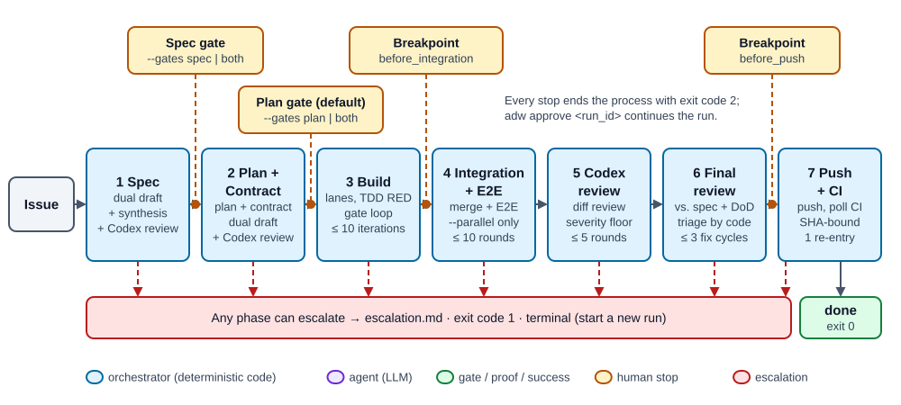
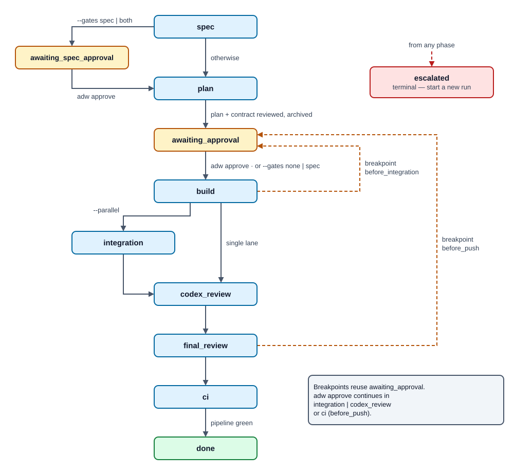
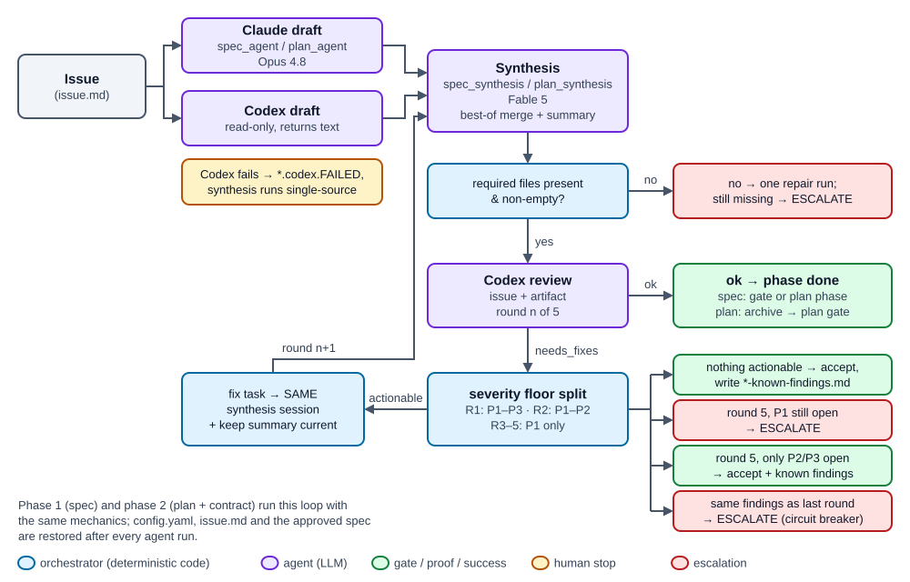
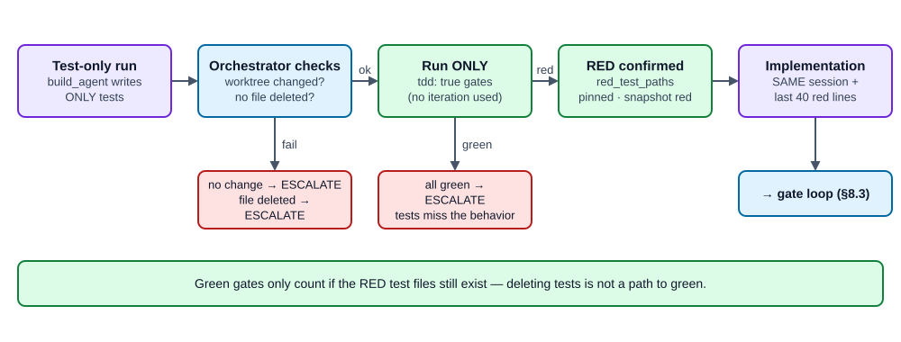
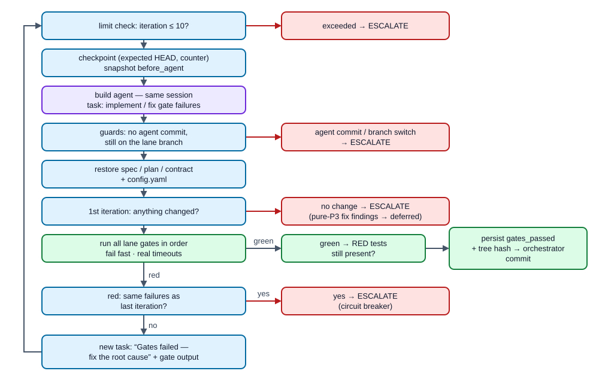
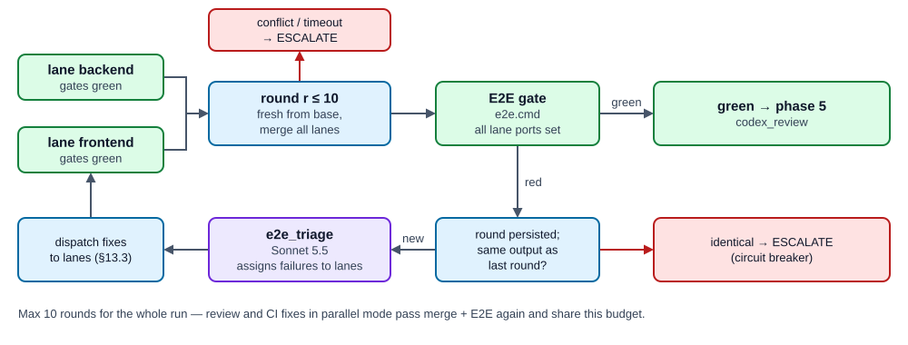
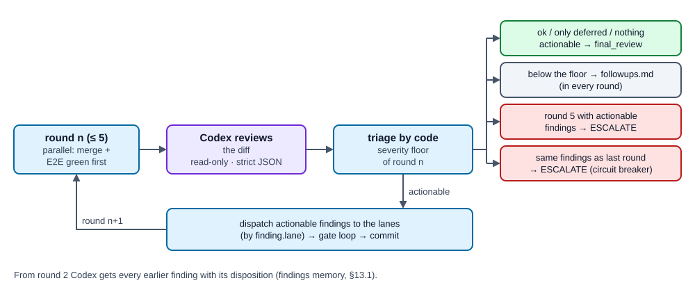
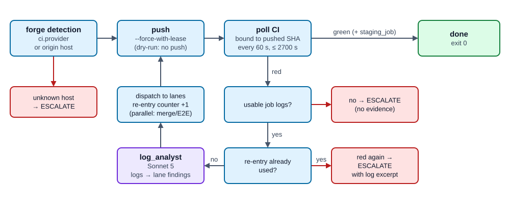
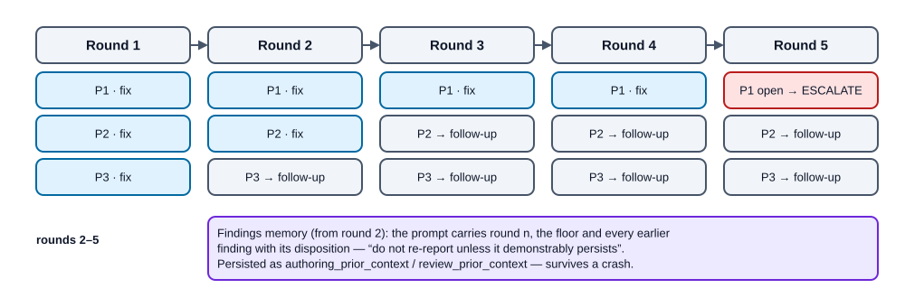
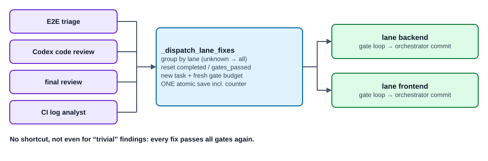

# ADW Workflow — How a Run Flows, Phase by Phase

**English** | [Deutsch](ADW-WORKFLOW.de.md)

> **Audience:** ADW contributors and end users who want to understand *why* a run
> behaves the way it does — not only which command to type.
> **Companion documents:** [ADW Handbook](ADW-HANDBOOK.md) (operating ADW as a
> developer) · [ADW Spec](ADW-SPEC.md) (design philosophy, invariants and
> contributor contract).
> **Ground truth:** the code under `adw/` at version 0.26.1. Where this document
> and the code disagree, the code wins — please file a fix for the document.

---

## Contents

1. [The one idea behind everything](#1-the-one-idea-behind-everything)
2. [Cast: who does what](#2-cast-who-does-what)
3. [The run at a glance](#3-the-run-at-a-glance)
4. [Before phase 1: starting a run](#4-before-phase-1-starting-a-run)
5. [Phase 1 — Spec](#5-phase-1--spec)
6. [Phase 2 — Plan + Contract](#6-phase-2--plan--contract)
7. [Human gates: approvals and breakpoints](#7-human-gates-approvals-and-breakpoints)
8. [Phase 3 — Build (lanes, TDD RED, gate loop)](#8-phase-3--build-lanes-tdd-red-gate-loop)
9. [Phase 4 — Integration + E2E (parallel mode only)](#9-phase-4--integration--e2e-parallel-mode-only)
10. [Phase 5 — Codex code review](#10-phase-5--codex-code-review)
11. [Phase 6 — Final review + triage](#11-phase-6--final-review--triage)
12. [Phase 7 — Push + CI](#12-phase-7--push--ci)
13. [Cross-cutting mechanics](#13-cross-cutting-mechanics)
14. [Ending a run: done, paused, escalated, refused, interrupted](#14-ending-a-run-done-paused-escalated-refused-interrupted)
15. [Resume and checkpoints](#15-resume-and-checkpoints)
16. [Observing a run: event log, snapshots, GUI](#16-observing-a-run-event-log-snapshots-gui)
17. [Worked example: run `b65f5d75`](#17-worked-example-run-b65f5d75)
18. [Quick reference](#18-quick-reference)

---

## 1. The one idea behind everything

> **Control flow is code, not prompt.**

ADW is an **orchestrator**, not an agent. A fixed Python program
(`adw/phases.py`) decides *who acts when*: it runs the loops, counts rounds,
starts gates, merges branches, routes findings, makes commits, polls CI and
writes checkpoints. None of that costs a single token and none of it depends on
an LLM "remembering" a procedure.

Language models are used **only where judgment is needed**: writing a spec,
drafting a plan, implementing code, reviewing, assigning a red E2E test to a
lane, reading CI logs. Each agent gets a narrow task, a narrow tool set and a
narrow set of writable paths — and then the orchestrator checks the result
itself instead of trusting the agent's self-report.

Three rules follow from this and shape every phase:

1. **Reviewers never fix.** Whoever finds a defect only reports it as a
   structured finding. Every fix goes back to a build agent and then through
   *all* gates again. There is no shortcut, not even for "trivial" changes.
2. **The orchestrator trusts proofs, not claims.** Agents may not commit. Whether
   tests were red, whether gates were green, whether anything changed at all —
   the orchestrator measures it and persists the result as a proof bound to the
   exact worktree tree hash.
3. **Every loop has a cap and a memory.** Round limits, a circuit breaker for
   "nothing changed", and a severity threshold that drops with every review
   round guarantee that a run terminates — either green, or with a clear
   escalation report a human can act on.

---

## 2. Cast: who does what

| Role | Implemented by | Model / tool | May write? |
|---|---|---|---|
| Orchestrator (loops, limits, git, commits, CI polling, triage) | `adw/phases.py`, `adw/cli.py`, `adw/triage.py` | deterministic Python | everything it needs |
| Spec author A | `spec_agent` | Opus 5.5 (`claude-opus-5-5`) | `.adw/spec.md` only |
| Spec/plan author B (second opinion) | Codex CLI, `codex exec -m gpt-6-astra --sandbox read-only` | GPT-6-Astra (`gpt-6-astra`) | nothing — returns text |
| Spec synthesis | `spec_synthesis` | Fable 5.1 (`claude-fable-5-1`) | `.adw/spec.md`, `.adw/spec-summary.md` |
| Plan author A | `plan_agent` | Opus 5.5 | `.adw/plan.md`, `.adw/contract.yaml` |
| Plan synthesis | `plan_synthesis` | Fable 5.1 | plan, contract, `.adw/plan-summary.md` |
| Spec/plan/code reviewer | Codex CLI (read-only) | GPT-6-Astra | nothing |
| Builder | `build_agent` | Opus 5.5 | its own lane worktree (+ `Bash`) |
| E2E triage | `e2e_triage` | Sonnet 5.5 (`claude-sonnet-5-5`) | nothing (read-only) |
| Final reviewer | `final_reviewer` | Fable 5.1 | nothing (read-only) |
| CI log analyst | `log_analyst` | Sonnet 5.5 | nothing (read-only) |
| Gates | `adw/gates.py` | your lint/test/E2E commands | — |

All Claude agents run through the **Claude Code CLI** (spawned headless by the
Agent SDK) on the user's stored login, so usage counts against the Claude plan;
API-key variables are actively blanked. The registry with tool whitelists and
path rules is `adw/agents.py:REGISTRY`.

Every subprocess (gates, git, Codex, `glab`/`gh`) runs with an **environment
whitelist** (`adw/env.py`: `PATH`, `HOME`, `LANG`, … — no tokens, no secrets).

---

## 3. The run at a glance



Amber boxes are possible human stops; the red bar is the **escalation** exit
(`escalation.md`, exit code 1) that every phase can take. In the HTML version all
diagrams are interactive: **Play** steps through the flow, and every box explains
itself on hover or click.

### Phase state machine

The persisted `phase` field in `state.json` (`adw/state.py:Phase`) is the single
source of truth. These are all its values and transitions:



Breakpoints reuse the phase `awaiting_approval`; which breakpoint is waiting is
recorded separately in `pending_breakpoint`. On `adw approve`, a breakpoint
continues in `integration` (parallel) or `codex_review` (single lane) for
`before_integration`, and in `ci` for `before_push`.

---

## 4. Before phase 1: starting a run

`adw run` (`adw/cli.py:run`) does a fixed sequence of checks **before** any
state exists:

1. **Exactly one issue source:** `--issue "text"`, `--gitlab-issue <id>` (via
   `glab`) or `--github-issue <nr>` (via `gh`).
2. **Gate mode resolved:** `--gates none|spec|plan|both` (default `plan`); the
   legacy flags `--no-approval` (= `none`) and `--spec-approval` (= `both`) are
   still accepted; a contradiction between them fails immediately.
3. **Config validated (fail fast):** `.adw/config.yaml` in the target repo is
   parsed strictly — unknown keys, duplicate YAML keys, missing gates or
   non-positive timeouts abort with a clear message.
   Right after it, the **forge preflight** (real runs only) checks that the
   forge is known — `ci.provider` or an origin host containing `gitlab`/`github`.
   Otherwise the command is refused before any agent runs (also before `resume`
   and `approve`); a dry run falls back to GitLab.
   Then the **model check** (real runs only) asks whether newer models exist than
   the ones ADW pins: the CLI aliases `opus`/`fable`/`sonnet` resolve to the newest
   Claude models, the codex CLI's catalog names the newest GPT model of the pinned
   tier. If one is newer, the command is refused — update ADW first. The result is
   cached for 24 h; a check that cannot run (offline, plan limit) only warns.
4. **Working-tree preflight:** the main checkout must be clean. If the *only*
   dirty files are ADW's own six authoring artifacts (`.adw/issue.md`,
   `spec.md`, `plan.md`, `contract.yaml`, `spec-summary.md`,
   `plan-summary.md`), they are **self-healed** (reset to `HEAD` or deleted).
   Anything else is a **refusal** — ADW never discards foreign changes. The same
   preflight runs before `resume` and `approve`.
5. **Pinning:** a fresh 8-hex `run_id` is created, and the effective
   `base_branch`, the gate decisions and the breakpoint set are **pinned into
   the state** — a later edit of `config.yaml` cannot shift a running run.
6. **First save:** `state.json` is written immediately (under a per-run
   execution lock), so even a crash in the first agent call leaves a resumable
   run. `.adw/runs/` is self-ignored via its own `.gitignore`.

Then `_execute` simply calls the seven phase functions in order. Each function
checks `state.phase` itself and returns immediately if it is not its turn —
that is what makes `resume` trivial (§15).

---

## 5. Phase 1 — Spec

**Question:** *What exactly should be built, and what not?*

| | |
|---|---|
| **Input** | Issue text (written as `.adw/issue.md`, regenerated from the state) |
| **Actors** | `spec_agent` (Opus 5.5) and Codex as parallel authors · `spec_synthesis` (Fable 5.1) · Codex reviewer |
| **Output** | `.adw/runs/<id>/spec.md`, `spec-summary.md`, `drafts/spec.claude.md`, `drafts/spec.codex.md` |
| **Loop** | Authoring review loop, max **5 rounds** |

### Step 1 — Dual draft (in parallel)

Two independent authors write a spec from the same task, at the same time:

- **Claude draft** — `spec_agent` writes `.adw/spec.md` in the checkout; the
  orchestrator copies it to `drafts/spec.claude.md` and cleans the checkout. If
  the draft is missing, empty or byte-identical to a leftover from an earlier
  run, the run **escalates** (an idle agent must not pass off old content).
- **Codex draft** — Codex runs read-only and *returns* the content between
  per-call markers; the orchestrator writes `drafts/spec.codex.md`. Codex is the
  second opinion: if it fails, ADW **degrades** instead of escalating — it
  writes a `spec.codex.FAILED` marker, logs a warning, and the synthesis works
  single-source.

Drafts are written atomically (tmp + rename); a finished draft is never redone
on resume.

### Step 2 — Synthesis + Codex review loop

`spec_synthesis` (Fable 5.1) reads the issue and both drafts, writes the
**best-of merge** to `.adw/spec.md`, and writes `.adw/spec-summary.md` — the
document the human reads at the gate (decisions, scope, provenance: which draft
contributed what, where the authors disagreed).

Then the **authoring loop** (`_reviewed_authoring_loop`) runs:



Codex receives the issue text on purpose: it checks the spec for
**proportionality** — is this what was actually asked for? From round 2 on it
also gets the previous findings with their disposition ("fix dispatched",
"below threshold, recorded as follow-up"), so it does not re-report the same
points (§13.1).

`config.yaml`, `issue.md` and later the approved spec are **protected**: they are
snapshotted and restored after *every* agent run, so even a misbehaving agent
cannot change what the reviewer sees.

**Exit of phase 1:** the reviewed spec and summary are copied into the run
folder at once. With `--gates spec|both` the run pauses in
`awaiting_spec_approval`; otherwise it moves to `plan`.

---

## 6. Phase 2 — Plan + Contract

**Question:** *How will it be built — and what exactly is the interface?*

| | |
|---|---|
| **Input** | approved `spec.md` (+ `spec-summary.md`), issue, active lanes |
| **Actors** | `plan_agent` (Opus 5.5) and Codex as parallel authors · `plan_synthesis` (Fable 5.1) · Codex reviewer |
| **Output** | `plan.md`, `contract.yaml`, `plan-summary.md`, `drafts/plan.*.md`, `drafts/contract.*.yaml` |
| **Loop** | Authoring review loop, max **5 rounds** (same mechanics as phase 1) |

The pattern is identical to phase 1, with two artifacts instead of one:

- **`plan.md`** — workstreams per active lane (`backend`, and with `--parallel`
  also `frontend`), steps, assumptions, verification.
- **`contract.yaml`** — the interface contract between lanes. It pins only the
  externally observable surface (endpoints, fields, behavior rules); lanes build
  *against* it in parallel without seeing each other.

The spec and its summary are restored from the run folder and are **fixed** from
here on — the plan phase may read them, never rewrite them. Codex reviews plan
and contract *against* the issue and the spec's acceptance criteria.

**Exit of phase 2:** all artifacts (`issue.md`, `spec.md`, `plan.md`,
`contract.yaml`, both summaries) are **archived** into `.adw/runs/<id>/` and
removed from (or reset in) the main checkout, so the checkout stays clean during
the approval pause. The phase becomes `awaiting_approval`.

---

## 7. Human gates: approvals and breakpoints

ADW has two kinds of human stops. Both end the **process** with exit code `2` —
nothing keeps running while you read. `adw approve <run_id>` releases the stop
and continues the run in a new process.

### Approval gates (`--gates`)

| Mode | Stop after spec | Stop after plan | Legacy flags |
|---|---|---|---|
| `none` | – | – | `--no-approval` |
| `spec` | ✔ | – | `--no-approval --spec-approval` |
| `plan` *(default)* | – | ✔ | *(none)* |
| `both` | ✔ | ✔ | `--spec-approval` |

At each stop the CLI tells you exactly what to read:
`.adw/runs/<id>/spec-summary.md` + `spec.md`, or `plan-summary.md` + `plan.md`
(and `contract.yaml`). The summary is the intended decision basis — short, with
provenance and open questions — not the full plan.

### Breakpoints (`breakpoints:` in `config.yaml`)

Optional stops **before the expensive, hard-to-undo steps**:

| Breakpoint | Where it holds | Continues in |
|---|---|---|
| `before_integration` | after all build lanes are green, before any merge/review work | `integration` (parallel) / `codex_review` |
| `before_push` | after the final review, before any push or CI work | `ci` |

Breakpoints are pinned at run start and each holds at most once per run. They
only hold when the plan gate is active (`--gates plan` or `both`); the modes
`none` and `spec` skip the plan approval and therefore the breakpoints, too.

---

## 8. Phase 3 — Build (lanes, TDD RED, gate loop)

**Question:** *Build it — and prove it works.*

| | |
|---|---|
| **Input** | archived spec/plan/contract; lane config (gates) |
| **Actors** | `build_agent` (Opus 5.5) per lane · gates (deterministic) · orchestrator (git, commits) |
| **Output** | lane branch `adw/<run_id>/<lane>` with orchestrator commits; snapshot refs |
| **Loop** | gate loop, max **10 iterations** per task; circuit breaker |

### 8.1 Lanes and worktrees

A **lane** is one workstream — `backend` and/or `frontend`. Each lane gets:

- its own **git worktree** at `.adw/runs/<id>/trees/<lane>` on its own branch
  `adw/<run_id>/<lane>`, forked from the pinned base branch (the fork point is
  pinned as `base_sha`);
- its own **agent session** (resumable by session id);
- its own deterministic **port** (`backend` 9100–9149, `frontend` 9200–9249,
  derived from the run id, with a bind-check fallback), exported to its gates as
  `BACKEND_PORT` / `FRONTEND_PORT`;
- read denial for the other lanes' worktrees.

Without `--parallel` ADW runs one lane (`backend` if configured). With
`--parallel` both lanes run concurrently in a thread pool and the config must
define both.

The orchestrator first **seeds** the approved spec/plan/contract into the lane's
`.adw/` and commits them (`adw(<id>): Spec/Plan/Kontrakt`) — the build agent
builds against checked-in artifacts.

### 8.2 TDD RED stage (gates marked `tdd: true`)

If the lane has at least one gate with `tdd: true`, the **initial** build starts
with a proof that the tests actually test something:



The RED check consumes no gate iteration. Fix dispatches and resumes after the
proof skip it. At the end, green gates only count if the **RED test files still
exist** — deleting the tests is not a path to green.

### 8.3 The gate loop



Key properties:

- **Gates are your commands** (`lanes.<lane>.gates[]` with `name`, `cmd`,
  `timeout`), run in order, stopping at the first failure. Their output is
  bounded to the last 200 lines.
- **Only the orchestrator commits** — `adw(<id>/<lane>): Build-Ergebnis nach
  grünen Gates`. An agent commit, a branch switch or a HEAD move from a crash
  window escalates.
- **Proof bound to the tree:** `gates_passed` and `gates_tree` (a hash over the
  full worktree incl. untracked files) are persisted *before* the commit. On
  resume, a lane is only treated as done if the tree still matches the proof.
- **Something must be built:** green gates with no change beyond `.adw/` versus
  the base branch escalate.

When all lanes are complete: optional `before_integration` breakpoint, then
`integration` (parallel) or straight to `codex_review` (single lane).

---

## 9. Phase 4 — Integration + E2E (parallel mode only)

**Question:** *Do the parts fit together?*

| | |
|---|---|
| **Input** | all green lane branches |
| **Actors** | orchestrator (merge) · E2E gate · `e2e_triage` (Sonnet 5.5) |
| **Output** | branch `adw/<run_id>/integration` |
| **Loop** | max **10 rounds**, run-wide; circuit breaker |



Each round rebuilds the integration worktree **fresh from the base branch** and
merges every lane branch into it (idempotent, crash-safe). A merge conflict or
merge timeout **escalates** — conflict resolution is a human job.

Then the E2E gate (`e2e.cmd` with all lanes' ports in the environment) runs. If
no `e2e` is configured, integration is a pure merge. On red:

1. the round counter is persisted;
2. identical failure output as last round → circuit breaker;
3. `e2e_triage` assigns each failure to a lane (`frontend`/`backend`/`unknown`)
   as structured findings;
4. the findings are **dispatched** as fix tasks into the normal lane loop
   (§13.3) — fresh iteration budget, gates, orchestrator commit;
5. next round: merge again, E2E again.

Important: the review phases (5–7) also go through this loop in parallel mode.
Every review fix therefore passes the E2E gate again, and the 10-round budget is
shared across the whole run.

---

## 10. Phase 5 — Codex code review

**Question:** *Does an independent reviewer find defects in the diff?*

| | |
|---|---|
| **Input** | changed files vs. base branch (integration worktree in parallel mode, lane worktree otherwise) |
| **Actors** | Codex (read-only) · orchestrator (triage, dispatch) |
| **Loop** | max **5 rounds**, severity floor, findings memory, circuit breaker |



Each finding is structured JSON (`adw/findings.py`): `severity` (P1–P3),
`lane`, `file`, `issue`, `remediation_plan`. The parser is deliberately strict —
an unreadable review is an escalation, never a silent "ok".

---

## 11. Phase 6 — Final review + triage

**Question:** *Was the right thing built — measured against the spec?*

| | |
|---|---|
| **Input** | the same worktree as phase 5, `spec.md`, `contract.yaml` |
| **Actors** | `final_reviewer` (Fable 5.1, read-only) · `adw/triage.py` |
| **Loop** | max **3 fix cycles per lane**; circuit breaker |

Codex looked at the **diff**; the final reviewer looks at the **result against
the acceptance criteria and the Definition of Done**. Every finding must carry a
`category`, and triage is pure code:

| Category | What happens |
|---|---|
| `scope_gap` — the spec never asked for it | written to `followups.md`, **no** fix, no automatic restart |
| `implementation` / `trivial` | fix task to the finding's lane; `unknown` lane → all active lanes |

A finding without a category escalates (it cannot be triaged safely). Each
dispatch bumps the lane's `fix_cycles` in the **same save** as the staged task;
the 4th cycle for a lane escalates. Only scope gaps left → phase done.

Then: optional `before_push` breakpoint, then `ci`.

---

## 12. Phase 7 — Push + CI

**Question:** *Is it green where it counts?*

| | |
|---|---|
| **Input** | lane branch (single) or integration branch (parallel, after a fresh green E2E) |
| **Actors** | orchestrator (push, polling) · `log_analyst` (Sonnet 5.5) |
| **Loop** | **1 CI re-entry**, then a human |



1. **Forge detection:** `ci.provider` in the config wins; otherwise the origin
   URL host must clearly say `gitlab` or `github` (already checked in the preflight; if origin or config changed during the run, it escalates here).
2. **Push** by the orchestrator: `git push --force-with-lease -u origin <branch>`
   (hooks disabled; the SSH agent socket is passed to the push only). In
   `--dry-run` there is no push.
3. **Polling** (0 tokens) via `glab` or `gh`, every `ci.poll_interval` seconds
   (default 60) up to `ci.timeout` (default 2700). Polling is **bound to the
   pushed SHA**, so a stale pipeline from an earlier push cannot decide the
   result. On GitHub, green means all workflow runs for the SHA completed and
   none is red. With `ci.staging_job`, that job must also be green.
4. **Red pipeline:**
   - no usable job logs (canceled, skipped, YAML error) → escalate immediately —
     an analyst without evidence would only hallucinate;
   - otherwise `log_analyst` turns the logs into lane findings, they are
     dispatched through the lane loops (counter bumped atomically), and the
     phase loops once more: merge/E2E (parallel), push, poll;
   - red again after that one re-entry → escalate with the log excerpt.
5. **Green** → `done`. After a successful run, automatic pruning of old run
   directories may run (`trace.keep_runs`, default 20; fail-open).

---

## 13. Cross-cutting mechanics

### 13.1 Review-loop policy (authoring loops and phase 5)

A deterministic reviewer always finds another edge case at the lowest severity.
Without a policy, review loops oscillate forever. ADW therefore applies:

| Round | Acted on | Below the floor |
|---|---|---|
| 1 | P1, P2, P3 | — |
| 2 | P1, P2 | P3 → follow-up / known findings |
| 3–5 | P1 only | P2, P3 → follow-up / known findings |



From round 2 on, the reviewer prompt contains the round number, the current
floor and every earlier finding with its **disposition**, plus the instruction
not to re-report them unless the problem demonstrably persists. The history is
persisted (`authoring_prior_context`, `review_prior_context`) and survives a
crash.

### 13.2 Circuit breaker

Every loop compares the current failure set with the previous round's
(`triage.check_progress`). An identical set means the last fix changed nothing —
the run escalates **immediately** instead of burning the rest of its budget.
Keys: `file|issue` for findings, `gate|exit code|output` for gates.

### 13.3 Fix dispatch — one path for every fix

E2E failures, Codex findings, final-review findings and CI findings all go
through `_dispatch_lane_fixes`:

- findings are grouped by lane (`unknown` or inactive lane → all active lanes);
- for each affected lane: `completed`/`gates_passed` reset, a new pending task
  with the findings, a **fresh gate-iteration budget** (the limit is per task);
- all lanes are staged in **one** atomic save together with the counter update
  (review round, fix cycle or CI re-entry);
- then each lane runs the normal gate loop and gets an orchestrator commit.



### 13.4 Deferred findings and follow-ups

If a fix run leaves the worktree untouched and *all* its findings are P3 (notes,
process remarks, findings the agent rejects with reason), that is not an error:
the findings go to `followups.md` and their keys to `deferred_findings`. A
reviewer re-reporting them later triggers neither a fix cycle nor the circuit
breaker — unless it now rates the same problem P1/P2.

`followups.md` collects everything deliberately not fixed in this run (scope
gaps, below-floor findings, deferred P3s), deduplicated by `file: issue`. It is a
list of candidate issues, not an error report.

### 13.5 Limits at a glance

| Limit | Value | Scope | When exceeded |
|---|---|---|---|
| Authoring rounds | 5 | per spec / plan | P1 open → escalate; only P2/P3 → accept + known findings |
| Gate iterations | 10 | per lane **task** (reset on each dispatch) | escalate |
| Integration/E2E rounds | 10 | whole run | escalate |
| Codex code-review rounds | 5 | whole run | escalate |
| Final-review fix cycles | 3 | per lane | escalate |
| CI re-entries | 1 | whole run | escalate |
| Codex call timeout | 900 s (`codex.timeout`) | per call | draft: degrade to single source · review: the process aborts at the last checkpoint → `adw resume` |
| CI wait | 2700 s (`ci.timeout`) | per poll cycle | escalate |

---

## 14. Ending a run: done, paused, escalated, refused, interrupted

| Outcome | Exit | State | What to do |
|---|---|---|---|
| **done** | 0 | `done` | review the branch / open the MR/PR |
| **paused** at a gate or breakpoint | 2 | `awaiting_spec_approval` / `awaiting_approval` | read the summary, then `adw approve <id>` |
| **escalated** | 1 | `escalated` (terminal) | read `.adw/runs/<id>/escalation.md`, fix the cause, start a **new** run |
| **refused** (dirty checkout) | 1 | unchanged | commit/stash your changes, then `adw resume <id>` |
| **interrupted** (agent call failed, e.g. plan limit exhausted; Codex review error/timeout; crash; Ctrl-C) | 1 / – | unchanged at the last checkpoint | `adw resume <id>` (after the limit resets) |

The distinction matters: an **escalation** is a verdict ("a human must decide"),
written to `escalation.md` with phase, lanes and the concrete reason (gate
output, findings, merge conflict, limit). A **refusal** and an **interruption**
are not verdicts — the run stays exactly where it was and can be continued.

---

## 15. Resume and checkpoints

`state.json` is the **resume authority**. It is written atomically (tmp +
rename) under a repo-wide `flock`, with a monotonic sequence number. The phase
functions are written so that every expensive or side-effecting step is
preceded by a checkpoint:

| Checkpoint | Survives a crash so that … |
|---|---|
| `authoring_session`, `authoring_pending_task`, `authoring_rounds`, `authoring_prior_context` | the authoring loop continues in the same session with the same open fix task and round count |
| drafts in `drafts/` + `*.codex.FAILED` marker | finished drafts are not re-authored, a failed Codex is not retried |
| lane `session_id` (stored as soon as the stream reports it) | an aborted agent run can be resumed in its session |
| lane `expected_head` | an agent commit inside a crash window is still detected |
| lane `pending_task`, `last_failures`, `pending_findings` | gate feedback and circuit-breaker baseline are not lost |
| lane `red_confirmed`, `red_test_paths` | the test-only run is not repeated |
| lane `gates_passed` + `gates_tree` | a green-gated tree is committed without re-running — **only** if the tree hash still matches |
| `integration_rounds`, `review_rounds`, `fix_cycles`, `ci_reentries` | limits cannot be reset by crashing |
| `pinned_base_branch`, `pinned_breakpoints`, `skip_approval`, `spec_approval` | continuations behave exactly like the original run |

On `adw resume <id>`, `_execute` calls all phase functions again; each skips
until the persisted phase is reached. Before review and CI work every lane is
passed through the lane loop once more: unfinished lanes catch up, finished
lanes are revalidated against their tree hash. Escalated runs are deliberately
**not** resumable.

---

## 16. Observing a run: event log, snapshots, GUI

ADW writes three kinds of observability data. All of it is **fail-open**: an
error there warns once and never aborts or changes a run.

- **Event log** — `.adw/runs/<id>/events.jsonl`, JSON Lines. Spans (`run`,
  `phase`, `lane`, `round`, `agent.run`, `codex.review`, `codex.author`) nest the
  work; point events record facts *after* they happened (`state.saved`,
  `artifact`, `commit`, `merge`, `red.check`, `snapshot`, `triage.decision`,
  `followup`, `limit.hit`, `circuit_breaker`, `escalation`, `approval`,
  `ci.reentry`, CI polls, warnings). Agent runs carry tool calls, messages,
  usage and cost. Switch off with `trace.enabled: false`.
- **Snapshots** — at every build step boundary (`before_agent`, `after_agent`,
  `after_gates`, `red`) the lane worktree is pinned as a git commit under
  `refs/adw/<run_id>/<seq>` — without touching the real index. "What did this
  step change?" is a `git diff` between two refs.
- **GUI (Run Inspector)** — `adw gui` (optional extra `gui`) is a strictly
  **read-only**, loopback-only web app over the event log, state and artifacts:
  run list grouped by status, phase timeline, trace tree, per-step diffs,
  prompt diffs between rounds, artifacts (drafts, summaries, `escalation.md`,
  `followups.md`), a recovery card that names the right next command, and a
  live view while a run is active. It never starts, approves or changes a run —
  control stays with the CLI.

Retention: `adw runs list` shows runs and whether pruning is due; `adw runs
prune [--keep N] [--older-than DAYS] [--gzip]` removes old run directories
(worktrees, never dirty ones, never non-terminal runs) or compresses their event
logs.

---

## 17. Worked example: run `b65f5d75`

A real run of ADW on its own repository (ADW 0.11.0, single lane, GitHub CI).
The mechanics described above were already in place; the numbers come from its
event log. Issue: *"Jump from a trace node into the raw log + prompt diff
against the previous round."*

| Segment | Time (min) | What happened |
|---|---|---|
| **1 Spec** | 0.0 – 6.7 | Opus draft + Codex draft in parallel; Fable synthesis. Codex review: round 1 and 2 each found a P2 — e.g. an acceptance criterion promised an interval filter shows *exactly* a subtree's events, which a sequence interval cannot guarantee. Both fixed in the same session. Round 3: `ok`. |
| **2 Plan** | 6.7 – 17.4 | Same pattern, `plan.md` + `contract.yaml`. Round 1: P2 + P3 (both fixed). Round 2: P2 (fixed). Round 3: one P3 left — **below the round-3 floor**, so accepted and written to `authoring-plan-known-findings.md` plus a log warning. Loop ends with a paper trail, not exhaustion. |
| **Plan gate** | 17.4 – 53.4 | Process exits with code 2. Artifacts archived, checkout clean. The human reads `plan-summary.md` — including the provenance note on the one real disagreement between the two drafts — and runs `adw approve b65f5d75`. |
| **3 Build** | 53.4 – 78.4 | Worktree `trees/backend`, seed commit. **RED stage:** test-only run writes 2 test files / 17 tests; the orchestrator runs the `tdd` gate → pytest exit 1 → `red.check confirmed=true`. Then **one** gate iteration: implementation in the same session, `ruff` and `pytest` green, RED tests still present, proof persisted, orchestrator commit. |
| **4 Integration** | – | skipped (single lane). |
| **5 Codex review** | 78.4 – 79.5 | Round 1: `ok`. |
| **6 Final review** | 79.5 – 82.2 | Fable, read-only, checks against spec + contract: `ok`. |
| **7 CI** | 82.2 – 84.3 | Push, 5 polls bound to the pushed SHA, `success` → `done`. |

Result: 9 files, +859/−23 lines, 17 new tests, 0 fix cycles, 0 escalations,
about 48 minutes of machine time plus 36 minutes of human pause. The cost was
concentrated *before* the code (spec + plan) — and the build needed no
correction round afterwards. That is the design bet of ADW in numbers: thinking
up front is cheaper than repairing at the end.

A detailed German walkthrough of this run is in
[`adw-flow-handout.de.md`](adw-flow-handout.de.md).

---

## 18. Quick reference

### Run directory `.adw/runs/<run_id>/`

| Path | Content |
|---|---|
| `state.json` | persisted run state — the resume authority |
| `events.jsonl` (or `.gz`) | event log (spans + points) |
| `issue.md` | the original issue text |
| `spec.md`, `spec-summary.md` | reviewed spec + gate summary |
| `plan.md`, `contract.yaml`, `plan-summary.md` | reviewed plan, contract + gate summary |
| `drafts/` | `spec.claude.md`, `spec.codex.md`, `plan.*.md`, `contract.*.yaml`, `*.codex.FAILED` |
| `authoring-<spec|plan>-known-findings.md` | findings accepted as known limitations |
| `followups.md` | scope gaps, below-floor and deferred findings |
| `escalation.md` | only after an escalation: phase, lanes, reason |
| `trees/<lane>`, `trees/integration` | git worktrees of the lanes / integration branch |

### Branches and refs

`adw/<run_id>/<lane>` · `adw/<run_id>/integration` · `refs/adw/<run_id>/<seq>`
(snapshots)

### Commands

```
adw run --repo <path> (--issue "…" | --gitlab-issue <id> | --github-issue <nr>)
        [--parallel] [--dry-run] [--gates none|spec|plan|both] [--base-branch <name>]
adw resume  <run_id> [--repo <path>]
adw approve <run_id> [--repo <path>]
adw status  [<run_id>] [--repo <path>]
adw runs list|prune [--repo <path>] …
adw gui [--repo <path>] [--port 8765] [--open]
```

Exit codes: `0` done · `2` waiting for approval/breakpoint · `1`
escalation, refusal or interruption.

`--dry-run` drives the complete control flow with scripted mocks — 0 tokens, no
push, no forge calls — and is the safest way to see this whole document in
motion.

---

ADW Workflow · source: ADW 0.26.1 (`adw/` code, `docs/SPEC.md`, `CHANGELOG.md`)
· as of 2026-10-11
